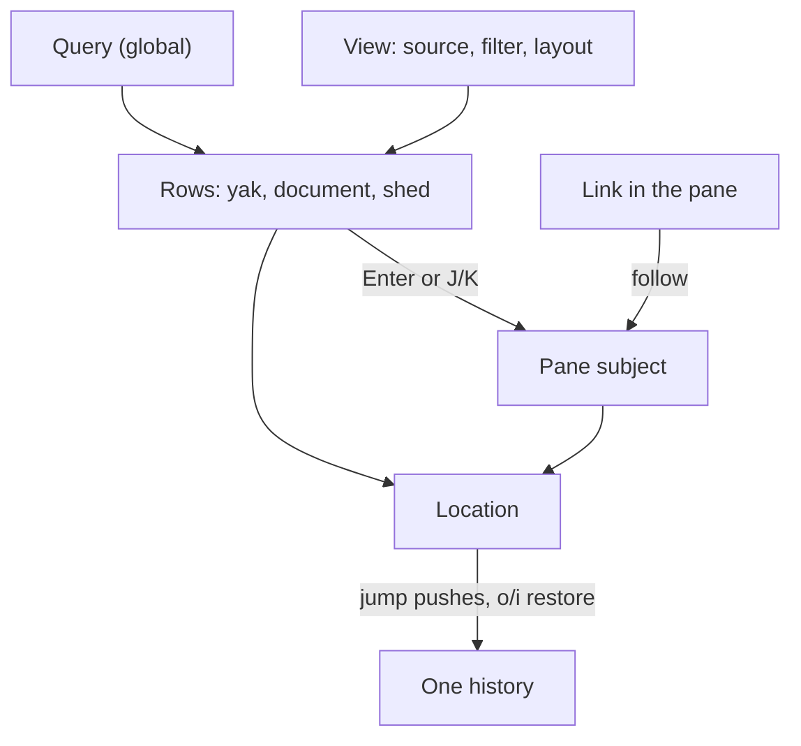

# TUI design: one model for views, panes, history, search and keys

Status: agreed with Joel, 2026-11-02. Tracked by [yaks-9c3c](yaks-9c3c).

This design replaces five separate plans with one model. Each plan below solved
its own problem with its own mechanism; together they would leave the TUI with
more special cases, not fewer.

| Yak | Problem | Earlier design (reference) |
|---|---|---|
| yaks-158d | `o`/`i` lose the list you came from; history is detail-only | [158d-design.md](yaks-158d/158d-design.md) |
| yaks-953f, yaks-1bbd | the `/` search and its header fall out of sync; detail find is separate | [search-design.md](yaks-953f/search-design.md) |
| yaks-c7ba | no global search in the TUI | none |
| yaks-f1e6 | the Sheds tab is an outlier: wasted space, its own keys, loses context | none |
| yaks-0ac1 | the key bindings are a context-dependent mishmash | none |

The earlier designs remain the reference for details this one does not repeat
(restore-and-clamp rules, the search phasing). Where they disagree, this one
wins.

## Why: five surfaces, five of everything

Since the first two designs were written, the TUI gained a Wiki tab, a text
viewer that follows links between pages with a peek pane, image viewing, and a
Sheds tab rebuilt as one row per actor. Each arrived as its own surface:

| Surface | Rows and cursor | Keys | What it shows on the right | Back stack | `/` matches |
|---|---|---|---|---|---|
| Yak views | `App.cursor` over `rows()` | `handle_key_inner` | the yak detail (`detail_*` fields) | `nav_back`/`nav_fwd` (also footnotes) | title, body, id |
| Wiki tab | `WikiTab.cursor` | `handle_wiki_key` | opens the viewer overlay | none | title, path, kind, tags |
| Sheds tab | `ShedsTab.cursor`, `.line` | `handle_sheds_key`, `handle_shed_detail_key` | its own shed detail | none | not bound |
| Text viewer | `Overlay::Attachment`, its own `LineNav` | `handle_attachment_key` | the document | `viewer_back`/`viewer_fwd`, plus `LineNav.back` for footnotes | its own find |
| Image viewer | `Overlay::Image` | `handle_image_key` | the image | shares the viewer's | none |

The user-visible results, each checked against the current code (and the first
two with a headless run of the built binary):

- A toast reading `filter: widget` stays on screen after the search it
  describes is gone. Nothing ever clears `App.notification`.
- `U` and `W` do nothing on the Sheds tab or with a page open. The viewer is an
  overlay, so it swallows every key it doesn't handle, `Tab` between views
  included.
- There are three back stacks, and `o` in a list does nothing. Following a
  link to a yak calls `set_view(<its status view>)`, which resets the filter
  and the cursor, so `o` can't bring your list back.
- `/` matches different fields on the Wiki tab than on the yak tabs, and a
  third mechanism inside a yak or a page.
- `yaks find` searches yaks, pages and sources, but the TUI can't. Recent is
  the nearest thing, and it stops at 50 rows and hides dead yaks.
- Opening a yak from a shed jumps to the yak's status view, so the shed
  context is lost.
- Keys change meaning by surface (see [Keys](#5-keys)), and the help is
  maintained by hand in three places: `help_content`, `help_hint` and
  `docs/tui.md`.

## The model

Four ideas replace the five surfaces:

- **Row:** one entry in a list. Its kind is a yak, a document (a page or a
  source) or a shed. A row's key is the subject it opens.
- **View:** a named list of rows: where they come from, a filter, and a
  layout (tree or flat, sort, limit). Every tab is a view, including Wiki
  and Sheds.
- **Pane:** the right side. It shows one **subject**: a yak, a document (a
  page, a source, an attachment or an image) or a shed. The subject's kind
  picks the renderer; every text subject uses one `LineNav`.
- **Location:** where you are: the view, its filter and query, the cursor
  row, the list scroll, the focus, and the pane's subject and position.
  History is one stack of locations.



The keymap and the search register sit beside these and apply to all of them.

## 1. Rows and views

A row is a yak, a document or a shed. `selected_row()` is the row under the
cursor. Yak commands act on `selected_yak()`: the row in list focus, the
subject in pane focus, and nothing when that isn't a yak (as on an empty list
today). Document and shed commands work the same way.

The tabs become ordinary views:

- **Wiki:** a flat view of document rows, pages and then sources, as today.
  Its separate cursor and key handler go.
- **Sheds:** a tree view. Each actor is a collapsible root showing its
  liveness, last write and checkpoint branch. Its children are the yaks it
  touched, outstanding ones first and landed ones folded (the yaks-c1f8
  order). PRs are not rows. The background scan stays and feeds the rows.
  Selecting a yak shows it in the pane with the shed tree still beside it,
  and `J`/`K`, `U`, `/`, `o`/`i` and collapse work as in any view.
- **All** (new, unpinned): every yak (dead included), page and source, with no
  limit. With a query it is the TUI's global search, the same set `yaks find`
  searches. It also gives link-following and `#` a home for anything no
  other view shows.

Tab counts apply the query, so `Shaving (3)` means three matches there.

A future view fits the same way: the activity log (yaks-19c3) would be a
flat view whose rows open the yak or document they touched.

## 2. The pane and its subjects

The pane shows a subject: `Yak(id)`, `Shed(actor)` or `Doc { path, rev }`
(an attachment, page or source; an image is a document drawn as a picture).

- **Enter on a row** shows that row's subject. `J`/`K` move to the next or
  previous row and show it.
- **Following a link** shows the target, whatever its kind. If the current
  list has the target, the cursor moves to it. Otherwise the list stays
  where it is, and the pane header says the subject isn't in this list.
- **The viewer and image viewer stop being overlays.** `Overlay` keeps only
  modal input: pickers, editors, the drawer, help and confirmations. With a
  page open, `U`, `W`, `Tab` and `?` then work as anywhere else.
- **Edit follows the subject.** `E` on a yak body edits that block in place;
  on a page it opens the whole file; on a source or a pinned version it
  refuses, as today.
- **Peek follows the subject.** Any text subject with a peekable link gets
  the peek pane (`p` toggles it), falling back to the status-line form when
  the pane is too short.

Showing a link's target without moving the list **revised decision 5**
below. When that decision was made, the detail pane only ever showed yaks.
Documents now open detached from any row: an attachment or a linked page is
shown over the yak you came from. Keeping yaks row-bound would mean two
rules, and the yak rule needs a list to put the target in (its status view,
else All, else "isn't shown in any view"). One detached rule for every
subject removes that machinery, and `selected_yak()` has to change for row
kinds anyway.

## 3. One history

A location records:

```rust
struct Location {
    view_key: String,         // stable across reorders
    filter: FilterSpec,       // the live facets, unsaved edits included
    query: Option<String>,    // part of the location (decision 1)
    cursor: Option<RowKey>,   // by key; an index is the fallback
    cursor_idx: usize,
    list_offset: usize,
    focus: Focus,             // List or Pane
    pane: Option<PaneAt>,     // subject + line + scroll, in pane focus
}
```

The rules:

- **Jumps push; movement doesn't.** A push snapshots the location you are
  leaving.
  - Jumps: following a link (a yak, a document, a footnote, a `#section`), a
    view switch, and `#`.
  - Not jumps: cursor and line movement, `J`/`K`, entering or leaving the
    pane, and committing a search or the drawer. These update the current
    location in place.
- **`o`/`i` work in every focus and view.** Each jump's notification names
  the view and subject (`← Recent · yaks-1234`).
- **One stack replaces three:** `nav_back`/`nav_fwd`, `viewer_back`/`viewer_fwd`
  and `LineNav.back`/`fwd`. `Esc` from a page no longer forgets where you
  came from.
- **Restore clamps.** A deleted view falls back to the subject's status view.
  A row that moved or is gone clamps the cursor and says so. A document is
  re-read from disk on return. The yaks-158d design §5 has the details.
- **The stack isn't persisted.** Reopening where you quit (one location in
  the UI cache) can come later.

## 4. Search

Three things that `filter.search` and `detail_find` mix together today:

| State | Set by | Lives on | Survives a view switch |
|---|---|---|---|
| A view's facets, including a saved view's own search | the drawer, `V` | the view's `FilterSpec` | no |
| The **query** | `/` in a list | `App`, and each location | yes |
| The **search register** | any committed `/` | `App` (vim's `@/`) | yes, all session |

- **One matching rule:** the query matches what `yaks find` searches (a
  yak's id, title, description and notes; a page's frontmatter and body; a
  source's text). A shed matches by name or through a matching yak, as a tree
  keeps the ancestors of a match. A saved view's own search must also match
  (decision 2).
- **The header:** the query has its own chip, apart from the facets'
  `filter:` chip, with its All count: `/"widget" · 14 in All`.
- **Esc in a list** clears the query first, then reverts the facets.
- **In the pane, `/` sets the register,** not the query, so searching inside a
  yak can't filter it out of the list. Matches are highlighted in every text
  subject and `n`/`N` step through them. The register is kept across `J`/`K`
  and `o`/`i`. Past the last match, `n` moves to the next matching row.
- **In a list, `n`/`N`** re-apply the register as the query when the query
  is empty.
- **Notifications** clear on the next key, and the redundant `filter:` toast
  goes.

## 5. Keys

The unification needs one piece of yaks-0ac1 up front: a **command table**.
Otherwise every phase rewrites hand-written `match` arms and three help texts.

- Each command has a stable name (`view.next`, `nav.back`, `yak.state`,
  `doc.edit`), a context (global, list, pane, or a subject kind), default
  keys, and a help line.
- Dispatch tries the layers in order: a modal overlay, then the subject, then
  the list or pane, then global.
- The `?` overlay and the bottom hint are generated from the table, and a
  test checks `docs/tui.md` against it.

The key choices then become one pass over the table instead of edits in five
handlers. These are the collisions it has to settle:

| Key | Yak list | Yak detail | Viewer | Wiki | Sheds |
|---|---|---|---|---|---|
| `Tab`, `[`, `]` | next view | next link | next link | next view | next view |
| `h` | family scope | back (or scroll left) | close (or scroll left) | none | back (in detail) |
| `v` | view picker | visual select | visual select | view picker | view picker |
| `N` | none | previous match | previous match | new page | none |
| `r` | none | rename attachment | none | reread | rescan |
| `o`, `i` | none | back, forward | back, forward (own stack) | none | none |
| `U`, `W` | sync, commit | sync, commit | none | sync, commit | none |
| `/` | search title, body, id | find | find | search title, path, kind, tags | none |

The proposed rule: a key means the same thing in every context, unless the
layer makes the difference obvious (movement keys move whatever has focus).
The rest of yaks-0ac1 builds on the same table:

- a which-key popup listing the current context's commands, after a prefix
  key or a pause;
- multi-key sequences, if a leader key is wanted;
- a small `keys:` override map in user config (not the farm), by command
  name, with editor keys left to edtui's vim and emacs modes;
- mouse actions bound through the same table, such as clicking an editor
  field to focus it.

## What gets simpler

The code that goes:

- **Key handlers:** `handle_sheds_key`, `handle_shed_detail_key`,
  `handle_wiki_key`, `handle_image_key`, and the half of
  `handle_attachment_key` that duplicates the detail pane.
- **Cursor state:** `ShedsTab`'s cursor, line and offsets, and `WikiTab`'s
  cursor and offset. The scans and entries stay.
- **Branches:** the 16 `on_sheds_tab()` and `on_wiki_tab()` call sites.
- **Stacks:** three back stacks become one.
- **Search:** `detail_find`, `Overlay::DetailFind` and the per-page find
  query become the register.
- **Overlays:** `Overlay::Attachment` and `Overlay::Image`.
- **Link plumbing:** `select_task`'s status-view switch and `goto_task`'s
  "isn't shown in any view" case.
- **Help:** three hand-kept help texts become one table.

What's added: row kinds, `Subject`, `Location` and the history, the query and
register, the All view, and the command table.

## Phases

Each phase ships on its own, and each deletes what it replaces.

1. **Notifications clear on the next key.** This is the 953f phase-1 fix.
2. **The command table.** A refactor with no key changes: snapshots stay the
   same, and help and hint are generated.
3. **Row kinds; Wiki and Sheds become views** (yaks-f1e6). This deletes the
   two tab handlers and their cursors.
4. **Pane subjects.** The viewer and image viewer leave `Overlay`, the pane
   is detached, and one `LineNav` serves every text subject.
5. **One history** (yaks-158d).
6. **Query, register and All** (yaks-953f, yaks-1bbd, yaks-c7ba).
7. **The key pass** (the rest of yaks-0ac1): settle the collisions, then
   which-key and user overrides.

## Decisions

Agreed with Joel on 2026-11-02:

1. The query is part of a location, so `o` brings back the search you had.
   The chip shows it and `Esc` clears it.
2. A saved view's own search and the query must both match.
3. All is unpinned. You reach it from `v`, from links, and through the query
   chip's count; Recent stays the everyday list.
4. A shed's children are the yaks it touched, outstanding first and landed
   folded. No PR rows.
5. The pane is detached from the list: it shows a subject, and following a
   link doesn't move the list ([§2](#2-the-pane-and-its-subjects)). This
   replaced an earlier "the pane shows the row under the cursor".
6. The query matches what `yaks find` searches, in every view.
7. Starred holds any row kind, pages included; Recent stays yaks-only.
8. The command table is phase 2, before the unification.

## Open questions

- [x] Detached pane? Yes (decision 5), Joel, 2026-11-02.
- [x] Should the query match `yaks find`'s fields in every view, including
  page bodies and source text? Yes (decision 6), Joel, 2026-11-02. The cost
  is holding sources' extracted text in memory.
- [x] Should Recent and Starred include pages? Starred yes, Recent no
  (decision 7), Joel, 2026-11-02.
- [x] Command table second? Yes (decision 8), Joel, 2026-11-02.
