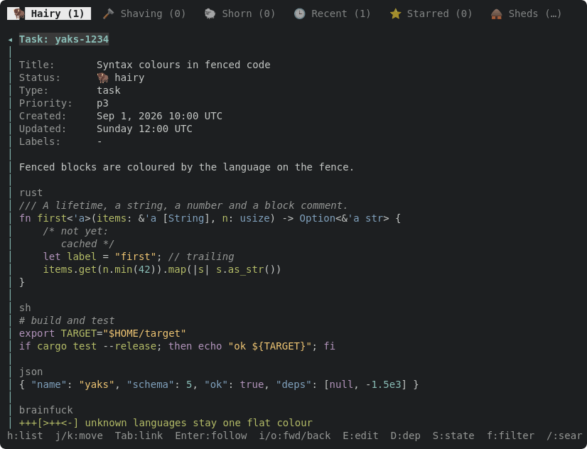
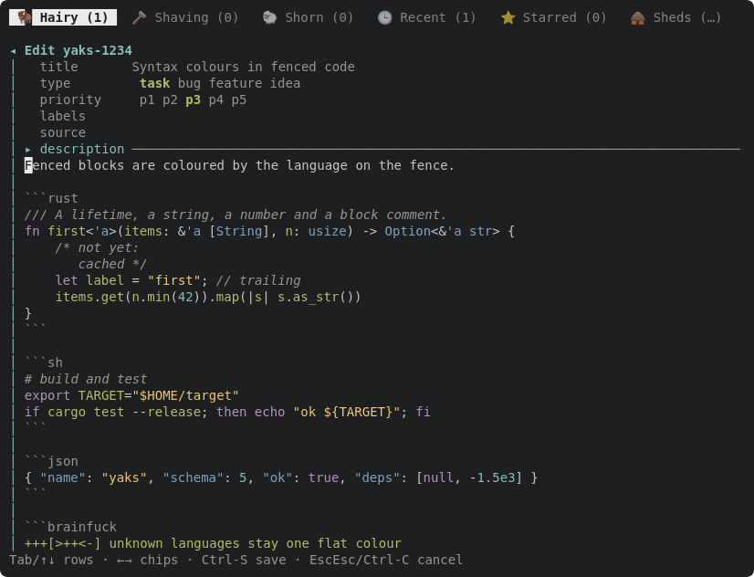

Stretch goal split out of yaks-2956 (render-time markdown highlighting). Our hand-rolled highlighter in src/tui/markdown.rs currently colors a fenced code block as one flat code style. Extend it to detect the fence info string (the language after the opening fence) and run a small per-language tokenizer over the block body so embedded code gets real syntax coloring in BOTH surfaces (detail read-pane and the editor via EditorState.highlights).

Design notes:
- The Highlighter already tracks fence state across lines; thread the info-string language through that state.
- Add tiny, pure-Rust tokenizers per language (start with rust, maybe json/sh/toml) that emit MdSpan runs; keep them C-free (no syntect/onig).
- Fall back to the flat code style for unknown languages.
- Spans stay in char coords so they compose with wrap/link/find just like the existing markdown spans.
- Fully our choice of palette.

---
▸ 2026-10-17T05:17:20Z [delta-lead]

moved: hairy -> shaving

---
▸ 2026-10-17T05:17:20Z [delta-lead]

Claim (yakherd delta-lead, 2026-10-17): owner **syntax-1**. The description above predates the renderer core; scope as of now:

- New module `src/tui/syntax.rs`: tiny pure-Rust tokenizers (no new dependencies) returning styled runs for one line given a language and carried state (block comments, multi-line strings). Start with rust, sh/bash, json, toml, python, js/ts, java; aliases (`rs`, `shell`, `console`, `yml`/`yaml` as a bonus). Unknown language → `None` (flat `palette::code_block()`).
- Styles: add a small token section to `src/tui/palette.rs` (keyword, string, number, comment, type/ident, punctuation), 16 ANSI colours only, matching the palette's rules.
- Read pane hook: in `src/tui/mdrender.rs`, remember the fenced language in `Tag::CodeBlock` and colour each line in `verbatim_text` (only those two places).
- Editor hook: in `src/tui/markdown.rs`'s `Highlighter`, carry the fence's info string and colour the code lines with the same tokenizer (fence lines stay dim).

Out of scope: detail.rs, render.rs, handlers.rs, detail_nav.rs (another worker is in them). Evidence: unit tests per tokenizer (failing first); an SVG + PNG of the read pane and of the editor on a yak with rust, sh, json blocks (write SVGs to `target/`, attach the PNGs; Firefox: `firefox --headless --profile $(mktemp -d) --screenshot out.png --window-size=W,H file://...svg`). Update docs/tui.md's markdown paragraphs. Judge: coordinator at landing, plus Joel's eye on the PNGs.

---
▸ 2026-10-17T05:20:27Z [syntax-1]

syntax-1 start Sat Oct 17 05:20:27 AM UTC 2026 (re-recorded in my own checkout; path /home/joel/src/yaks/.delta/worktrees/mfb9m83nvqhc/yaks/.yaks/yaks-3020.md)





---
▸ 2026-10-17T05:28:46Z [syntax-1]

Decision: one generic lexer driven by a per-language `Spec` table (keywords, comment/string syntax, a few flags) in `src/tui/syntax.rs`, not a hand-written tokenizer per language.

- Rejected: eight bespoke tokenizers (more code, and every one would need the same carried-state plumbing).
- Rejected: syntect/tree-sitter (C deps or large; the claim says no new dependencies).
- Cost: a few honest approximations (e.g. `cargo test` in sh is plain, capitalised identifiers read as types).

Decision: palette token colours: keyword magenta, string yellow, number cyan, comment dark-grey italic, type and json/toml/yaml keys blue, punctuation default colour, plain identifiers keep `code_block()` green.

- Rejected: bold keywords (a monochrome terminal gets no extra signal worth the noise).
- Rejected: a distinct colour for keys (blue, same as types, keeps the palette small).
- Magenta/blue deliberately echo headings; they sit inside a gutter-marked code block, so they are not confused with prose.

Decision: lexer state carried per line is just `Normal | Block(depth) | Str{quote,triple}`.

- Rust block comments nest, so depth is kept.
- Multi-line strings carry only where the language has them (rust, sh, js template literals, python/java/toml triple quotes); JSON and unterminated single-line strings stop at end of line.

Decision: both surfaces call the same `syntax::highlight(lang, &mut State, &[char], base) -> Vec<Run>`.

- mdrender keeps the `(Lang, State)` of the open code block in a renderer field, reset at `TagEnd::CodeBlock`.
- The editor's Highlighter keeps the same pair next to its `fence`, set from the opening fence's info string.
- Fence lines stay dim in the editor, and the read pane's label row is unchanged.

Decision: in the editor the code lines are never hidden or restyled by `hide_markers`; syntax runs cover each line exactly (char coordinates), so display width == text width.

Decision: the old test `fenced_block_colors_until_close` fenced ```rust and expected one flat colour. Re-pointed it at an unknown language (```text) rather than deleting it; the known-language behaviour has its own new tests.

Decision: added a `docshots_md_syntax` scene to `src/tui/docshots.rs`, which writes `docs/assets/tui-md-syntax.svg` and `tui-md-syntax-edit.svg`, embedded in docs/tui.md.

- Scope beyond the claim's file list, but it is the repo's durable-UI-state convention.
- The existing `tui-md-render*.svg` and `tui-md-palette.svg` shots also regenerated, because their java and rust blocks are now coloured. That is expected churn.

Evidence: tests written after the lexer, but the two integration tests (`mdrender::…known_fence_languages…`, `markdown::…known_language_lines…`) were run RED first by making `Lang::from_info` return None (both FAILED), then green. Lexer unit tests: 13, all in `syntax::tests`, one initial round of 3 failures were my own wrong expectations, fixed (yaml `-`, carried-string run split, python indent).

Eyeballed target/tui-md-syntax.png (read pane) and target/tui-md-syntax-edit.png (editor, cursor on the description's first line), rasterised with Firefox from the docshots SVGs; both attached. The unknown `brainfuck` block stays flat green in both.

---
▸ 2026-10-17T05:29:14Z [syntax-1]

verify: `cargo test -p yaks` -> PASS (exit 0)

---
▸ 2026-10-17T05:29:24Z [syntax-1]

Summary: fenced code in rust/sh/json/toml/yaml/python/js-ts/java (plus aliases) is syntax-coloured in the read pane (`mdrender` `Tag::CodeBlock` + `verbatim_text`) and the editor (`markdown::Highlighter`), via the new `src/tui/syntax.rs` and a `syntax_*` token section in `palette.rs`. Unknown languages stay flat. docs/tui.md has a "Code syntax colours" paragraph and two new docshots; no `?` help, CLI or skill surface changes (no key or flag changed). Gate: `yaks verify` PASS, plus `cargo test --release` all ok (663 passed, 7 ignored). `cargo fmt` reformatted src/actor.rs and src/tui/tests.rs; both were checked out again.

---
▸ 2026-10-17T05:29:24Z [syntax-1]

moved: shaving -> shorn
