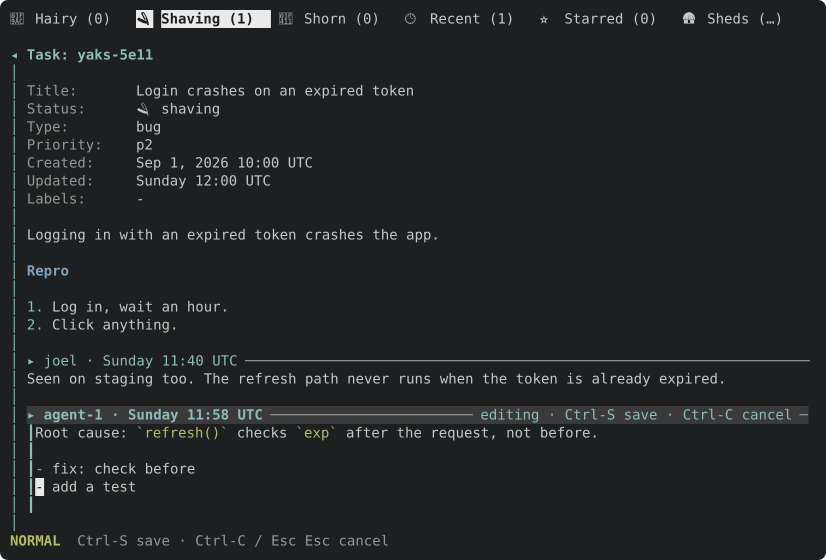
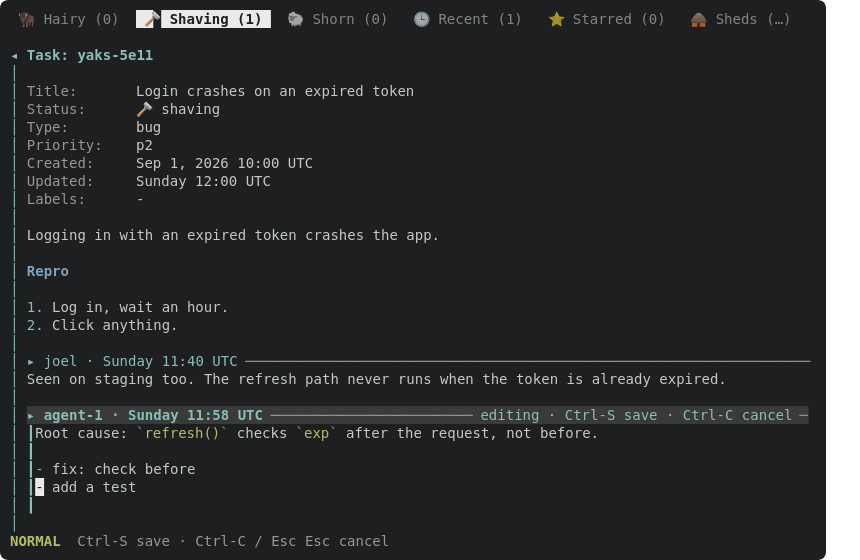
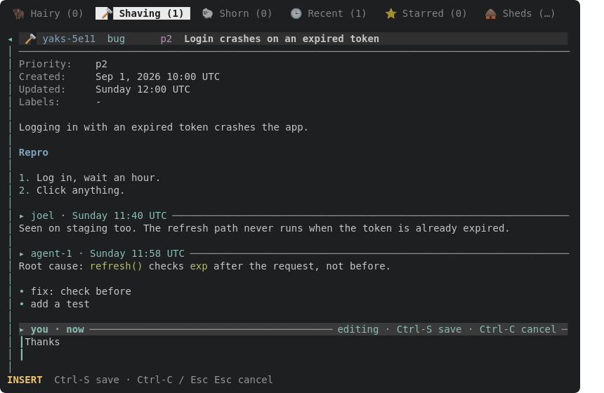

Implements the design Joel approved on yaks-a893 (read its design note and mock frame first).

- `E` on a body row (description or a comment) turns that content block into an edtui editor at the same position in the detail pane; the rest stays rendered and scrolls as usual. The editing block keeps its header, accented, with an `editing · Ctrl-S save · Ctrl-C cancel` hint and a left gutter bar. It shows raw source.
- The editor's cursor lands on the source line behind the row the detail line cursor was on (`DLine.src` from yaks-649d). This delivers yaks-4fa6.
- `M` opens an empty editor under a provisional `▸ <you> · now` header after the last comment.
- Height: the block's source lines + 1 spare row, capped so ~4 rows of context stay visible; edtui scrolls inside beyond that. The detail scroll moves only as much as needed to show the whole editor.
- `Ctrl-S` saves only that block, through `content::assemble` (other blocks round-trip byte-identical; `M` appends via the existing comment path, attributed as today). `Ctrl-C` / `Esc` cancel with the existing dirty-confirm. After saving, the block re-renders in place and the line cursor stays on the same source line.
- Docs/help: `help_content`, `help_hint`, docs/tui.md, the docshots (replace the `M`/`E` frames).

---
▸ 2026-10-17T17:02:15Z [delta-lead]

moved: hairy -> shaving

---
▸ 2026-10-17T17:02:15Z [delta-lead]

Claim (yakherd delta-lead, 2026-10-17): owner **inplace-1**.

Scope: src/tui/render.rs (`render_detail` + a helper that lays out the editor region inside the row list), src/tui/handlers.rs (key routing while a block editor is open; commit/cancel), src/tui/actions.rs (`open_edit_at_cursor` / `open_comment` routing body targets to the new overlay; header targets still open the form), src/tui.rs (a new `Overlay` variant, e.g. `BlockEdit { id, block: Option<usize>, editor: Editor, ... }`), src/tui/detail_nav.rs (scroll arithmetic so the editor region counts as N rows), src/tui/mouse.rs if hit-testing needs it, src/tui/editor.rs (reuse `Editor`, `editor_theme`, `set_md_highlights`; no changes to their behaviour). Tests in src/tui/tests.rs. Docs: docs/tui.md, help_content/help_hint, docshots for the new states.

Out of scope: removing the form's content blocks (the follow-up yak), mdrender.rs, palette.rs, the edtui fork.

Evidence: failing-first tests (E on a comment row opens the block editor at that block with the cursor on the right source line; Ctrl-S saves only that block, others byte-identical; M adds a comment at the end; Esc with edits asks to confirm; the rendered rows above the editor stay put); headless frames of E and M with context visible; docshot SVG → PNG via Firefox, looked at. Judge: coordinator at landing, then Joel by trying `~/go/bin/yaks`.

---
▸ 2026-10-17T17:03:02Z [inplace-1]

inplace-1 start: Sat Oct 17 05:02:59 PM UTC 2026

yaks path yaks-597d: /home/joel/src/yaks/.delta/worktrees/13wv27ckc2gj/yaks/.yaks/yaks-597d.md (my checkout, not 6fqb32r03p5m)

[frame-E](yaks-597d/frame-E.txt)

[frame-M](yaks-597d/frame-M.txt)

---
▸ 2026-10-17T17:50:27Z [inplace-1]

Decision: the editor region is rows in the detail row model, not an overlay drawn on top.

- `detail::build_at` takes an `Option<&EditSlot>`: the edited block's rendered rows are replaced by a header row plus N `Kind::Editor` rows, and `render_detail` blits the edtui view over those rows (`blockedit::render_block_editor`).
- So scroll arithmetic, the line cursor, the pinned header and `detail_max_scroll` see the editor as N ordinary rows, and `detail_dlines` stays the single source of truth. No special case in `detail_nav.rs` or `mouse.rs`.
- Rejected: drawing the editor over the finished pane (rows underneath would need masking and every scroll computation would disagree with what is on screen); and a separate scroll model for the editor.

Decision: one new `Overlay::BlockEdit(BlockEdit)` wrapping the existing `Editor`, with a new `EditAction::Block { id, block }`; a new comment reuses `EditAction::Comment`.

- Save goes through the same `commit_edit` as every other editor; the new-comment path is the old comment path, extracted into `commit_comment` (same `$YAKS_ACTOR`-else-git attribution).
- Rejected: reusing `Overlay::Edit` (it renders as the whole-pane editor panel and has no row/block identity); a `Create` form variant.

Decision: the key routing of `Overlay::Edit` is extracted into `handlers::editor_key` (returns `EditKey::{Commit, Cancel, Complete, Cmdline, Handled}`) and both overlays use it.

- Commit/cancel/`:`/Tab-completion therefore cannot drift between the two editors. Existing behaviour of `Overlay::Edit` is unchanged (its tests pass untouched, apart from the ones that opened a comment with `M`).
- Rejected: copying the 50-line block into a second branch.

Decision: `E` on a body row always edits in place, `E` on a header row (Title/Type/Priority/Labels/Source/Herd) still opens the form, `Status:` still opens the picker. `E` from the LIST pane still opens the form with its content blocks: removing those is yaks-92e5, out of scope here.

- `edit_target_at` already returned `EditTarget::Content(b)` for body rows; `open_edit_at_cursor` now routes that to `open_block_edit(Some(b))`.
- Three old tests that did `M` then `E` to reach the form now press `E` from the list focus; `e_on_comment_line_opens_form_focused_on_that_comment` is deleted (its behaviour is replaced by the new in-place tests).

Decision: editor height = wrapped source lines + 1 spare row, capped at `detail_rows_shown(1) - 2 - 4` (blank row, header, ~4 context rows), floor 3. The wrap count mirrors edtui's private `LineWrapper::wrap_ranges` (break after the last space that fits, hard-break longer words) in `blockedit::wrapped_rows`.

- Rejected: counting source lines only (long lines wrap in edtui and would hide the last line); touching the edtui fork or `editor.rs` to expose its wrapper (another worker owns that area, and the fork is out of scope). If the two ever disagree it costs only the spare row.

Decision: the editor view is drawn into a scratch `Buffer` of the full editor size, two render passes, and the visible rows copied into the frame (a half-scrolled-off editor still draws right).

- Two passes because edtui only scrolls to the cursor once it knows the previous frame's row count: a cursor opening on source line 42 of a 60-line block was invisible on the first frame (found by the capped-editor test failing first).
- Rejected: shrinking the render rect to the visible rows (edtui would then scroll its own viewport to whatever remains visible, hiding the cursor).

Decision: while the discard-confirm is up, the editor region stays in the row model (`App::block_edit` also looks at `dirty_cancel`), so the pane does not jump when `Confirm` replaces the overlay and `n` returns to the editor intact.

Decision: line cursor after open = the editor's header row; after a save it goes to the row showing the same source line of the re-rendered block (last row of the block if the block got shorter); after `M` + save, to the new comment's header. An unchanged save says `<id> unchanged` and writes nothing.

Decision: the help bar while editing shows the vim mode tag + `Ctrl-S save · Ctrl-C / Esc Esc cancel`; the header carries `editing · Ctrl-S save · Ctrl-C cancel`, falling back to shorter hints when the pane is narrow (`EditSlot.hints`, longest that fits).

Decision: the detail help hint gains `M:comment` (`E:edit` unchanged, since E still serves header rows); `help_content` documents E/M/Ctrl-S/Ctrl-C; docs/tui.md has an "Editing in place" paragraph and two docshots (`tui-edit-inplace.svg`, `tui-edit-inplace-new.svg`, scene `docshots_edit_inplace`). Four insta snapshots moved, each by exactly the `M:comment` text in the detail help bar (read the .snap diffs).

---
▸ 2026-10-17T17:50:27Z [inplace-1]

Evidence (inplace-1):

- New tests, `tui::tests::block_edit::*` (14): they were written after the code but the first run failed 6 of 14 (`A` needs SHIFT in edtui's keymap; the capped-editor test caught the edtui first-frame scroll bug above; `M` frame asserted `- gamma` where the pane renders `• gamma`), each fixed before this note. They cover: `E` on a comment row opens block 2 with the cursor on source line 1 and the rest still rendered; `E` on the description is block 0; `E` on a header row opens the form; rows above the editor are identical before and after; Ctrl-S saves only that block (`parse` of the other blocks equal before/after, body differs by exactly the edit); unchanged save writes nothing; description edit leaves comments alone; the line cursor lands on the same source line after a save; `M` appends a comment (new 4th block, existing text a prefix, empty save is a no-op, cursor on the new header); Esc Esc with edits asks, `n` returns to the intact editor, `y` discards; Ctrl-C when clean cancels at once; a 60-line block gets a capped editor fully inside the viewport with the cursor line drawn; typing grows the editor.
- Existing tests moved: 11 used `M` to open `Overlay::Edit` (now `BlockEdit`); `editor_state` and the editor.rs marker tests handle both; the marker tests use a 24-row pane (the cap leaves a 16-row pane 3 editor rows).
- Frames from the real release binary (my own build) against a scratch farm: attached `frame-E.txt` (E on the last comment: header `editing · Ctrl-S save · Ctrl-C cancel`, `┃` gutter, raw source with backticks, description and first comment still rendered above) and `frame-M.txt` (M, typed text, Ctrl-S: `comment added to yak-cf78`, the new comment under its header, the file shows `---\n▸ <ts> [actor]\n\nThanks, fixed in the next release.`). Docshot SVGs rasterized with Firefox and looked at: `e-inplace.png`, `tui-edit-inplace-new.png` attached (the accented header with hint, the left bar, context above, the Normal-mode cursor block on `add a test`).
- Docs/help parity grep (below) shows no stale description of E/M.

Not covered: mouse (ignored while any overlay is open, as before); live terminal. `~/go/bin/yaks` install is the coordinator's.

---
▸ 2026-10-17T17:50:31Z [inplace-1]

verify: `cargo test --workspace` -> PASS (exit 0)

---
▸ 2026-10-17T17:50:42Z [inplace-1]

moved: shaving -> shorn
