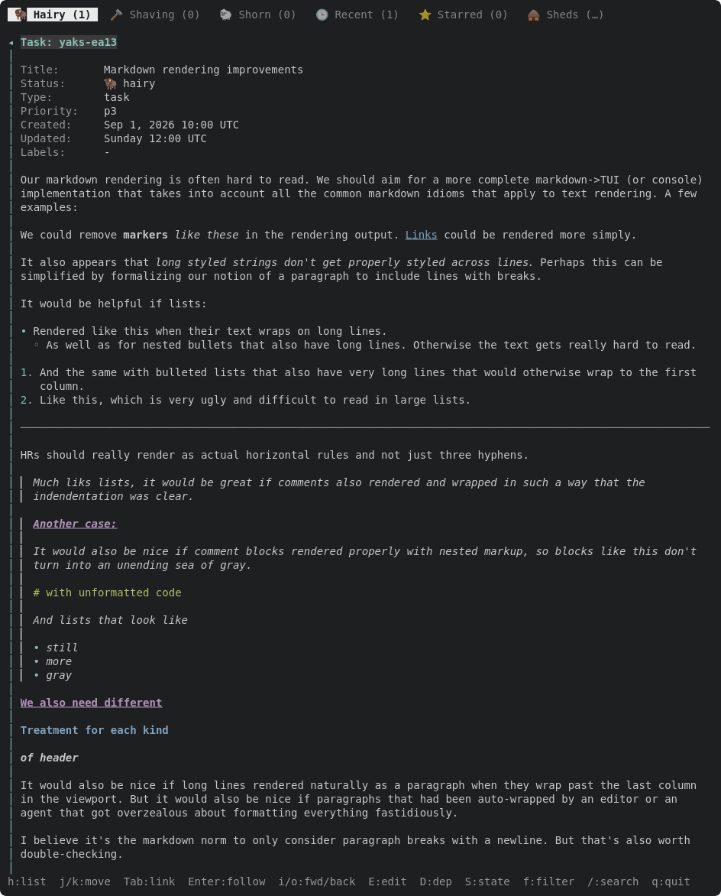
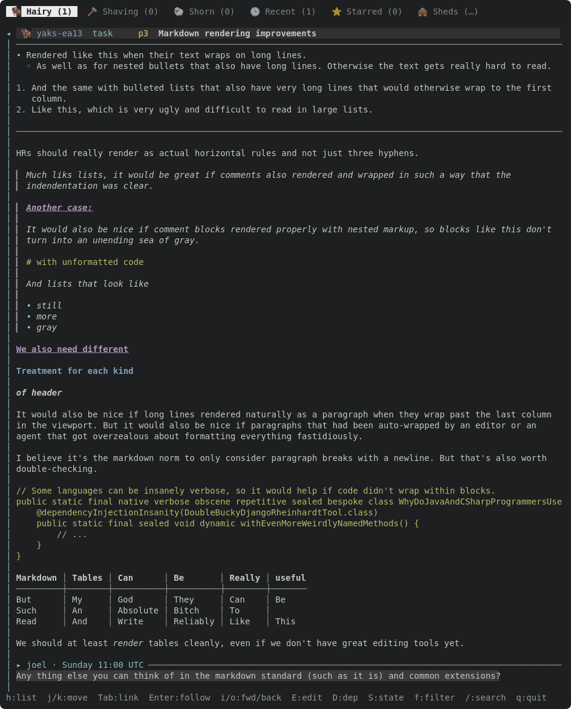

Replace the line-at-a-time `markdown::Highlighter` in the read pane with a block renderer. Follows the decisions on yaks-e9de (CommonMark soft breaks, split with `content::parse` first, source map).

## Shape

- Add `pulldown-cmark` (pure Rust; GFM options on). Parse each content block (description, each comment) as its own document.
- Lay blocks out with a **prefix stack**: every container pushes a (first-row, continuation-row) prefix pair: `▎ ` / `▎ ` for a quote, `• ` / `  ` for a bullet, `1. ` / `   ` for an ordered item. A paragraph is word-wrapped to the pane width minus the stacked prefix width. Nesting (a quote holding a list holding code) composes with no per-combination code; this is what fixes hanging indents and the "sea of gray" quotes.
- Output rows that carry styled spans, link spans (the existing `Target`s, so Tab/Enter/jumplist keep working) and the **source line range** each row came from. Rows replace the wrap step in `detail::wrap` for body text; header fields keep their current path.
- Keep working: find (`/`, matches displayed text), Tab/Enter links, visual selection + yank (copies the *source* lines of the selected rows, not the displayed text), `E` (block-level is enough here; exact-line is its own yak), Ctrl-N/P block jumps (today found by matching `---`/`▸` in display lines, which this replaces with block indices from `content::parse`).

## In scope here

Paragraphs (soft/hard breaks), ATX + setext headings, bullet/ordered lists (start number, nesting, lazy continuation, tight vs loose), block quotes (nested, lazy), rules, inline emphasis/strong/code spanning lines, backslash escapes, entities, inline HTML as literal text. Code blocks and tables get a plain placeholder rendering here; their real treatment is a sibling yak.

## Evidence

yaks-ea13's own body is the fixture: before/after headless frames attached, an insta snapshot test of it, and a docshots scene. Tests that fail first for: hanging indent of a wrapped list item, a wrapped quote keeping its bar, emphasis across a soft break, a soft break joining lines, yank returning source.

---
▸ 2026-10-17T04:31:30Z [delta-lead]
moved: hairy -> shaving

---
▸ 2026-10-17T04:31:30Z [delta-lead]
Claim (yakherd delta-lead, 2026-10-17): the coordinator builds this one in the lead thread, in a new module (src/tui/mdrender.rs) first, wired into detail.rs after the quick-win workers land.

---
▸ 2026-10-17T04:56:17Z [delta-lead]
Core wired into the detail pane (delta-lead, 2026-10-17).

- `src/tui/mdrender.rs`: pulldown-cmark 0.13 (no default features, GFM tables/tasks/strikethrough/footnotes/alerts), prefix-stack layout, per-row source-line map, palette styles. 23 unit tests + an insta snapshot of yaks-ea13's body at 60 columns.
- `detail::build_at` takes the pane width; the body is split with `content::parse`, each block rendered on its own, each comment under a `▸ author · when` header row (`detail::comment_label`, also used by the edit form's `render_block_separator` now: one design). `DLine.src` (block + source lines) replaces `block_index_per_line`'s `---`/`▸` text match; `E` and Ctrl-N/P use it.
- Yank (`selection_text`) copies the source lines of rendered rows, gaps included (test `rendered_body_reflows_and_yank_copies_the_source_markdown`).
- The old `scan_body_links` is gone; bare-URL autolinking moved into mdrender with links-1's `trim_url_end` rule and tests (yaks-f67e).
- Docs: docs/tui.md "Rendered markdown" + two docshots (`docshots_md_render` → `tui-md-render*.svg`); the yaks skill's "Writing notes and descriptions" now states the CommonMark newline rule and what renders (part of yaks-382b's ask; the rest of 382b stays open).

Decision: tests that built long bodies from single-newline lines (`long_detail_app`) now join lines with hard breaks (`\` + newline): under CommonMark those were one paragraph, and the tests are about scrolling many rows, not about paragraphs. Alternative rejected: a special "preserve newlines" mode.

Evidence: `cargo test --release` all green (17 result lines ok). Attached PNGs (headless SVG rasterized with Firefox) of the torture test top and end, comment header included.

Remaining for this yak: nothing structural. Code/table horizontal scroll is yaks-c733, exact-line `E` is yaks-4fa6; inline-code-inside-a-link and footnote jumps are in their sibling yaks.

---
▸ 2026-10-17T04:56:58Z [delta-lead]
verify: `cargo test --workspace` -> PASS (exit 0)

---
▸ 2026-10-17T04:57:02Z [delta-lead]
moved: shaving -> shorn
