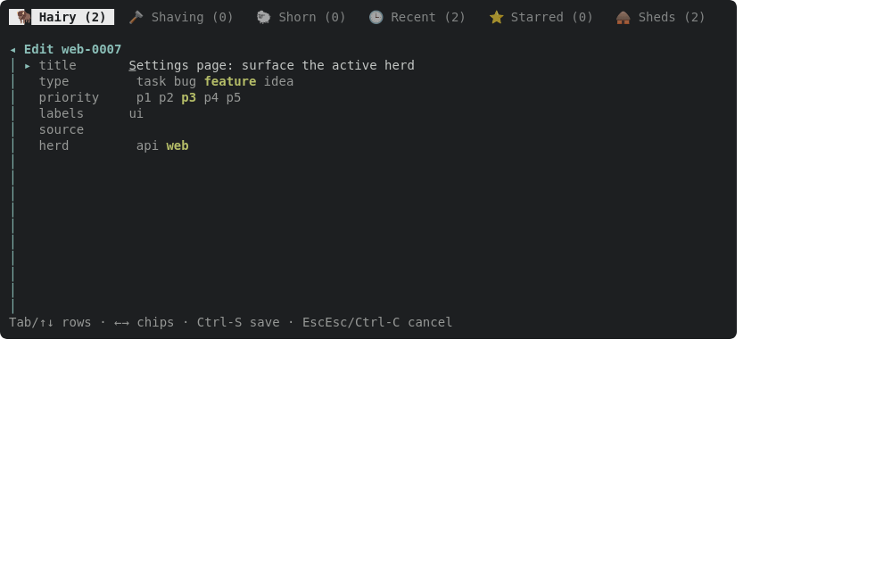
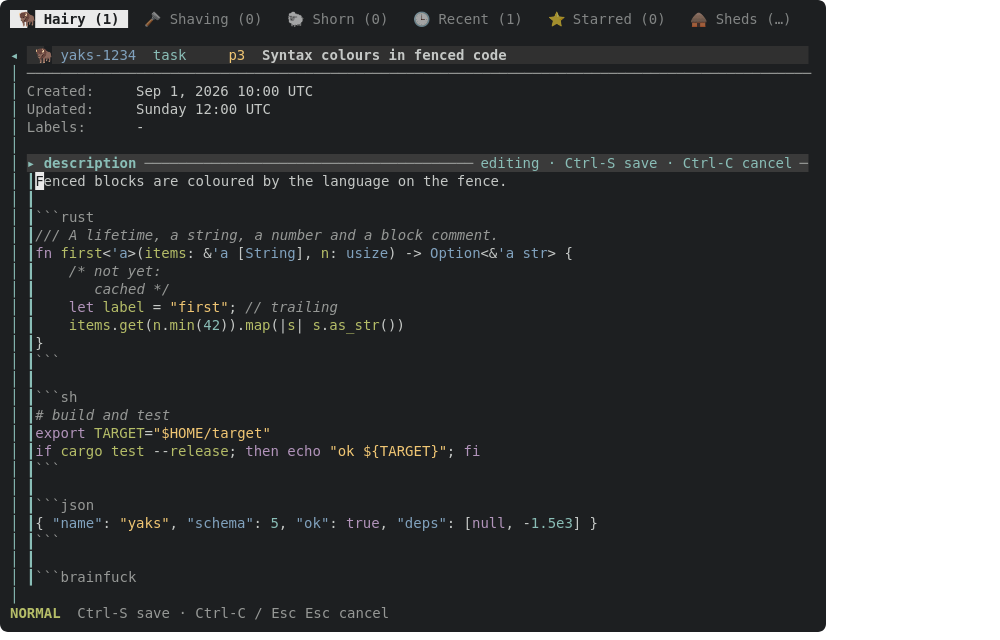

Second half of the yaks-a893 design: with body editing in place, `E` on a header row opens the form with title/type/priority/labels/source/herd only. Remove the per-comment `ContentBlock`s in edit mode, `render_content_stack`'s accordion, `EditTarget::Content` routing to the form, and yaks-c6f4's problem with them. Create (`c`/`C`) keeps its single description block. Depends on the in-place editing yak landing first.

---
▸ 2026-10-17T17:52:40Z [delta-lead]

moved: hairy -> shaving

---
▸ 2026-10-17T17:52:40Z [delta-lead]

Claim (yakherd delta-lead, 2026-10-17): owner **formtrim-1**. In-place editing (yaks-597d) has landed (41394a2): `E` on a body row in the detail pane edits that block in place (`Overlay::BlockEdit`, src/tui/blockedit.rs). Now trim the form.

Scope:
- src/tui/create.rs: in edit mode (`CreateForm::for_edit`), no `ContentBlock`s; the form is the header rows only. Create (`CreateForm::new`) keeps its one description block. Remove what only the edit accordion needed (`render_content_stack`'s multi-block accordion, the description preview, `render_block_separator` if unused, block navigation in edit mode). `assembled_body`/`commit_edit_form` (src/tui/handlers.rs) must then leave the body untouched on an edit.
- src/tui/actions.rs: `EditTarget::Content` no longer routes into the form. `E` on the list pane: opens the form (header fields only) — keep it, but its focus starts at title.
- Remove dead code you orphan (`EditTarget::Content` handling in the form, block-nav keys in the form handler). Keep `detail::comment_label` (the detail pane uses it).
- Tests: adjust/replace tests that assumed form content blocks (grep `blocks`, `content_index`, `Content(`); add failing-first tests that (a) `E` on a list row opens a form with no content rows, (b) a form edit of the title leaves the body byte-identical, (c) create still has its description block.
- Docs/help: docs/tui.md's edit-form description, `help_content`, any docshot showing the edit form with content blocks (regenerate only those).

Out of scope: blockedit.rs, mdrender.rs, the edtui fork. When done, also slaughter nothing: the yakherd handles yaks-c6f4 / yaks-4fa6 / yaks-a893.

Evidence: tests above; a headless frame of the trimmed edit form; docshot PNG looked at. Judge: coordinator at landing.

---
▸ 2026-10-17T17:53:06Z [formtrim-1]

formtrim-1 start: Sat Oct 17 05:52:55 PM UTC 2026

yaks path yaks-92e5: /home/joel/src/yaks/.delta/worktrees/3x0jskjgcx0g/yaks/.yaks/yaks-92e5.md (my checkout, 3x0jskjgcx0g)

[frame-edit-form](yaks-92e5/frame-edit-form.txt)

---
▸ 2026-10-17T17:59:46Z [formtrim-1]

verify: `cargo test --workspace` -> PASS (exit 0)

---
▸ 2026-10-17T17:59:57Z [formtrim-1]

Decision: `CreateForm.blocks: Vec<ContentBlock>` became `description: Option<RefCell<EditorState>>` (Some on create, None on edit).

- Edit has no content rows by construction, so `assembled_body`, `content_index` and `ContentBlock` are gone; `commit_edit_form` no longer touches the body at all (a title edit leaves it byte-identical, even a body `content::assemble` would normalize).
- Rejected: keeping a `Vec` that is empty on edit (a collection that can only ever hold 0 or 1 items, and leaves `assembled_body` alive for nothing).

Decision: kept a minimal description separator + dimmed preview in create (`render_description`), replacing `render_content_stack`/`render_block_separator`. Create is unchanged visually; the accordion's multi-block machinery is gone.

Decision: `EditTarget::Content` stays in the enum (the detail-pane routing in `open_edit_at_cursor` uses it for the in-place editor); `open_edit_focus` maps it to row 0 since it is unreachable there.

Decision: the `tui-md-syntax-edit` docshot showed code blocks in the form's description editor. It now drives the in-place block editor (`E` on the description row) instead; the SVG changed accordingly.

Tests (honest note: written after the code, not failing-first; the old tests that assumed blocks failed to compile first, then were rewritten): `edit_form_has_header_rows_only` (no description, row_count == header_rows, focus on title, no `description`/separator on screen, Ctrl-N wraps within header rows), `edit_form_title_edit_leaves_the_body_byte_identical` (untidy body with trailing spaces and extra blank lines), `edit_form_without_edits_is_not_dirty_and_keeps_the_body`, `create_form_still_has_its_description_block`, `create_form_saves_its_description`, `colon_w_saves_the_create_form`. Deleted `edit_form_edits_a_comment_in_place` (covered by block_edit::*); `edit_form_deletes_an_emptied_comment` became `block_edit_deletes_an_emptied_comment` (in place). Paste/preview tests moved from the edit form to the create form. Insta: only `edit_form_panel` moved (title row focused, no description rows); read the diff.

Evidence: headless `key E` frame attached (frame-edit-form.txt: `Edit yak-ccfc`, title/type/priority/labels/source, no description or comment rows, on a scratch farm with a description and two comments). Docshots regenerated: tui-edit-herd.svg and tui-md-syntax-edit.svg only (the other scenes' output, a stale `M:comment` help-bar diff from yaks-597d, was reverted as not mine); rasterized with Firefox and looked at: tui-edit-herd.png (header rows incl. herd chip, no content), tui-md-syntax-edit.png (in-place editor on the description). Docs: docs/tui.md edit-form paragraph rewritten, `help_content` E line updated; grep for content_index/ContentBlock/render_content_stack/assembled_body/accordion over src, docs, README, skills finds nothing.

Gates: `cargo test --workspace` and `cargo test --release` both exit 0, no warnings.

---
▸ 2026-10-17T17:59:57Z [formtrim-1]

moved: shaving -> shorn
