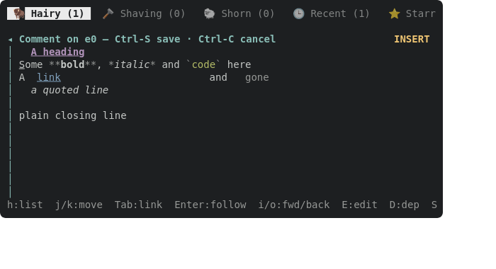
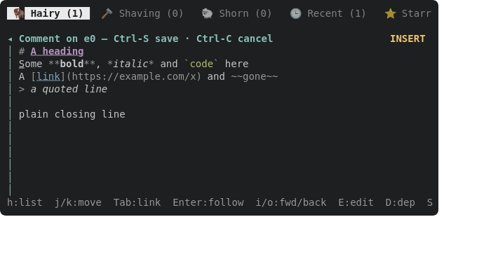

Within edtui's highlight support only (display width == text width; see yaks-e9de):
- Emphasis/code/strike markers are dimmed on the cursor's line and `Modifier::HIDDEN` (drawn as spaces) on other lines.
- Links: `[text]` styled as a link, `(url)` dimmed (hidden off the cursor line is worth trying, judge by the frame).
- Highlights come from the same pulldown-cmark pass and palette as the read pane (`set_md_highlights` maps parser offsets to edtui `Highlight`s), so the two surfaces stop disagreeing. Retire `markdown::Highlighter` once nothing uses it.
- Check `HIDDEN` on the terminals we care about (kitty, ghostty, wezterm, iTerm2, Terminal.app, tmux); if any draws hidden text, fall back to fg == bg.
Depends on the palette and the renderer core.

---
▸ 2026-10-17T04:58:35Z [delta-lead]
moved: hairy -> shaving

---
▸ 2026-10-17T04:58:35Z [delta-lead]
Claim (yakherd delta-lead, 2026-10-17): owner **edmarks-1**.

Scope: src/tui/editor.rs (`set_md_highlights` and its callers' plumbing of the cursor row) and src/tui/markdown.rs (the editor's line highlighter; it already reads palette.rs). Behaviour, display width unchanged (umbrella decision on yaks-e9de):
- Emphasis/strong/strike/code markers and heading `#`/quote `>` markers: `palette::marker()` (dim) on the cursor's line, `Modifier::HIDDEN` on every other line.
- Links `[text](url)`: text as `palette::link_text()`, the `(url)` dim on the cursor line and hidden elsewhere; brackets treated as markers.
- Keep it in our highlighter (no pulldown-cmark in the editor path: its offsets can't express per-line marker hiding without the block context, and the umbrella says the editor stays a text editor). If you find a strong reason to switch, `yaks ask`.
- Check what `HIDDEN` looks like via toque SVG (does toque render HIDDEN as blank? if it doesn't, note it) and record which real terminals honour SGR 8 (kitty, ghostty, wezterm, alacritty, iTerm2, Terminal.app, tmux) from documentation; if any common one draws hidden text, fall back to fg == bg? You cannot know bg under the 16-colour palette, so then prefer DIM and say so in a `Decision:` note.

Out of scope: rendering in the detail pane, mdrender.rs, render.rs, handlers.rs (another worker owns those). Evidence: unit tests on the highlighter output (markers hidden off the cursor line, dim on it; link url hidden); SVG + PNG of the comment editor with cursor on one line of a marked-up body (scratch harness or a test-only docshot written to target/, NOT docs/assets). Judge: coordinator at landing, plus Joel's eye via the attached PNG.

---
▸ 2026-10-17T04:59:12Z [edmarks-1]
Start: Sat Oct 17 04:59:08 AM UTC 2026; path: /home/joel/src/yaks/.delta/worktrees/pdzaze1df5ah/yaks/.yaks/yaks-9425.md





---
▸ 2026-10-17T05:05:01Z [edmarks-1]
Decision: keep our line-at-a-time `markdown::Highlighter` for the editor (per the claim note), extended with `line_with(text, hide_markers)`; no pulldown-cmark in the editor path. `Highlighter` is therefore NOT retired (the claim note's scope supersedes the yak body); `line()` is now `#[cfg(test)]` (docshots/tests only).

Decision: hidden marker style = `palette::marker()` (DarkGray) + `Modifier::HIDDEN`, not fg==bg and not DIM. The dim colour under HIDDEN means a terminal that ignores SGR 8 still shows a quiet marker. Rejected: fg==bg (bg unknowable under the 16-colour palette).

Decision: SGR 8 support, from documentation: terminfo.dev (tested on real apps) says iTerm2, Ghostty, Kitty, Terminal.app, VS Code, Warp all draw it blank; ansicode.eversources.app lists xterm, kitty, alacritty, WezTerm, Ghostty, GNOME Terminal, Konsole, Windows Terminal, tmux, GNU screen, iTerm2, Terminal.app as yes; the Linux console and cmd/ConPTY ignore it (marker stays visible, dim). Not tested on real terminals by me. Alacritty/WezTerm are only "partial/not exposed" on terminfo.dev's headless backends, yes on the other source. So no fallback needed.

Decision: toque's SVG ignores `Modifier::HIDDEN` (text_decl handles only BOLD/ITALIC/DIM/UNDERLINED), so toque draws hidden markers as dim glyphs. The ignored harness `editor_markers_svg` (src/tui/editor.rs) blanks HIDDEN cells before `buffer_to_svg` to emulate a terminal honouring SGR 8, and also writes a raw file; both PNGs attached. Rejected: patching toque (external dep).

Decision: fence lines (` ``` ` and info string) stay dim, never hidden, so a block's start/end stays visible. Heading `#`+space, quote `>`, emphasis/strong/strike delimiters, code backticks, link `[`/`]`/`` links and `` images recognised; emphasis inside link text keeps link colour + weight. Previously backticks were part of the code style (green); now they are markers around green text. No snapshot moved.

Decision: the editor's cursor row is `state.cursor.row` read inside `set_md_highlights`, so no caller plumbing changed (comment editor and create/edit form both use it).

Evidence: unit tests in markdown.rs (hidden vs dim, link url, widths identical hidden/not, fences) and editor.rs `markers_are_dim_on_the_cursor_row_and_hidden_elsewhere` (draws the real comment editor, checks cell modifiers, moves the cursor to swap). PNGs attached: editor-markers.png (HIDDEN blanked, cursor on row 1: `**`/`*`/backticks visible, `#`, `>`, `[`,`](url)`, `~~` blank), editor-markers-raw.png (what toque draws unmodified). Both read before attaching; they look as described.

Gate: `cargo test --workspace` and `cargo test --release` both pass (634 passed, 6 ignored in the bin, all integration tests ok). Docs: docs/tui.md "Markdown styles" paragraph updated. No `?` help / README / skills text mentions editor marker dimming (grep for dim/dimmed/markers across docs, README.md, .agents/skills, src/tui/render.rs).

---
▸ 2026-10-17T05:05:04Z [edmarks-1]
verify: `cargo test --workspace` -> PASS (exit 0)

---
▸ 2026-10-17T05:05:08Z [edmarks-1]
moved: shaving -> shorn
