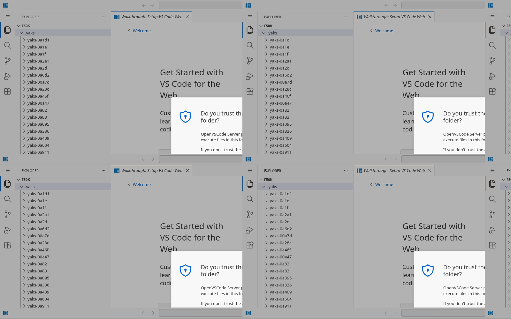

Given that we've recently merged all yaks into a single directory, and that we're also in the process of reconsidering the way we handle branches and worktrees (ie, yaks-6a34), it seems like a good time to consider whether this is the right final directory structure state.

A lot of systems (git included, IIRC) go to some lengths to put large numbers of files into a predictably nested directory hierarchy. For yaks, this might look like (just to throw out an idea:
```
.yaks/
  thingone/
    3/
      5/
        a/
          thingone-35a5/
            artifact-zero.png
          thingone-35a5.md
      e/
        0/
          thingone-3e00.md
          thingone-3e05.md
        7/
          thingone-3e72.md
          thingone-3e7f.md
     c/
       1/
         b/
          thingone-c1ba.md
	thingtwo/
    4/
      8/
        f/
          thingtwo-48f9.md
...
```

or something like that, at least. I expect there are plenty of technical arguments to be had about whether such a thing is important, unnecessary, just a convenience, or even anachronistic cargo-culting. For all I know, this habit grew out of the constraints of 90s-era win16 filesystem constraints, like so many things.

Let's research this carefully, and if it proves still worthwhile, make a concrete plan to design & implement. A few considerations that come to mind:
- Do we separate herds at the top-level, even if just for clarity?
- Is it best to keep the `foo-1234/` and `foo-1234.md` structure we currently have at the leaves?
  Or would it be better to colocate a yak and its attachments? Does it matter beyond aesthetics?
- Should individual yak dirs/files get their full name repeated, even though it's visible in the dir hierarchy? Argument for: Quickly opening a yak or attachment by find-file in an IDE.
- What does the resulting tree balancing distribution look like? Do our random allocations keep that reasonable? I don't love the idea of having to perform inscrutable hashes, but are there reasons to do this that go beyond our random id allocation?
- What should the tools do with misplaced files? Eg, it's a little hacky, but could be convenient if `yaks` automagically finds them and puts them where they belong, so a user that _does_ need to create one manually (or just feels like it that day) doesn't have to do file-system surgery.

That last point gets at a larger principle: We started this project with the idea that it would be _simple_ and _filesystem-native_. We've grown some modestly complex features, somewhat in tension with this. Which is fine, but we shouldn't do such things without a defensible purpose.

The most obvious reason to do so would be performance at scale. But that's a question that can only be answered in light of an understanding of modern filesystem performance characteristics, and perhaps also those of modern editor/IDE indexing systems.

---
▸ 2026-10-18T20:00:00Z [delta-farm]

moved: hairy -> shaving

---
▸ 2026-10-18T20:00:00Z [delta-farm]

Claim (delta-farm, yakherd). Owner: `scale-1` (scout: measures, recommends, does not decide or shear). Decision belongs to Joel, before the orphan-farm migration (yaks-73f4).

Question: does a flat `.yaks/` stay fine at O(1000s-10000s) yaks, or does a nested layout earn its keep? Measure on synthetic farms of 1k, 10k, 50k yaks (realistic files: copy the shape of real yak files, a few % with attachment dirs), in /tmp, with the real binary: yaks `list`, `show`, `next`, `search`, the TUI startup (headless, first frame), `yaks sheds`; plain `ls`, `ls -l`, `find`, `grep -r`, shell globbing (`ls .yaks/*.md` arg limits); git `status`, `add -A`, `commit`, `log -- .yaks`; and a web IDE file tree: if openvscode-server/code-server can run headless here (a release tarball unpacked in /tmp is fine; no system install, no sudo), open each farm and time the explorer listing `.yaks/` (headless Chrome is on this machine; see docs/tui.md for the recipe). Compare against a nested layout only if flat shows a real problem. Report numbers in a table, attach the scripts and raw output, and give a recommendation with the threshold where flat stops being fine, if any.

---
▸ 2026-10-18T20:15:07Z [scale-1]

Interim (scale-1, measurement in progress). Synthetic farms built on **btrfs**
(`/var/tmp`, same filesystem as `/home`) — not tmpfs, which would have flattered
the numbers. Files mirror the real farm: sampled bodies, observed status/type/
priority/label/parent distributions, 16% with an attachment dir, mean 3.5 KB,
plus 200 realistic commits each (1-3 yak files per commit).

**The headline is not what the yak expected.** The filesystem is a non-issue at
every size measured; the one thing that falls over is `yaks` itself, and nesting
cannot fix it.

TUI first frame (headless, 120x40), farm with no git at all so this is pure yaks:

| n | wall | user CPU | sys CPU |
|---|---|---|---|
| 1,000 | 24 ms | - | - |
| 2,000 | 56 ms | - | - |
| 5,000 | 214 ms | 0.17 s | 0.04 s |
| 20,000 | 2.60 s | 2.45 s | 0.15 s |
| 50,000 | 17.5 s (to 57 s observed) | 17.1 s | 0.33 s |

Fitted exponent rises 1.21 -> 1.46 -> 1.80 -> 2.08 across those steps: the TUI's
startup is **quadratic in yak count**. At 50k it burns 17.1 s of *user* CPU
against 0.33 s of *sys* - zero of it is directory lookup, so a nested/hashed
layout would not move it by a millisecond. For contrast, on the same 50k farm
`yaks list` is 0.29 s user / 0.36 s sys, i.e. the CLI is I/O-shaped and linear
while the TUI is CPU-shaped and quadratic.

Partial bisect of the quadratic term at n=20k: stripping `parent:` from every
yak takes 2.63 s -> 1.85 s; stripping yak-id mentions from bodies changes
nothing (2.59 s); stripping both gives 1.56 s. So parent/tree construction is
roughly a third of it and something else O(n^2)-ish accounts for the rest - the
remaining 1.56 s at 20k is still well above the 0.21 s at 5k (exponent ~1.4).
Not yet located to a function; that is a code question for a follow-up yak, not
a layout question.

Still to come: plain-tool and git tables, the ARG_MAX finding (already have one
real failure at ~41k), and the web-IDE tree measurement (openvscode-server
1.109.5 unpacked in /var/tmp, headless Chrome via Vivaldi 8.2 / Chromium 142).

---
▸ 2026-10-18T20:55:28Z [scale-1]

Web IDE measured (scale-1). openvscode-server 1.109.5, unpacked under /var/tmp,
no sudo and no system install; driven by headless Chromium (Vivaldi 8.2 =
Chrome 142) via puppeteer-core. Expanded `.yaks/` in the explorer at each size.

| metric | 1k | 10k | 50k |
|---|---|---|---|
| workbench + explorer ready | 1.48 s | 1.51 s | 1.51 s |
| expand `.yaks/` | 20 ms | 7 ms | 641 ms |
| **DOM rows rendered** | **39** | **39** | **39** |
| explorer DOM nodes | 442 | 442 | 442 |
| whole-document DOM nodes | 1301 | 1394 | 1394 |
| virtual scroll height | 25,256 px | 255,904 px | 1,275,930 px |
| scroll latency median / max | 33.3 / 33.4 ms | 33.3 / 45.3 ms | 33.3 / 83.7 ms |
| renderer JS heap | 58.7 MB | 91.6 MB | 157.4 MB |

**Joel's DOM-node-per-entry worry is disproved.** VS Code's `monaco-list`
virtualizes strictly: 39 rendered rows and 442 explorer DOM nodes at *every*
size, 1k to 50k. Only the spacer div grows (1.27 M px of virtual height at 50k =
57,994 rows x 22 px, matching the farm's entry count exactly). Scroll stays
pinned at the 33.3 ms median the double-rAF probe can resolve (i.e. one 30 Hz
headless frame — at the floor, not above it); worst-case frame rises 33 -> 84 ms,
visible as a blip only at 50k. Expand cost is 641 ms at 50k, one-time. Joel
confirmed the same impression by hand in real VS Code: "performs far better than
I expected interactively."

Renderer heap grows ~2 MB per 1,000 yaks (58.7 -> 157.4 MB). Real, but modest.

**Memory of Joel's real VS Code (one window, f50k open), PSS to avoid
double-counting shared Electron pages:**

| process | RSS MB | PSS MB |
|---|---|---|
| renderer | 446.6 | 364.0 |
| gpu-process | 270.8 | 136.6 |
| main | 242.9 | 109.5 |
| copilot-runtime | 110.3 | 106.9 |
| utility: node x4 | 672.8 | 296.8 |
| ext: markdown-language-features | 118.1 | 43.4 |
| network / broker / 3 zygotes | 286.0 | 63.7 |
| **TOTAL (14 procs)** | **2147.6** | **1121.0** |

Nothing jumps out as farm-driven. ~1.1 GB PSS is ordinary for a VS Code window
with Copilot resident (copilot-runtime alone is 107 MB and has nothing to do
with the farm), and the renderer's 364 MB is the same virtualized explorer that
headless measured at 157 MB of JS heap plus the usual workbench. No baseline
restart needed to reach the conclusion.

**The one resource that DOES scale with the farm — and it argues AGAINST
nesting.** The file-watcher utility process holds **8,003 inotify watches** for
f50k, against the farm's **7,993 directories** and 62,822 files. One watch per
DIRECTORY, none per file. So:

- flat `.yaks/` at 50k = 1 + 7,992 attachment dirs = 7,993 watched dirs
- 2-level hex nest = 1 + 16 + 256 + 7,992 = 8,265 watched dirs

A nested layout **adds 272 watched directories (+3.4%) and removes none.** The
watch cost is driven entirely by attachment dirs (`<id>/`), which nesting does
not reduce. Headroom is fine either way: `fs.inotify.max_user_watches` is
524,288 here, so 50k yaks uses 1.5% of it; flat stays under the limit past
3 million yaks. Colocating each yak's attachments *with* its file would not help
either — it is the per-yak directory that costs a watch, however it is nested.

So the IDE evidence runs the opposite way from the yak's hypothesis: the web IDE
is indifferent to flat-vs-nested on render (virtualized), and mildly *penalized*
by nesting on watches.

---
▸ 2026-10-18T21:05:53Z [scale-1]

Pipeline hazards + Joel's colocated-nested layout, measured (scale-1).

## 1. The `ls | grep | xargs` "wonkiness" is REAL — and mostly silent

Joel's memory checks out. Three distinct failure modes at 50k, only one of
which announces itself:

| pipeline | 1k | 10k | 50k | mode |
|---|---|---|---|---|
| `ls \| grep \| wc -l` | - | - | 94 ms | fine |
| `for f in *.md` (shell builtin) | - | - | 92 ms | fine |
| `ls *.md \| xargs grep -l` | - | - | 545 ms | fine |
| `find . -name '*.md' \| xargs grep -l` | - | - | 383 ms | fine |
| `find -name '*.md' -exec grep -l {} +` | - | - | 468 ms | fine |
| **`find -name '*.md' -exec grep -l {} \;`** | **723 ms** | **8.5 s** | **64.8 s** | LOUD: 50k forks |
| **`wc -c /abs/path/.yaks/*.md`** | ok | ok | **E2BIG** | LOUD: refuses to run |
| **`ls *.md \| xargs wc -l \| tail -1`** | correct | correct | **WRONG ANSWER** | **SILENT** |

**(a) The silent one is the real hazard.** `xargs` splits its argument list into
chunks and runs the command once per chunk. Any pipeline that reads a *summary*
line therefore reads only the LAST chunk:

```
ls *.md | xargs wc -l | tail -1   ->    96,966     (looks plausible!)
true total                        ->  2,325,384     (24x larger)
```

No error, no exit code, a believable number. Same shape bites `xargs grep -c`,
`xargs ... | head`, and any `| tail -1` summary. **Threshold: the split begins
at ~10,070 bare filenames, or ~3,110 absolute paths** (128 KiB xargs buffer,
far below the 2 MiB ARG_MAX). At 50k the flat farm needs 6-7 invocations.
So this one starts biting between 3k and 10k yaks depending on path length —
the lowest threshold anything in this study hit.

**(b) E2BIG on absolute-path globs** — `cmd /abs/.yaks/*.md` dies at ~41,310
paths (measured by bisection; 42-byte paths vs 2 MiB ARG_MAX). Relative globs
from inside `.yaks/` survive all 50k. Loud, so harmless.

**(c) `-exec \;`** is 50,000 forks: 64.8 s vs 0.47 s for `-exec +`. Loud, and
a pre-existing shell footgun at any scale.

Verdict on (a)-(c): these are **generic large-directory shell hazards, not yaks
defects**, and the usual fixes are one flag away (`-exec +`, `xargs` with
awareness, `rg`, `yaks path`). But (a) deserves a doc line precisely because it
is silent.

## 2. Joel's colocated layout (`<herd>/3/a/8/yaks-3a81.md` + attachments in the
bucket, last digit truncated) — BUILT and measured

Built it from the flat farms (`bin/gennest.py`): 3 hex levels, last digit names
the file, attachments colocated in the bucket (id-prefixed names, so no
conflicts). Occupancy at 50k is well balanced: 4,096 leaf buckets, median 15
files, min 4, max 41 — random hex ids distribute fine, no hashing needed.

**Joel's intuition about watch scaling is CORRECT, with a crossover:**

| | flat dirs/watches | nested dirs/watches | |
|---|---|---|---|
| 1k | 144 | 1,160 | nested 8.1x WORSE |
| 10k | 1,628 | 4,097 | nested 2.5x WORSE |
| 50k | 7,993 | **4,370** | nested **1.8x better** |

(Real `inotify_add_watch` calls, not estimates.) The mechanism is exactly as he
guessed: flat costs **one watch per yak-with-attachments** (1 + 0.16n, unbounded),
while the colocated nest **saturates at 4,370** (1 + 1 + 16 + 256 + 4096) because
attachments stop creating directories. **Crossover: n = 27,306 yaks.**
Note my earlier note compared the wrong thing — a 2-level nest that KEPT per-yak
attachment dirs, which only adds dirs. Colocation is the part that pays; the
nesting is just what makes colocation's bucket count bounded.

**But the practical significance is nil at any size we measured:** 7,993 watches
is 1.5% of this machine's `max_user_watches` (524,288). Flat does not exhaust
inotify until ~3.3M yaks. The crossover is real and the curve shapes genuinely
differ (linear vs bounded) — it just happens two orders of magnitude below the
limit that would make anyone care.

**And nesting does NOT fix the pipeline hazards — it makes one worse:**

- the xargs silent-chunking trap is **worse** nested: 11 invocations vs 7 flat
  at 50k, because the paths are longer
- `ls *.md` in `.yaks/` silently matches **nothing** (files are 4 levels down),
  so every existing one-liner, doc example and muscle-memory command breaks
- recursive tools are a wash: `rg -l` 78 ms flat vs 55 ms nested;
  `find | xargs grep` 367 ms vs 356 ms
- `yaks stats` on the nested farm reports **"Total: 0"** — the format change is
  a full breaking migration of `store.rs`, every doc, and every skill

So the layout that wins the watch metric loses the ergonomics metric, and the
watch metric does not matter until ~27k yaks (where both are far under the
kernel limit anyway).

[raw-results](yaks-b32e/raw-results.md)

[genfarm](yaks-b32e/genfarm.py)

[gennest](yaks-b32e/gennest.py)

[watchcount](yaks-b32e/watchcount.py)

[bench](yaks-b32e/bench.py)

[githist](yaks-b32e/githist.py)

[mem](yaks-b32e/mem.js)



---
▸ 2026-10-18T21:07:28Z [scale-1]

## Recommendation (scale-1, scout — Joel decides)

**Keep the flat `.yaks/`. The nested layout does not earn its keep at any size
measured, and the real scaling defect is in yaks' own code, not the directory.**

### Threshold table: where each thing stops being fine

| what | threshold | severity |
|---|---|---|
| `xargs` silent chunking (`\| xargs wc -l \| tail -1`) | **~3,110 abs paths / ~10,070 bare names** | silent wrong answer; NOT fixed by nesting (made worse) |
| **yaks TUI first frame** | **~10,000 yaks (2.1 s), unusable by 50k (17-57 s)** | **the real wall; quadratic; nesting CANNOT help (CPU-bound)** |
| `git log -- .yaks` | ~50k (2.0 s) | annoying; history-depth driven, not width |
| abs-path glob E2BIG | ~41,310 files | loud, trivially avoided |
| inotify watch crossover | 27,306 yaks | real curve difference, but 1.5% of the kernel limit at 50k |
| `ls`, `find`, `rg`, `git status`, VS Code tree | **none up to 50k** | all linear and fast |

**The first thing to break is `yaks tui`, at ~10k yaks — and it is CPU-bound
(17.1 s user vs 0.33 s sys at 50k), so a directory reshuffle would not move it
by a millisecond.** Nesting would be solving a problem the data says does not
exist, while leaving the one that does.

### Why flat wins on the merits, not just on inertia

1. **Nothing filesystem-shaped is in trouble.** `ls` 90 ms, `rg` 83 ms,
   `git status` 111 ms at 50k — 100x the farm's current 480 yaks. btrfs/ext4
   hash their directory indexes; the 90s-era constraint this yak suspected was
   cargo-cult is, on this evidence, exactly that.
2. **The web-IDE fear is disproved.** VS Code virtualizes absolutely: 39 DOM
   rows and 442 nodes at 1k, 10k AND 50k. Joel confirmed by hand ("far better
   than I expected"). No DOM node per entry.
3. **Nesting is a full breaking change** — `store.rs`, discovery, `yaks path`,
   every doc, every skill, every user one-liner (`ls .yaks/*.md` matches
   nothing nested) — bought against metrics that are all green.
4. **It would make the one silent hazard worse** (11 xargs chunks vs 7).
5. The colocated variant's watch ceiling is genuinely the better *curve*, but
   both are ~1% of `max_user_watches`; flat survives to ~3.3M yaks.

### What I'd do instead, in priority order

1. **File the quadratic TUI startup as its own yak.** This is the actual
   finding. ~1/3 is parent/tree construction; the rest wants a profiler. At
   today's 480 yaks it is invisible; at 5k it is 214 ms; at 10k it is 2 s.
   Fixing it buys more than any layout change, at a fraction of the cost.
2. **One doc line about the xargs trap**, since it is silent and starts at ~3k
   paths: prefer `yaks path`, `rg`, or `-exec +` over
   `ls | xargs <summarizing-command>`.
3. **Revisit only if** a farm passes ~25-30k yaks AND the watch curve starts
   mattering on a real machine. Record the trigger; do not pre-build for it.

### On per-yak attachment dirs (Joel's second question)

They are the entire source of the linear watch growth (1 + 0.16n), so the
instinct is sound. But: only 16% of yaks have one, the ceiling is far away, and
they buy real things — `yaks attach` needs no name-collision scheme, `rm -rf
<id>/` is the whole cleanup, and `<id>/<file>` links are readable. Colocating
into shared buckets needs a conflict rule (id-prefixing, which is what makes
the nested variant's filenames redundant — the exact "repeat the full name?"
question this yak raised). **Not worth changing on current evidence**, and worth
noting the per-yak dir is independent of flat-vs-nested: you could colocate
attachments in a flat farm too, and get the same bounded-watch benefit without
any nesting. That is the cheaper experiment if the watch curve ever matters.

### Evidence caveat

The headless IDE screenshot shows a "Do you trust the folder?" dialog open over
the workbench. The explorer still rendered and expanded normally behind it (the
39-row / 442-node virtualization numbers come from the live DOM, and the
attachment dirs visibly sort first), so the tree measurement stands — but
restricted mode does suppress extensions, so a trusted window with language
servers active would use more memory than my headless renderer figures. Joel's
own 1.1 GB PSS measurement is the trusted-window number, and it showed nothing
farm-driven.

Attachments: `raw-results.md` (full tables + a "Not measured, and why"
section), `genfarm.py`, `gennest.py`, `watchcount.py`, `bench.py`,
`githist.py`, `mem.js`, `shot-f50k.png`.

---
▸ 2026-10-18T21:15:00Z [delta-farm]

Decision (Joel, recorded by delta-farm, 2026-10-18): keep the flat `.yaks/` layout, per scale-1's measurements and Joel's own rounds with it (VS Code tree confirmed by hand). The real scaling defect is the quadratic TUI startup (yaks-e61e). Follow-ups: the xargs/argv guidance yak (filed beside this), revisit only past ~25-30k yaks on a real farm. Nothing in the orphan-farm migration (yaks-73f4) changes paths.

---
▸ 2026-10-18T21:15:00Z [delta-farm]

moved: shaving -> shorn
