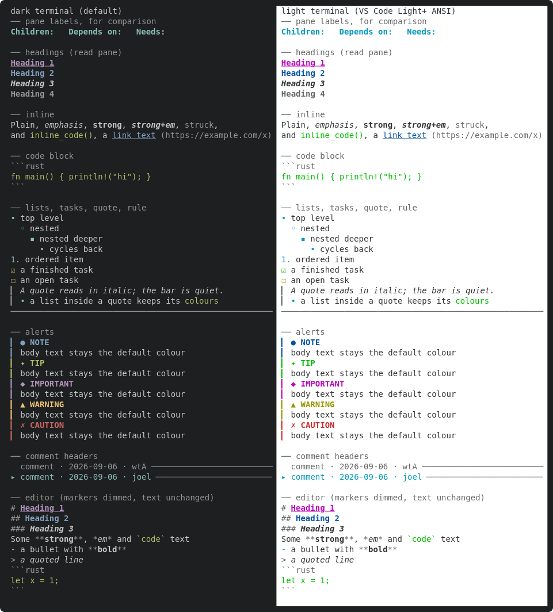

Design pass, then a small code change. One table of styles used by both the read pane and the editor (today `markdown.rs` has its own private styles and the read pane layers its own link/label colors on top).

Must cover: H1/H2/H3 (three visibly distinct levels that do not read like the pane's own cyan-bold labels `Children:` / `Depends on:`), emphasis, strong, strikethrough, inline code, code block (fg + optional subtle bg), quote bar, list bullets per depth (•, ◦, ▪), rules, links (text vs dimmed URL), task boxes, alert kinds (NOTE/TIP/IMPORTANT/WARNING/CAUTION), comment headers, dimmed markers (editor).

Evidence: a docshots scene rendering every style against the default and a light terminal palette; attach the frames. Get Joel's sign-off on the frame before the renderer core consumes it.

---
▸ 2026-10-17T04:31:30Z [delta-lead]

moved: hairy -> shaving

---
▸ 2026-10-17T04:31:30Z [delta-lead]

Claim (yakherd delta-lead, 2026-10-17): owner **palette-1**.
Scope: a new module src/tui/palette.rs (named `Style` constructors or a struct of them) holding every markdown style listed in this yak's description; switch the private style fns in src/tui/markdown.rs to read from it (behaviour may change only where the new palette differs); a new docshots scene in src/tui/docshots.rs that renders a sample document covering every style (headings H1-H3 next to a pane label like `Children:`, emphasis, code, quote bar, bullets per depth, rule, link text + dim URL, task boxes, the five alert kinds, a comment header) to a NEW docs/assets/tui-md-palette.svg (generate only that one SVG). The renderer that will use most of these does not exist yet: render the sample by hand-building ratatui Lines from the palette, it is a swatch, not the renderer.
Constraints: 16-colour/indexed colours that work on dark and light terminals; headings must not reuse the pane-label style (cyan bold) from `render_dline`.
Evidence + judge: Joel decides by looking. Rasterize the SVG to PNG (headless Chrome recipe in docs/tui.md; on Linux try `google-chrome`/`chromium`), attach SVG (+PNG if you got one), then `yaks ask yaks-bc53` for sign-off and finish with the commit anyway (the ask stays open on the shorn-pending yak: do NOT shear; leave it shaving with the ask open, commit, return).
Do NOT regenerate docs/assets docshots (several workers would collide on the SVGs; the coordinator regenerates them after landing). Re-accept any insta snapshot your change moves (`INSTA_UPDATE=always cargo test`, or `cargo insta accept` if installed) and read every changed .snap diff before committing. `cargo fmt` reformats files nobody touched (src/actor.rs, src/tui/docshots.rs, src/tui/tests.rs): run `cargo fmt -- <your files>` and `git checkout` those three if they changed. Docs/help parity per AGENTS.md (docs/tui.md, help_content in src/tui/render.rs) where behaviour a user sees changes.

---
▸ 2026-10-17T04:33:10Z [palette-1]

Start Sat Oct 17 04:33:10 AM UTC 2026; path: /home/joel/src/yaks/.delta/worktrees/g01yg13e0zfq/yaks/.yaks/yaks-bc53.md

---
▸ 2026-10-17T04:41:57Z [palette-1]

Decision: no code-block background. Alternatives rejected: Indexed(236/237) grey (subtle on dark, a black slab on light terminals), Rgb tint (same, and pins a hue). Code is set apart by green fg + the dim fence line instead; the constraint (16-colour, dark+light safe) wins over the "optional subtle bg" in the description.
Decision: headings = H1 magenta+bold+underline, H2 blue+bold, H3 default-fg bold+italic, H4-6 dark grey bold. Alternatives rejected: yellow (the old heading colour; clashes with the Warn/needs accent), cyan (is the pane-label colour). Levels differ by colour AND weight/underline/italic so they read on monochrome terminals. A unit test asserts no level equals `pane_label()`.
Decision: API = plain `pub fn x() -> Style` in src/tui/palette.rs plus glyph fns/consts (`bullet_glyph(depth)`, `task_glyph`, `QUOTE_BAR`, `RULE_CHAR`) and an `AlertKind` enum with `label()`/`glyph()`. Alternative rejected: a `Palette` struct (nothing to configure yet; fns are simplest to call from mdrender). `#![allow(dead_code)]` on the module until yaks-649d consumes it.
Decision: quote text is italic only (not dark grey); the `>` / `▎` bar is dark grey. Rationale: yaks-ea13's "unending sea of gray" case: a quote holding a list or code must keep their colours. Editor highlighter now matches (marker `>` dim + italic text).
Decision: editor headings: the `# ` run (including the space) is the dim marker span, the text gets heading(level); previously the whole line was yellow bold. Behaviour change visible in the editor + `detail::build`'s md spans (one test updated: build_attaches_markdown_spans_to_body_lines now expects 2 spans). Display width unchanged.
Decision: bullets use cyan non-bold (was cyan bold) so they don't read like pane labels either; alert glyphs are single-cell non-emoji (●✦◆▲✗); task boxes ☑/☐ green/yellow.
Decision: light-terminal panel in the swatch is simulated by re-colouring buffer cells with VS Code Light+ ANSI values (toque's SVG renderer is dark-only), so both panels come from the same palette calls in one SVG.

---
▸ 2026-10-17T04:41:57Z [palette-1]

Summary: new src/tui/palette.rs (single style table; unit tests: distinct heading levels != pane_label, distinct alert colours, only 16 ANSI colours + no bg, bullet cycle); src/tui/markdown.rs reads every style from it (heading levels, dim `#`/`>` markers); new docshots scene `docshots_md_palette` -> docs/assets/tui-md-palette.svg (only this SVG generated; the diff in docshots.rs is pure additions); docs/tui.md gains a "Markdown styles" paragraph + embed. No `?` help / CLI change (no key or flag changed). Attached: SVG + PNG (rasterized with `firefox --headless --screenshot`, since no Chrome on this box; emoji-free swatch so Firefox is fine).
Gate: `cargo test --workspace` and `cargo test --release` both pass (605 unit + all integration tests).

---
▸ 2026-10-17T04:42:02Z [palette-1]

verify: `cargo test --workspace` -> PASS (exit 0)

---
▸ 2026-10-17T04:42:09Z [palette-1]

asked: needs human

Joel: please sign off on the palette frame before the renderer core (yaks-649d) consumes it. Attached: yaks-bc53/tui-md-palette.png (+ .svg); also docs/assets/tui-md-palette.svg in the commit. Left = default dark, right = VS Code Light+ ANSI.
What I'd like your eye on:
1. Heading levels vs pane labels: H1 magenta bold underline, H2 blue bold, H3 default-colour bold italic, H4 grey bold, vs the pane's cyan-bold `Children:` / `Depends on:`. Distinct enough? (H3 has no colour, only weight/italic.)
2. Light-terminal contrast: bright green (code, TIP, done task) and olive yellow (WARNING, open task) are the weakest on the light panel. No code-block background on purpose (any fixed grey is a slab on one of dark/light).
3. Alert colours: NOTE blue, TIP green, IMPORTANT magenta, WARNING yellow, CAUTION red, with ●✦◆▲✗ glyphs. Note IMPORTANT = H1's magenta.
4. Quote: bar dim, text italic only (not grey), so quoted lists/code keep colour.
5. Editor: `# `/`>` markers now dim, heading text styled by level (was whole-line yellow bold); bullets cyan non-bold.
Reply = approve, or tell me which styles to change.

---
▸ 2026-10-17T16:29:41Z [Joel Webber]

I dig it!
