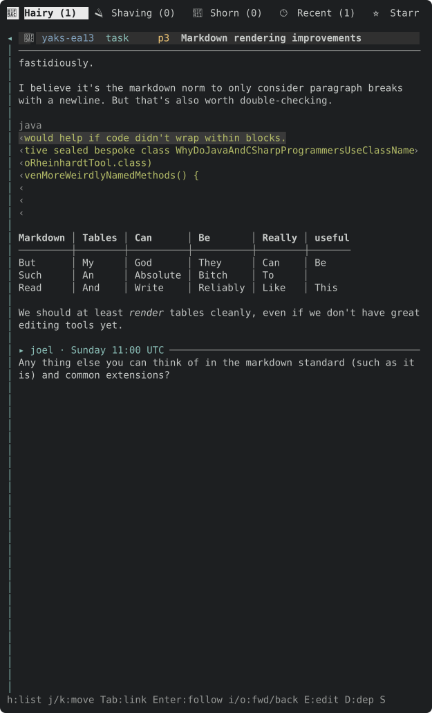

On the renderer core.

- **Code blocks** (fenced and 4-space indented) never wrap: fences hidden, a dim language label (e.g. `java`) on the block's first row, optional subtle background. Mermaid is just a labelled code block.
- **Tables** (GFM) render with box-drawing borders and per-column alignment; short rows pad with empty cells (as GFM does); cells hold inline styling.
- **Horizontal scroll, per block.** When the line cursor is on a row of a no-wrap block, `h`/`l` and `←`/`→` scroll that block sideways (other blocks don't move); a dim `…`/`›` marks clipped edges. Today `h`/`←` in the detail pane mean "back to the list", so on a no-wrap block they are re-bound and `Esc` still returns to the list; at scroll 0, `h` falls through to "back to list" (decide and document). Update `help_content` and docs.
- Yank on these rows copies the full source lines.

---
▸ 2026-10-17T04:58:35Z [delta-lead]

moved: hairy -> shaving

---
▸ 2026-10-17T04:58:35Z [delta-lead]

Claim (yakherd delta-lead, 2026-10-17): owner **hscroll-1**.

Starting point: the renderer core (src/tui/mdrender.rs, landed 47d5d5e) already renders code blocks and tables unwrapped (`MdRow.nowrap = true`), fences hidden, tables boxed with aligned/padded cells. Read `mdrender.rs` and `detail::body_rows` first; `docs/assets/tui-md-render-2.svg` shows the current look.

Scope:
- `mdrender.rs`: a dim language label for fenced code (e.g. a right-aligned or leading `java` tag on the block's first row, or a separate label row: your call, `Decision:` note), and a way to identify which rows belong to the same no-wrap block (e.g. a block id on `MdRow` carried into `DLine`; add the field to `DLine` in detail.rs with `src: None`-style defaults, in the same shape as the `src` field).
- Horizontal scroll per block: `App` state for the h-offset of the no-wrap block under the line cursor (reset when the cursor leaves the block or the yak changes); `render_dline` / `render_detail` in src/tui/render.rs clip such rows at the offset and pane width, with a dim `‹`/`›` at a clipped edge.
- Keys in the detail pane (`handlers.rs`, the detail match): on a no-wrap row `l`/`→` scroll right and `h`/`←` scroll left; `h`/`←` at offset 0 keeps today's meaning (back to list); `Esc` unchanged. Update `help_content` and `help_hint` if it fits, and docs/tui.md.
- Yank of these rows already copies source (core); keep it.

Out of scope: syntax colouring (yaks-3020), the editor, footnotes/links. Evidence: failing-first tests (clip + markers at an offset; `l` moves the offset only on a no-wrap row; `h` at 0 returns to the list), a docshots-style SVG or headless frames of a scrolled code block and table (add to `docshots_md_render` as `tui-md-render-scrolled`, generating only your SVG), PNG via `firefox --headless --profile $(mktemp -d) --screenshot out.png --window-size=W,H file://...svg` (Chrome is not installed). Judge: coordinator at landing.

---
▸ 2026-10-17T05:02:36Z [hscroll-1]

Started 2026-10-17T04:59Z by hscroll-1. Farm path: /home/joel/src/yaks/.delta/worktrees/krnrxm4pk6h1/yaks/.yaks/yaks-c733.md



---
▸ 2026-10-17T05:13:27Z [hscroll-1]

Decision: language label is its own dim row above a fenced block (the info string, `java`), not a right-aligned tag on the first code row. Rejected: a tag on the first code row (it would scroll with the code, or need a second clipping rule on row 0). The label row is not part of the no-wrap block, so it never scrolls. Indented code has no label; mermaid is just ```mermaid → label `mermaid`. Rejected: the optional code background (palette says foreground only, owned by yaks-bc53).

---
▸ 2026-10-17T05:13:27Z [hscroll-1]

Decision: `MdRow.nowrap` is now `Option<NoWrap { id, gutter }>` (was bool). `id` is unique per rendered document (code block, HTML block or table); `gutter` is the display width of the container prefix (quote bar, list marker) so a nested block scrolls only its own text. `DLine.nowrap` carries it; `DLine::nowrap_key()` = (content block, id).

---
▸ 2026-10-17T05:13:27Z [hscroll-1]

Decision: App state is ONE `detail_hscroll: Option<(yak id, block, id, cols)>`, not a per-block map. It is cleared by `drop_stale_hscroll()` run once after every `handle_key` and `handle_mouse` (handle_key/handle_mouse now wrap `*_inner`), whenever the cursor is not on that block or the yak changed. Rejected: resetting at each cursor-moving call site (many: j/k/d/u/g/G/Tab/mouse/find/nav) and a per-block HashMap (offsets would resurrect on return, contradicting 'reset when the cursor leaves the block').

---
▸ 2026-10-17T05:13:27Z [hscroll-1]

Decision: `h`/`←` on a no-wrap row scrolls left; only when that does not move (offset 0, or a non-no-wrap row) does it fall through to back-to-list. `l`/`→` on any other row is a no-op (it did nothing in the detail pane before). Esc is unchanged. Step is 8 columns per press, clamped to [0, widest row of the block − pane width]; resize re-clamps at render. Rejected: h at 0 doing nothing (would make `h` no longer leave on code rows, trapping the user), and half-page steps.

---
▸ 2026-10-17T05:13:27Z [hscroll-1]

Decision: clipping is in `render_dline` (new `clip_nowrap`), on the styled per-char cells after link/find/md layers, so find highlights and link spans stay valid column-wise. `‹` replaces the first scrolling cell, `›` the last, in the dim marker style; a row with nothing visible in the window gets just `‹`. Gutter cells are never clipped.

---
▸ 2026-10-17T05:13:27Z [hscroll-1]

Evidence: 7 new tests (6 in tui/tests.rs: label+clip marker, `l` moves only the block under the cursor (label, prose, table unchanged), `h` back to 0 then list, h on prose/Esc, clamp + reset on leaving the block, yank of a scrolled row copies the full source line; 1 in mdrender.rs: label row/ids/gutter/table id). ea13 snapshot re-accepted: diff is exactly the two new label rows (`▎ python`, `java`). New SVG docs/assets/tui-md-render-scrolled.svg (attached; rasterized with firefox and read: label row, `‹` on every code row, the table's `›` markers elsewhere, nothing else moved). docshots_md_render also rewrote tui-md-render*.svg; I reverted those two (they would change only by the new label rows).
Docs: docs/tui.md (key table prose, rendered-markdown paragraph, new section + embed), `help_content` in render.rs. help_hint left as is (bar is full).

---
▸ 2026-10-17T05:13:54Z [hscroll-1]

verify: `cargo test --workspace` -> PASS (exit 0)

---
▸ 2026-10-17T05:14:19Z [hscroll-1]

Summary: code blocks/tables scroll sideways per block (h/l, ←/→ on a no-wrap row; ‹ › edge markers; dim language label row; gutter stays put; offset dropped when the cursor leaves). Gate: cargo test --workspace PASS and cargo test --release PASS (636 bin tests). Docs: docs/tui.md + help_content.

---
▸ 2026-10-17T05:14:19Z [hscroll-1]

moved: shaving -> shorn
