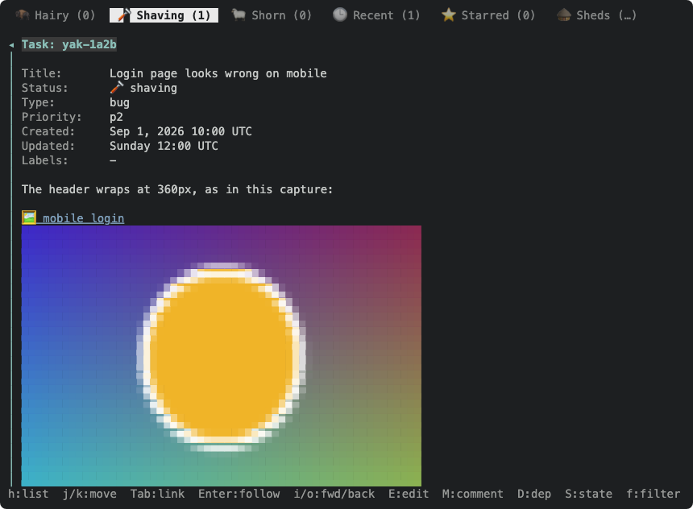
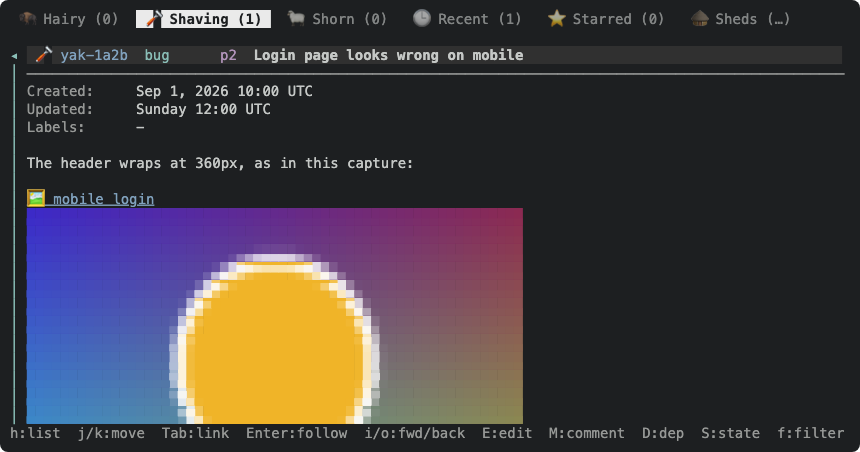

Follow-up to yaks-4305, which only shows an image in a pane of its own after Enter. An image link in a yak body (``) renders today as a `🖼 name` link row; it should draw the picture in place, in the detail pane, as GitHub does.

Things to work out (this is mostly a layout problem, not a decoding one):

- The detail pane is a list of text rows (`detail::DLine`) with a row-indexed cursor, scroll, find and link jumps. An image occupies N rows of cells and, with a graphics protocol, is not text at all. Give it N placeholder rows so every index stays valid, and paint the image over them after the text.
- ratatui-image draws with `StatefulImage` (resize and encode when the area changes), and a protocol image must be clipped or skipped when partly scrolled off. Its docs warn that rendering blocks the UI thread unless encoding runs on a background thread (`ThreadProtocol`). Measure that for a large PNG before committing to the simple path.
- The row count must be known before the image is decoded, or the pane reflows when it loads. Read the header (dimensions) first, decode lazily, and cache by path and size.
- Kitty graphics persist across redraws, so make sure scrolling and overlays (help, pickers) clear them. This is where terminal bugs live. Keep half-block as the safe fallback, and consider a config switch to turn inline images off.
- Image size and fit: see the sizing yak (it decides how many rows an image takes).
- Remote (`http://`) images stay links.

Depends on the viewer from yaks-4305 (`src/tui/imageview.rs`, the shared picker on `App`). Acceptance: scroll a yak body past an image in Ghostty with no artifacts and no flicker, plus a toque frame with the half-block image in the pane.

---
▸ 2026-10-22T20:47:07Z [delta:Add basic image attachment rendering]

moved: hairy -> shaving

---
▸ 2026-10-22T20:55:37Z [delta:Add basic image attachment rendering]

Claim (yakherd, thread of yaks-4305). Order: after yaks-89fc (size syntax: `imagesize::cells`, `MdRow.images`) lands, because this yak uses both. I do this one myself (it changes the detail pane's row model), not a worker.

Plan, recorded before the code so a reviewer can argue with it:

- `mdrender` already marks an image with a `🖼 alt` link row and now (yaks-89fc) reports `MdRow.images`. The detail builder (`detail::body_rows`) turns an image-only paragraph row into a block of N reserved rows, `Kind::Image`, carrying the image's farm-relative target, so every row index (cursor, scroll, find, jumps, yank) stays valid. N comes from `imagesize::cells` using the image header's pixel size (read with `image::ImageReader::into_dimensions`, no decode) and the picker's cell size, so the layout never waits on a decode. The first reserved row keeps the `🖼 alt` text (and its link, so Enter still opens the viewer); the other N-1 are blank.
- An image that shares a paragraph with text stays the `🖼 alt` link (no inline-in-a-sentence image). Only an image alone in its paragraph expands. Remote (`http://`) images and non-decodable ones (svg, missing file) stay link rows.
- `render_detail` draws the visible part of each image over its reserved rows after the text paragraph, as the in-place editor does over `Kind::Editor` rows. An image only partly scrolled into view is drawn only if it fits fully in the content area; otherwise its visible rows are left as the `🖼 alt` placeholder text. That sidesteps cropping, which protocol images (kitty, sixel) handle badly. Rows are bounded by a max height (about 2/3 of the pane) when no explicit size is given.
- Decoded images live in a cache on `App` keyed by (path, mtime, cols, rows) holding the `StatefulProtocol`; decode and resize-encode happen at first draw (blocking). Decision to measure rather than assume: time a large PNG; if a frame blocks noticeably, move decoding to a background thread (`ThreadProtocol`).
- Kitty graphics persist: the cached protocol must be re-sent or deleted when the image leaves the screen, and any overlay that covers the detail pane must not leave stale images. ratatui-image's kitty path (unicode placeholders) writes placeholder cells into the buffer, so ordinary buffer diffing erases them; verify that claim in the real terminal before relying on it.
- A switch to turn inline images off: farm config `inline_images: false` (default true), because a terminal with a flaky protocol should have an out. Config surface is a design choice the human may want a say in: asked below.

Evidence: toque frames with a half-block image inline in a body (before scrolling, mid-scroll, wholly off-screen), a unit test that an image-only paragraph reserves rows and a mixed paragraph does not, and the real-terminal check in Ghostty by the human (not something I can observe).

---
▸ 2026-10-22T20:55:43Z [delta:Add basic image attachment rendering]

asked: needs human

Two forks before I build this, with my leans (I will start on the parts that do not depend on them: the row model and the cache):

1. A farm-config switch to turn inline images off (`inline_images: false`, default on). Lean: yes, because kitty/sixel redraw bugs differ per terminal and the half-block fallback is a fine escape hatch. Alternative: no config, rely on the terminal query's fallback only. This adds a surface to `.yaks/config.yaml`.
2. Images that only partly fit the pane. Lean: draw an image only when it fits entirely in the visible area, else show the `🖼 alt` placeholder text for its visible rows (no cropping). Alternative: crop at the pane edge, which looks smoother while scrolling but protocol images (kitty, sixel) crop unreliably, so some terminals would show garbage.

---
▸ 2026-10-22T20:58:41Z [Joel Webber]

1. SGTM. Especially with various terminal maintainers fighting about image support for years.
2. Why not just scale down instead? Should be pretty efficient with Rust image libs.

---
▸ 2026-10-22T20:58:49Z [Joel Webber]

Response in comment above.

---
▸ 2026-10-22T21:49:01Z [delta:Add basic image attachment rendering]

picked up

Read your answers. (1) `inline_images` config switch: yes, I will add it (default on). (2) "Scale down instead": I read my question 2 too loosely, so one narrower question follows; the rest of the layout code waits on it.

---
▸ 2026-10-22T21:49:01Z [delta:Add basic image attachment rendering]

asked: needs human

I mixed two cases in question 2; your "scale down" answers the first, and I need you on the second.

1. An image bigger than the pane. Scale it down to fit, as you said. Already the plan: never wider than the pane, never taller than about two thirds of its height, no size given. An explicit size (`=50%`) is the author's call and may be taller.
2. An image only PARTLY scrolled into view (its top or bottom edge is off the pane). Options:
   - (A) Clip it at the pane edge. I said earlier that kitty crops unreliably, and that was wrong: the `ratatui-image` docs say kitty and halfblocks clip properly (`Image::allow_clipping`), and sixel and iTerm2 do not. So Ghostty clips fine; a sixel or iTerm2 terminal shows the `🖼 alt` placeholder text until the image is fully in view. My lean.
   - (B) Re-scale the visible part to the visible rows, so the image shrinks and grows as you scroll. It costs a re-encode and, on kitty, a re-transmit at every scroll step, which will probably flicker, and the picture changes size under your eyes.
   - (C) Draw only fully visible images, placeholder otherwise (my first plan: no flicker, but it pops in and out).

---
▸ 2026-10-22T22:12:53Z [delta:Add basic image attachment rendering]

Recorded by the yakherd from the human's comments in the Delta thread (not typed into this yak): on (A) clip a partly visible image at the pane edge: "That works. Let's try it and see how it goes."

---
▸ 2026-10-22T22:12:53Z [delta:Add basic image attachment rendering]

picked up

Building (A) clip-at-edge plus the inline_images switch.

---
▸ 2026-10-22T22:24:50Z [delta:Add basic image attachment rendering]

Decision (yakherd): partial visibility uses ratatui-image's `SlicedImage`/`SlicedProtocol`, not a placeholder. It clips at the pane edge on every protocol (kitty via unicode-placeholder row skip, half-blocks, sixel by dropping bands, iTerm2 by per-row slices), so the human's choice (A) works everywhere and the "placeholder on sixel/iTerm2" fallback in my earlier lean is not needed. Rejected: `StatefulImage` (re-encodes on every size change and blocks the frame), re-scaling the visible part (flicker).

Decision: an image expands only when it is alone in a TOP-LEVEL paragraph (no list, quote, table or footnote around it): `MdImage.alone`, computed in mdrender. Rejected: inline-in-a-sentence (no sensible layout) and indented images in lists/quotes for now (the draw offset needs the container gutter; a follow-up if wanted).

Decision: layout reads only the image HEADER (`ImageReader::into_dimensions`), at build time; decode and encode happen at first DRAW and only for images intersecting the visible rows, cached by (path, mtime, cols, rows) with a small cap. So opening a yak with twenty screenshots decodes the one or two on screen.

---
▸ 2026-10-22T22:44:09Z [delta:Add basic image attachment rendering]

verify: `cargo test --workspace` -> PASS (exit 0)

---
▸ 2026-10-22T22:44:38Z [delta:Add basic image attachment rendering]

Built (yakherd), committed in the thread clone as ea538c8 (on top of 7462a6f); not pushed to the user's `main`. `yaks verify yaks-0bf0`: PASS (`cargo test --workspace`, 730 in the bin).

What it does: an image that is the whole of a top-level body paragraph reserves rows in the detail row model (`DLine.image`, `ImageSlot`), sized from its file header alone (`imagesize::cells`, no decode), and `render_detail` draws it over those rows with `SlicedImage`, clipped at the pane edge. Decode and encode run at first draw for images on screen only, cached by (path, mtime, cols, rows) up to 8, a failed decode remembered. Everything else (in text, a list, quote or table; remote; svg; missing or undecodable; `inline_images: false`) stays the `🖼 alt` link row. The link row stays above the image, so Enter still opens the viewer. New config key `inline_images` (default true).

Tests that failed first: image-alone reserves rows (12x6 cells for a 120 px image at the half-block 10x20 px cell), mixed/list/quote/off/remote/missing do not, `=x60` sets 3 rows, clipping (2 rows visible at the bottom edge, all 6 when scrolled in, 0 when scrolled off), a broken file draws nothing and is not retried. mdrender: `MdImage.alone`.

Evidence attached: two color frames (full and clipped), rasterized from the docshots SVGs with headless Chrome. They show the half-block fallback only.

NOT verified, and the reason this is still open: any real graphics protocol. Kitty (Ghostty) scroll and redraw behavior is exactly what I cannot see: stale images when the pane scrolls, an overlay (`?`, a picker) opened over an image, a resize, and kitty re-transmitting on every frame. Also untested here: an image inside a comment (same `body_rows` path as the description, not separately tested) and several images in one yak.

Decision (yakherd): the draw cell size comes from `Picker::font_size()`; the half-block picker's default 10x20 px is what tests and headless frames use, so row counts there differ from a real terminal's.
Decision: `build_inline` stretches the decoded image to exactly cols x rows cells (`resize_exact`) before encoding. Rejected `Resize::Scale`: it left a padding strip where cell rounding did not divide evenly (seen in the first frame).
Follow-up if wanted: images inside list items and quotes (need the container gutter as a draw offset).

---
▸ 2026-10-25T21:07:19Z [Joel Webber]

Looking really good! One small nit -- the cursor movement in view-mode goes "underneath" an inline image based on its height in cells, forcing you to move down across many cells to move past a large image. I believe this should be more like edit mode, where you only have to move a single cell to get past the image.

---
▸ 2026-10-25T21:18:04Z [delta:Add basic image attachment rendering]

verify: `cargo test --workspace` -> PASS (exit 0)

---
▸ 2026-10-25T21:21:22Z [delta:Add basic image attachment rendering]

Cursor fix (yakherd), committed in the thread clone as c4b0b9f, after the human's nit: moving the line cursor through a body went "underneath" an inline image one reserved row at a time.

Fix: the rows an image reserves are no longer cursor stops. `detail::cursor_stops` lists every row but those; `move_detail_line` (j/k/d/u) and `detail_line_to` (g/G) step along the stops, so one `j` from the `🖼 alt` link row lands on the row after the picture and one `k` comes back, as in edit mode. A click on the picture lands on its link row (a second click there opens the viewer). A cursor already inside the block (only possible after a reflow) leaves it in the direction of travel, and a step up from inside arrives on the link row instead of overshooting it.

Tests that failed first: `the_line_cursor_steps_over_an_inline_image_in_one_move`, `paging_and_g_never_land_inside_an_inline_image`, `clicking_an_inline_image_selects_its_link_row_and_a_second_click_opens_it`. `cargo test --workspace` PASS (735 in the bin); `yaks verify yaks-0bf0` PASS. `docs/tui.md` says so.

Decision (yakherd): `d`/`u` count stops, not rows, so a half-page move over an image moves a little further on screen than half a pane. Rejected: counting rows (it would land inside the block or need a snap-back).

Installed the build to ~/.cargo/bin/yaks and ~/go/bin/yaks (identical). The human reported the inline images "work beautifully" in Ghostty, so the real-protocol check I flagged is done by them, apart from the cases they did not mention (several images in one yak, an image in a comment): treated as fine, not verified by me.

Closing the yak. Follow-ups not filed: images inside list items and quotes; an svg inline (it has no header size).

---
▸ 2026-10-25T21:21:22Z [delta:Add basic image attachment rendering]

moved: shaving -> shorn

---
▸ 2026-10-25T21:26:26Z [delta:Add basic image attachment rendering]

Landed (yakherd): the thread's five commits fast-forwarded onto the user's checkout main (2b1f3ba..c4b0b9f: yaks-89fc 7462a6f, yaks-0bf0 ea538c8 and c4b0b9f, yaks-4e9c 67122a0 and e4e378d). Verified there: git log shows c4b0b9f, status clean, no MERGE_HEAD. The first push attempt printed nothing and did not land; the second did. origin not pushed. toque origin/main 240eb5f. Release build installed to ~/.cargo/bin/yaks and ~/go/bin/yaks from c4b0b9f.

---
▸ 2026-10-27T01:10:50Z [Joel Webber]

requested: needs agent

Tidy request: change only the line structure of this yak's description and every note, so each renders as intended under CommonMark.

Put a blank line between blocks, make run-on facts a list, and fence pasted output. Never change a word, a note header (`▸ <ts> [actor]`) or the frontmatter. Edit the file at `yaks path yaks-0bf0` directly: `update --description` replaces the whole body, notes included. Then `yaks pickup yaks-0bf0 --drop-request`, which removes this request note, so no new note is left behind.
