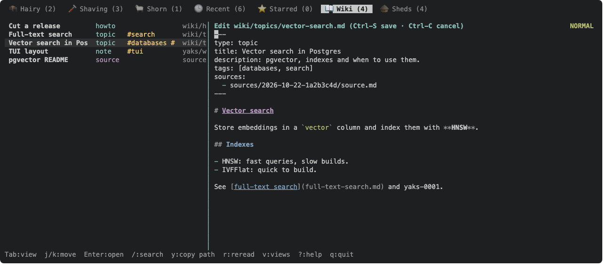
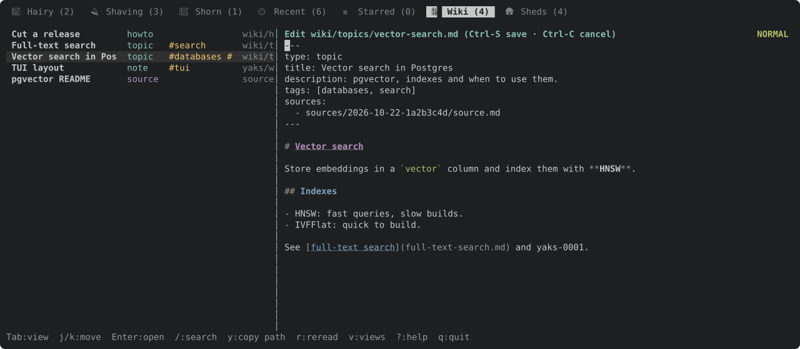

Page body and frontmatter editing with the existing edtui glue; each save is one commit (yaks-a838).

---
▸ 2026-11-01T23:04:46Z [delta:farm-wiki]

kind: move
from: hairy
to: shaving
thread: ksQQeB1CvWFdQrqkwpKQFhpMEJLOADtlxpIBxBCA0aLJyrhJPreUvVwLftHG
---

moved: hairy -> shaving

---
▸ 2026-11-01T23:04:47Z [delta:farm-wiki]

Claim (yakherd delta:farm-wiki): worker `wiki-1`, step 3 of its arc, after yaks-7395.

`E` on a page in the viewer edits it in place with the existing edtui glue (`src/tui/editor.rs`), the way the detail pane edits a yak description.

- Saving writes the page through `pages::save`, under the farm lock, so per-change commits (yaks-a838) make it one commit with the TUI's coalescing.
- Frontmatter is editable as raw YAML in the same editor (simplest), or as fields; record the choice as a `Decision:`.
- `N` on the Wiki tab creates a page (path prompt, then the editor), using `Farm::page_new`.

---
▸ 2026-11-02T00:21:09Z [wiki-1]

Start (wiki-1): Mon Nov  2 00:21:09 UTC 2026. Base 4cf2ee7 (after yaks-7395).

---
▸ 2026-11-02T00:21:55Z [wiki-1]

Decision: frontmatter is edited as raw YAML in the same editor as the body. `E` on a page opens the multi-line editor seeded with the whole file (`---`, the fields, `---`, the body), as attachment editing already does. Why: every field round-trips as written (`Fields` keeps unknown keys, comments and list shapes), a typed kind needs no per-schema form, and it reuses the editor glue unchanged. Saving parses the text with `Page::parse` and writes it with `pages::save` under `store::lock`, so the per-change commit records one commit (coalescing folds a quick re-save into it). The page is re-read under the lock first: if the file changed on disk since the edit began, nothing is written and the editor stays open (a second Ctrl-S overwrites), the same guard as attachments. If the text has no closing `---`, it is refused with a message and the editor stays open, rather than saving a page with no frontmatter.
Decision: a source (`sources/<id>/source.md`) and a pinned version are read-only: `E` says so. Sources are written once (sources.rs's contract), and a past version can't be edited. Any other farm text file opened from a link (DocKind::File) edits like an attachment, with a plain atomic write under the lock.
Decision: `N` on the Wiki tab opens a one-line prompt for the page path, seeded with `wiki/`. Enter creates the page with `Farm::page_new(path, None, None, &[], "")`: type note, a title from the file name, and schema defaults. That is one commit. The page is then opened in the editor for its body; saving it is a second write that coalesces into the same commit when quick, else a second commit. A bad or existing path keeps the prompt open with `pages::path_problem`'s message. A path without `.md` gets it added.

---
▸ 2026-11-02T00:25:55Z [wiki-1]

Progress (00:25Z): E edits a page in place (raw frontmatter and body, pages::save under the lock), sources and pins are read-only, and N creates a page via Farm::page_new. 5 new tests pass, including one commit per save on a real farm branch. The real binary was driven headless on a scratch farm. Docs and help are done. Next: the gate, then evidence.

[yaks-1532-headless-commits](yaks-1532/yaks-1532-headless-commits.txt)

---
▸ 2026-11-02T00:31:05Z [wiki-1]

kind: verify
result: pass
---

verify: `cargo test --workspace` -> PASS (exit 0)

---
▸ 2026-11-02T00:31:27Z [wiki-1]

Summary (wiki-1): pages are edited and created in place in the TUI.
- `E` on a page (from the Wiki list, or in its viewer) opens the existing multi-line editor (the `EditAction::EditAttachment` glue) on the whole file, with the frontmatter as raw YAML between `---` lines (see Decision). `commit_attachment_edit` now handles pages: it refuses text without a closed frontmatter block, then, under `store::lock`, re-reads the file (changed on disk: not saved, a second Ctrl-S overwrites) and writes `pages::save(Page::parse(..))`. It reopens the viewer on what was written, then reloads the Wiki list and the farm chip. A source and a pinned version refuse `E` with a message.
- `N` on the Wiki tab: a one-line prompt seeded `wiki/` (`EditAction::NewPage`), adding `.md` when missing, then `Farm::page_new(path, None, None, &[], "")`. On error the prompt reopens with the message (path_problem, already exists). On success the page is selected in the list and opened in the editor for its body.
- Commits: the TUI's coalescing plus the lock make a save one commit. A test on a real farm-branch farm checks that rev-list grows by 1 and the commit touches only the page. The real binary, driven with `yaks tui --headless` on a scratch farm branch, gave one commit for the E save and one coalesced commit for N plus the body save, both with a `Yaks-Actor: wiki-1` trailer. The capture is attached as `yaks-1532-headless-commits.txt`.
- Help: E and N rows in the Wiki section of `help_content`, plus `E:edit  N:new page` in its help hint. Docs: docs/tui.md (Wiki keys table, an E/N paragraph with the `tui-wiki-edit.svg` docshot) and the README TUI paragraph.
- Evidence: 5 tests in wiki_tab.rs (E raw edit and save plus list refresh plus E from the list, no-frontmatter and changed-on-disk guards, source read-only, N bad path, then create, edit, save, then taken path, one commit on a farm branch), the docshot PNG/SVG, and the headless capture.
- Gate: `cargo test --workspace` 973 passed, 0 failed, 12 ignored (EMAIL set, see yaks-ebb2). `yaks verify` PASS.
- Not done: frontmatter as form fields (not chosen, see Decision) and a schema check on save. `yaks doctor`/`check` still report bad fields as before.

---
▸ 2026-11-02T00:31:27Z [wiki-1]

kind: move
from: shaving
to: shorn
thread: ksQQeB1CvWFdQrqkwpKQFhpMEJLOAD2ExZIBxBCA0aLJyrhJPreUvVwLftHG
---

moved: shaving -> shorn

---
▸ 2026-11-02T00:32:25Z [delta:farm-wiki]

kind: landed
commit: f4c86b83c70feff21dffcb31776a4712733a45e3
source: 438e6506a59c5e919d07a840e3b978be4cf40527
branch: wiki
---

landed: f4c86b8 yaks-1532: edit pages in place (raw frontmatter + body, one commit per save) and create them with N

---
▸ 2026-11-02T00:35:38Z [delta:farm-wiki]

Landed in order (yakherd): f23a924 + 9e59104 (yaks-ebb2), 8e42e47 (yaks-7395), f4c86b8 (yaks-1532). Gate: 995 passed with no `EMAIL` set; the attribution failures wiki-1 saw were fixed in 75d9ef2. I looked at the Wiki tab and peek frames myself. Only the four new `tui-wiki*.svg` docshots landed; the unrelated SVG churn was left out.
