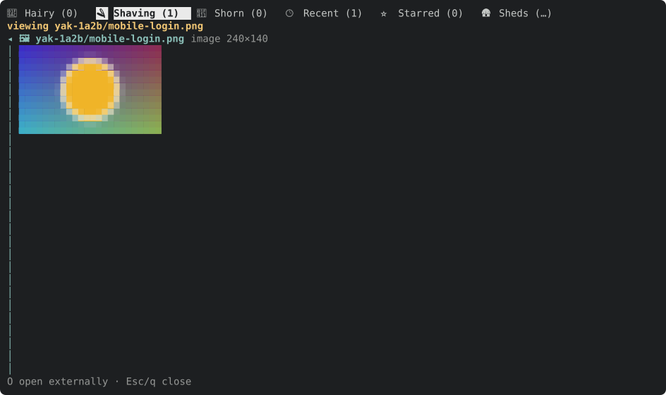
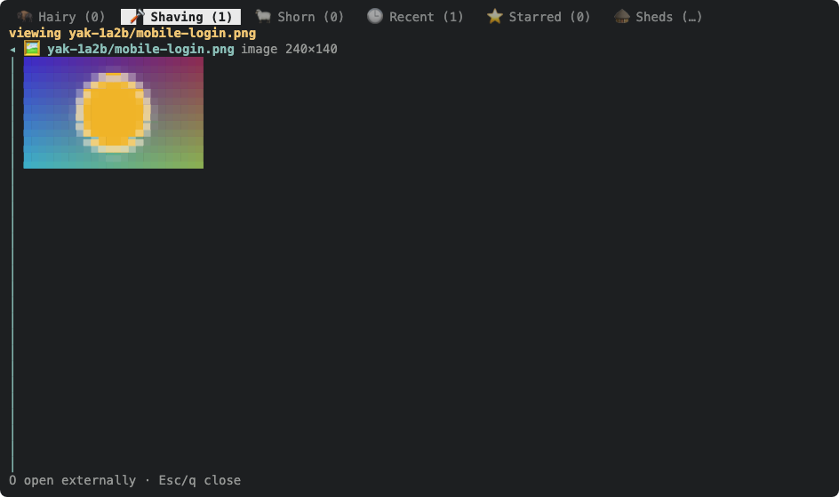

We can use the kitty image protocol to display images in terminals that support it (Kitty, Ghostty, iTerm2, and several others, to my understanding).

We need to start by investigating any existing image support in `ratatui`, and add it (directly or in a new crate) if needed. We'll also need to ensure `toque` supports it, so that we can get proper evidence on our yaks.

---
▸ 2026-10-22T19:47:15Z [delta:ksQQQTmKmfXeRfyO736_R3BpP5LOAClXIpIBxBCA]

moved: hairy -> shaving

---
▸ 2026-10-22T20:02:49Z [delta:ksQQQTmKmfXeRfyO736_R3BpP5LOAClXIpIBxBCA]

Basic image viewing, first slice (the same shape as yaks-699b: Enter or `O` on an attachment link opens it in the pane).

Decision: use the `ratatui-image` crate (11.1, `default-features = false, features = ["crossterm"]`) rather than writing kitty escapes ourselves or adding a crate of our own. It already covers kitty (unicode placeholders), sixel and iTerm2, queries the terminal for protocol and cell size, and falls back to half-block cells. I pinned 11.1 and not 12.0.0-rc.3 because it is stable. I turned off `chafa-dyn` (default) so there is no libchafa runtime dependency, and I enabled only the `image` formats png, jpeg, gif and webp.

Decision: `Picker::from_query_stdio()` runs once in `runtime::run`, after raw mode and before the first event is read, and stays `Picker::halfblocks()` in `App::new`. So headless toque frames, the SVG docshots and `cargo test` always draw an image as colored half-block cells (`▀` with fg and bg colors). Those land in ordinary text and SVG frames, so no toque change was needed for evidence. I rejected extending toque with an image-protocol capture: a protocol escape cannot be seen in a text or SVG frame anyway.

Scope: `Overlay::Image(ImageView)` in the new `src/tui/imageview.rs` (open, `render_image`, `handle_image_key`); `open_external` tries the image viewer, then the text viewer, then the OS opener. An svg (not decodable by `image`), a corrupt image, or a file over 32 MiB falls through to the OS opener. Keys: `O` opens externally, `Esc`/`q`/`h`/`←` close. The image is shrunk to fit and never enlarged, with no zoom or pan.

NOT verified: the real graphics protocols (kitty, sixel, iTerm2) drawn in an actual terminal. Only the half-block fallback is exercised here. It needs a try in Ghostty or Kitty.

Open: `from_query_stdio` waits up to 2 s on a terminal that never answers, so TUI startup is slow there. If that matters, shorten it with `QueryStdioOptions.timeout`. The query also goes before any event is read, so it cannot eat keys.

Evidence: tests `enter_on_an_image_attachment_shows_it_in_the_pane`, `an_undecodable_image_attachment_falls_back_to_the_os_opener`, `o_in_the_image_viewer_opens_externally_and_closes_it`; `cargo test --workspace` passes (708 in the bin). The attached SVG (`docshots_image_viewer`) shows the viewer. Docs: `docs/tui.md` (the `A`/`O` row and an "Image attachments" paragraph), the `?` help line and the status hint. The `?` help snapshot gained one row.

---
▸ 2026-10-22T20:26:10Z [delta:Add basic image attachment rendering]

Added a PNG attachment (the SVG one is deliberately opened externally: the `image` crate cannot decode svg). Try Enter on the PNG link in a graphics-capable terminal.

---
▸ 2026-10-22T20:36:20Z [delta:Add basic image attachment rendering]

verify: `cargo test --workspace` -> PASS (exit 0)

---
▸ 2026-10-22T20:36:41Z [delta:Add basic image attachment rendering]

Landed as 2b1f3ba on main (pushed to the user's checkout; origin not pushed). Verified there: `git log` shows it, `git status` is clean.

Evidence: `yaks verify` (`cargo test --workspace`) PASS on the landed commit; the user confirmed an actual PNG attachment displays in Ghostty (real graphics protocol). SVG attachments still open externally by design.

Follow-ups filed: yaks-4e9c (svg in the viewer), yaks-0bf0 (inline images in bodies and comments), yaks-89fc (image size syntax and default fit).

Handed over a release build to ~/go/bin/yaks; a running `yaks tui` needs a restart.

---
▸ 2026-10-22T20:36:41Z [delta:Add basic image attachment rendering]

moved: shaving -> shorn
