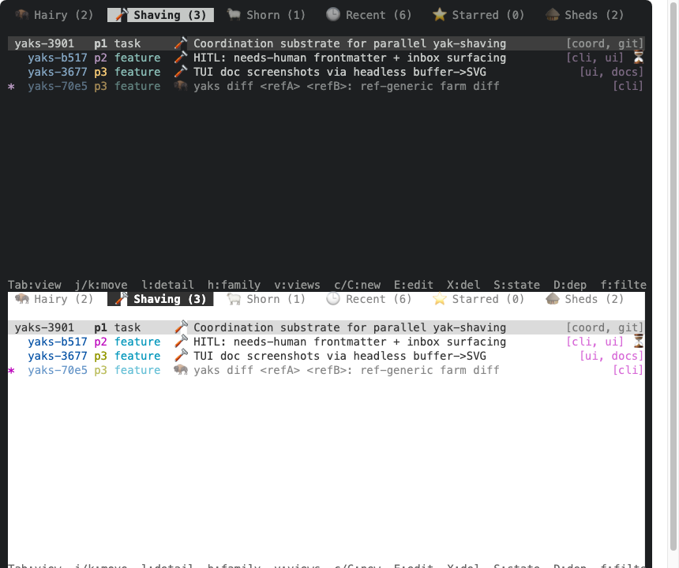

---
▸ 2026-10-31T14:30:20Z [delta:ksQQZYjOB1HNS6uSBKT_aZjoz5LOADi4D5IBxBCA]

## Analysis: highlight colours across light and dark terminals

**Cause.** The 16-ANSI-only rule in [`palette.rs`](../src/tui/palette.rs) covers markdown, but the *chrome* hardcodes dark-terminal assumptions:

- Selection and cursor bands use `Color::Indexed(237)` / `236` with `fg: Reset`. That is `render.rs` (list rows, detail line cursor, pinned header, form choices, link-selected), `fuzzy.rs` and `sheds_tab.rs`: about 12 sites. On a light theme the fg resets to dark text on a near-black band, which is the selected row in the screenshot.
- The active tab is `fg Black / bg White` ([`render.rs` ~L590](../src/tui/render.rs#L590)). Terminal themes remap ANSI white and black, so the tab can come out as a black slab (the empty black tab in the screenshot).
- The editor cursor is the same `White`/`Black` pair ([`editor.rs` L316](../src/tui/editor.rs#L316)). Yellow-bg prompt text is `Black`.

## Options

- **A. `REVERSED` for every highlight.** Needs no detection and is always legible. But on a multi-coloured list row, reverse turns each coloured span into a coloured block, and the original design explicitly rejected that.
- **B. Binary dark/light detection**, picking between two fixed bands (237 vs ~253). It handles the reported bug, but it is a guess that mispicks mid-tone themes (Solarized, Gruvbox).
- **C. Derive the band from the real terminal background.** Query OSC 11 once at startup, then blend the bg toward the fg by roughly 8% (selected) and 5% (unfocused/pinned) as truecolor. It is correct on any theme and keeps the current "subtle band, fg reset" look.
- **D. No backgrounds**: a `▸` marker plus bold. Theme-free, but loses the band people like.

## Recommendation

C, with fallbacks, behind one module (e.g. `tui/surface.rs`) so the 12 sites call `surface::selected(focused)`, `surface::band()` and so on instead of `Indexed(237)`.

- **Detection.** Run an OSC 11 query once at startup, next to the existing `Picker::from_query_stdio` in [`runtime.rs`](../src/tui/runtime.rs), before any event is read. `terminal-colorsaurus` is the likely crate; I have not tried it with the edtui/crossterm setup, so that is the first thing to check. A `YAKS_THEME=light|dark` override and a `COLORFGBG` read are the fallbacks.
- **No answer** (tmux without passthrough, ssh, a dumb terminal): keep today's 237/236, so behaviour only changes where we can positively tell. The tests and insta snapshots stay on that dark default.
- **No truecolor** (`COLORTERM` unset): use the nearest 256-colour index of the blended colour.
- **Tab and cursor.** Replace the `Black`/`White` pairs with `REVERSED` (+ bold for the tab), which uses the terminal's own fg and bg and needs no detection.

## Risks and follow-ups

- Detection happens once, so a terminal that flips theme mid-session keeps the old band until restart. A refresh on focus-gained is a possible follow-up.
- `DarkGray` (bright black) is used as the "quiet" colour all over, and it is *the background colour* in Solarized Dark. That is a separate legibility bug on one theme family, not part of this yak.
- Docs touch: the `palette.rs` header ("no backgrounds, 16 ANSI only") should state the new rule, `docs/tui.md` should mention `YAKS_THEME`, and the `docshots` light-terminal scene (VS Code Light+) should gain a list-selection frame as evidence. It currently shows only markdown.

---
▸ 2026-10-31T15:17:43Z [delta:Plan highlight colors for light and dark]

moved: hairy -> shaving

---
▸ 2026-10-31T15:26:28Z [delta:Plan highlight colors for light and dark]

Implemented option C: highlight bands derived from the terminal's own colours.

- New [`src/tui/surface.rs`](../src/tui/surface.rs): `selected()` and `band()` blend the real background 18% / 12% toward the real foreground. It is truecolor if `COLORTERM` says so, else the nearest xterm-256 index.
- Resolution order: `YAKS_THEME=dark|light`, then the OSC 10/11 query (`terminal-colorsaurus`), then `COLORFGBG`, then the old greys 237/236. `surface::init()` runs in `runtime::run` before the image-protocol query.
- All 11 `Indexed(237|236)` sites in `render.rs`, `fuzzy.rs` and `sheds_tab.rs` now call it. The active tab and the editor block cursor became `REVERSED` instead of `Black`/`White`.
- Docs: `docs/tui.md` ("Highlight bands"), the `palette.rs` header, and a new `docshots_surfaces` scene writing `docs/assets/tui-surfaces.svg`.

## Evidence

- 
- `cargo test`: 758 pass, 1 fail: `sheds::tests::inspecting_a_shed_changes_nothing_in_it`, which fails identically with my changes stashed (an fsmonitor cookie mtime in the temp repo; unrelated). New `surface::tests` (4) pass.

## Not verified

The OSC 11 query itself, in a real terminal: the shots simulate the terminal via a test-only override, and this thread has no TTY. Needs a human try in a light terminal, and ideally tmux and ssh (where the fallbacks should apply).

## Left alone

- `DarkGray` as the "quiet" foreground is still invisible on Solarized Dark; separate yak.
- `Black`-on-`Yellow` prompt bar kept: it is explicit on both of its colours, so it is legible on any theme.
