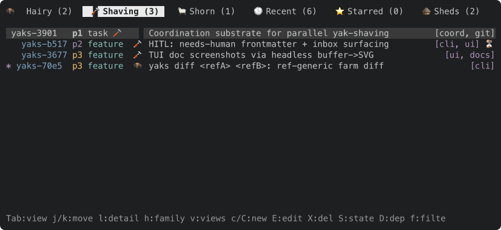
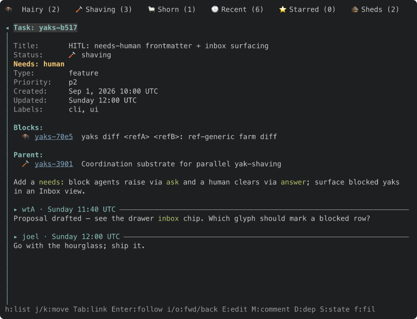
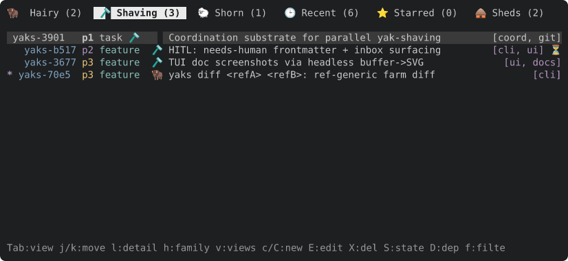
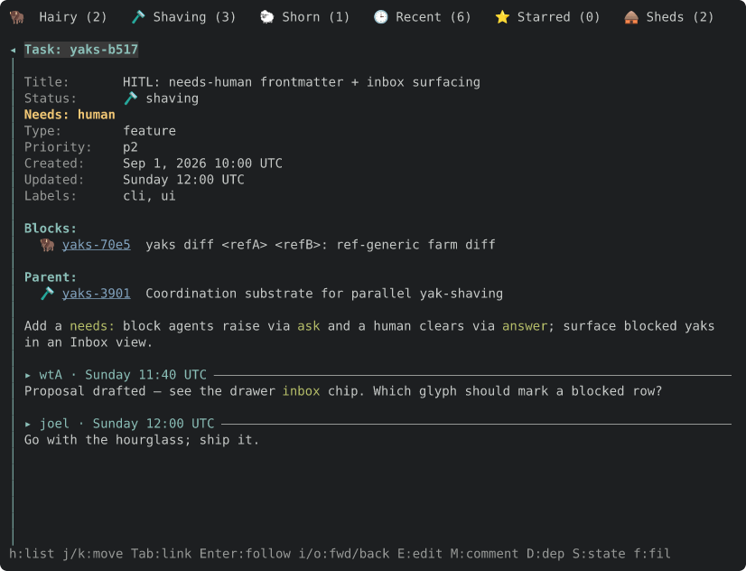
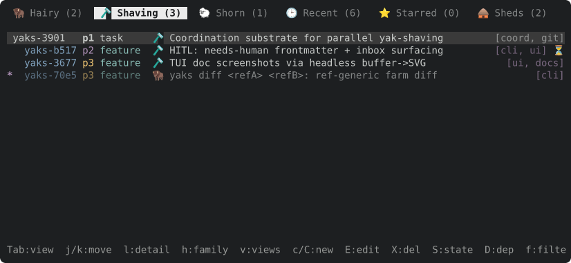
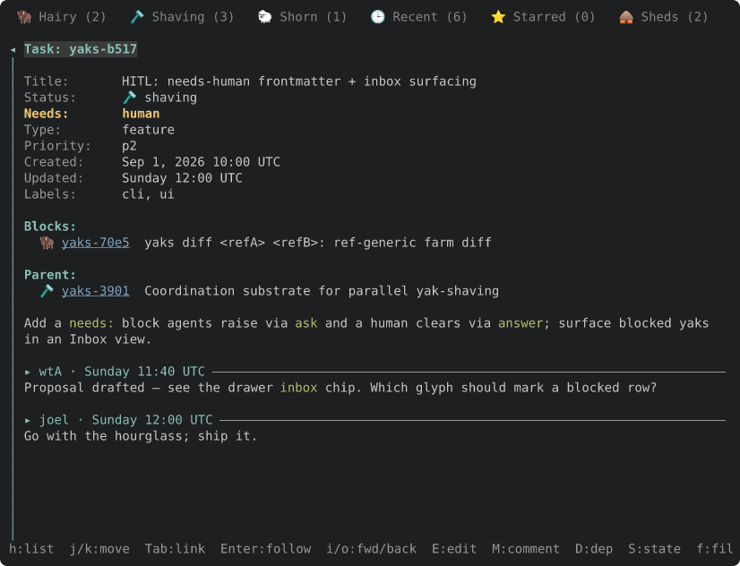
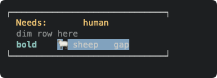
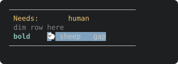

Follow-up to yaks-4305. The image viewer decodes with the `image` crate (png, jpeg, gif, webp), which cannot read svg, so an `.svg` attachment still goes to the OS opener. That is the format most yak evidence uses: toque frames and `docshots` write SVG.

Options to weigh:

- Rasterize with `resvg`/`usvg` (pure Rust) into a `DynamicImage`, then reuse `ImageView` as is. Caveat from `docs/tui.md`: a pure-Rust rasterizer renders our color emoji as tofu, so toque frames would look worse than in a browser. Fonts also need loading (system fonts via `fontdb`) or the text vanishes.
- Keep svg external and make the evidence habit attach a PNG next to the SVG (what the recipe in `docs/tui.md` already does).
- Teach toque to emit a PNG itself, so `yaks attach` gets something the viewer can show. That belongs in toque, not here.

Lean: the third or second, not `resvg` in yaks: this binary stays self-contained and out of rasterization on purpose (see `docs/tui.md`, "Rasterizing an SVG to view it"). Decide before building.

Acceptance: Enter on an `.svg` attachment either opens in the pane or has a documented reason it does not.

---
▸ 2026-10-22T20:47:07Z [delta:Add basic image attachment rendering]

moved: hairy -> shaving

---
▸ 2026-10-22T20:48:08Z [delta:Add basic image attachment rendering]

Claim (yakherd, thread of yaks-4305). Owner: `svg-1`. This is a SPIKE, not a landing: the dependency decision is the human's, so the output is evidence.

Goal: find out what `resvg` (pure Rust) would cost and give us. Rasterize an svg into an `image::DynamicImage` and feed it to the existing `ImageView::open` path (`src/tui/imageview.rs`) so an `.svg` attachment shows in the pane. Build it on a branch behind the question; do not land.

Measure and report: (1) release binary size before and after (`ls -l target/release/yaks`), (2) clean-build time delta, (3) transitive crate count (`cargo tree --prefix none | sort -u | wc -l` before and after), (4) the look: attach as PNG (rasterize with headless Chrome per docs/tui.md) a toque docshot svg (`docs/assets/tui-list.svg`, `tui-detail.svg`) as our viewer renders it, next to how Chrome renders the same svg. Specifically: does text show (font loading via `fontdb` system fonts: what happens with no monospace font?), and the color emoji (tofu?). (5) decode time for a typical frame.

Scope: `Cargo.toml`, `src/tui/imageview.rs` (the decode step only), a test. Out of scope: everything else, docs, skills.

Gate: `cargo test --workspace`. Final message: the numbers, two PNGs, your recommendation (adopt / do not adopt / adopt behind a cargo feature), and the commit SHA.

---
▸ 2026-10-22T20:48:42Z [svg-1]

Start (svg-1) 2026-10-22T20:48:42Z. Farm file: /Users/joel/.local/share/yaks/farms/yaks-539d3edb/.yaks/yaks/yaks/yaks-4e9c.md. Branch svg-1-resvg-spike. Baseline: 225 unique transitive crates.

---
▸ 2026-10-22T20:55:51Z [svg-1]

Decision: rasterize svg with `resvg` (text + system-fonts + memmap-fonts only; default-features off). Rejected: default features (adds raster-images/svgz: +282 KB, +3 crates, and `image` already decodes embedded-raster formats we would never need); `usvg`+`tiny-skia` directly (same dep tree, more glue).

Decision: load system fonts via `fontdb::Database::load_system_fonts` once per process in a `OnceLock` (14 ms, 838 faces here) rather than per open; rejected a lazy per-svg load (the scan, not the parse, dominates a small svg).

Decision: a malformed or empty-pixmap svg returns None from `ImageView::open`, so it falls back to the OS opener like a corrupt png.

Decision: `an_undecodable_image_attachment_falls_back_to_the_os_opener` now uses a corrupt `logo.png` (svg is decodable now, so it no longer meant "undecodable"); added `enter_on_an_svg_attachment_rasterizes_it_into_the_pane` and `a_malformed_svg_attachment_falls_back_to_the_os_opener`.

---
▸ 2026-10-22T20:55:51Z [svg-1]

Spike summary (svg-1; branch svg-1-resvg-spike, one commit, not landed, yak NOT shorn). resvg 0.48.1, default-features=false + text/system-fonts/memmap-fonts. Release build, macOS arm64, separate CARGO_TARGET_DIR per build.
1. Binary: 6,238,736 B before; 9,060,352 B after (+2.82 MB, +45%). With resvg default features: 9,342,480 B.
2. Unique transitive crates (`cargo tree --prefix none | sort -u | wc -l`): 225 before; 263 after (+38); 266 with default features.
   Clean full release build, fresh target dir: 18.6 s wall (2m19 cpu) before; 21.8 s wall (3m12 cpu) after (+3 s wall, +53 s cpu).
3. Look (attached, 826x380 and 826x632, same size as the SVGs): tui-list-chrome / tui-list-resvg-trimmed, tui-detail-chrome / tui-detail-resvg-trimmed, plus tui-list-resvg-nofonts.
   - Text shows with system fonts loaded. The svg's font-family list (`ui-monospace,'SF Mono','DejaVu Sans Mono',Menlo,Consolas,monospace`) resolved to Menlo here (ui-monospace/SF Mono are not matched by fontdb; Menlo is the 4th candidate). Chrome resolves to SF Mono-ish; glyph widths line up, so the frames look the same layout-wise.
   - With NO font database (or only a proportional font such as Helvetica) text is silently dropped: you get background rects and no letters (tui-list-resvg-nofonts.png). No error, no tofu, no fallback. On Linux without DejaVu Mono/fontconfig monospace this would be the result; mitigation would be bundling a font (adds ~0.3-1 MB) or detecting `fonts.len()==0` / no monospace face and falling back to the OS opener.
   - Color emoji: NOT rendered as colour. resvg draws the emoji tabs (🦬 🪒 🐑 🕒 ⭐ 🛖) as small monochrome/silhouette outlines or blank (Starred star is a thin outline; Shaving razor shows as a broken tiny glyph) where Chrome shows full-colour Apple Color Emoji. Not blank squares of tofu here because macOS has the emoji font and fontdb finds it as an outline fallback, but they are visibly worse than Chrome and the pill highlight behind "Shaving" clips the glyph. docs/tui.md's "tofu" claim holds in spirit (degraded), not literally as boxes on this machine; on a box without an emoji font it would be missing glyphs.
   - Other differences: Chrome draws list bg highlight bars slightly wider and bolds "Needs: human"; resvg lost the bold weight on "human" (Menlo bold selected only for some runs) and draws the row highlight identically. Small, but the Chrome render is the truthful one.
   - Default-features vs trimmed renders differ in 791 / 740 pixels out of ~314k / ~523k (antialiasing noise), so trimming costs no fidelity.
4. Decode time, release, median of 10 after font load: tui-list.svg 175 ms, tui-detail.svg 153 ms (no font db: 0.26-0.44 ms, i.e. nearly all of it is text shaping/glyph outlining with fonts). One-time system font scan: 14 ms (838 faces). So Enter on an svg blocks the UI thread ~170-190 ms the first time; fine for evidence frames, would matter for a large svg (the 32 MiB cap is far too high for svg).

Gate: `cargo test --workspace` green (710 lib + all integration tests, 0 failed), run on the final tree. `cargo fmt -- <files>` only; src/actor.rs restored.

Recommendation: do not adopt as default; if the human wants svg in the viewer anyway, adopt behind a cargo feature (default off) with a fallback to the OS opener when no monospace face is found. Reasons: +2.8 MB (+45%) and +38 crates for a viewer whose main svg input (toque frames) renders worse than a browser (emoji, weight), silently loses all text without a font, and the existing lean (toque emits PNG / attach PNG next to SVG) gives a perfect image at zero binary cost.

---
▸ 2026-10-22T20:56:02Z [svg-1]

Correction to the summary note after re-reading the PNG pairs side by side (the numbers stand; two "look" lines were loose):
- Not verified: which font Chrome picked (I did not query it), and my "bold lost on human" guess was wrong. The real differences: (a) resvg ignores `opacity` on `<tspan>` (class `.s0{opacity:.6}`), so dimmed tabs/rows (Hairy, Shorn, the 4th list row) are full brightness; (b) in tui-detail, `Needs: human` has "human" jammed right after "Needs:" instead of at the x=136 value column, i.e. a per-tspan x position was not honoured for that bold run; (c) emoji are small monochrome/outline glyphs, not colour, and the Shaving pill clips its razor. Text itself, layout and colours otherwise match Chrome.
- Font: resvg resolved the family list to Menlo (queried via fontdb: `ui-monospace`/`SF Mono` not matched by name, Menlo matched).

---
▸ 2026-10-22T20:56:27Z [delta:Add basic image attachment rendering]

Spike result (yakherd, from svg-1's report; not landed). Commit a703b64 on branch `svg-1-resvg-spike` in svg-1's clone (thread ksQQQTmKmfXeRfyO736_R3BpP5LOACmuQpIBxBCA0aLJyrhJPreUvVwLftHG); `cargo test --workspace` passes there. I have not re-run it on main because I am not merging it.

- Cost of `resvg` 0.48.1, default features off, `text`+`system-fonts`+`memmap-fonts`: release binary 6.24 MB to 9.06 MB (+2.82 MB, +45%); 225 to 263 unique crates (+38); clean release build 18.6 s to 21.8 s wall (2m19 to 3m12 cpu).
- Look: text shows only if a system monospace font is found (Menlo here); with none, all text is silently dropped and you get blank rectangles. Emoji are monochrome/outline, not color. `opacity` on `<tspan>` is ignored, so dimmed text is full brightness. One layout oddity in `tui-detail` (`Needs: human`), cause not investigated.
- Speed: 150-180 ms per toque frame, almost all of it text shaping, so Enter on an svg blocks the UI about 170-190 ms.

Recommendation: do not adopt by default. The svgs we attach most (toque frames) look worse than in Chrome and render blank on a box with no monospace font. Cheaper: have toque or the attach step emit a PNG beside the svg (a perfect image, zero binary cost).

---
▸ 2026-10-22T20:56:27Z [delta:Add basic image attachment rendering]

asked: needs human

Decision for you: how should svg attachments display?

- (a) Don't add `resvg`. Keep svg opening externally, and make evidence a PNG next to the svg (a toque `render_to_png`, or `yaks attach` accepting a pair). My lean, and svg-1's. It costs nothing in the binary and the picture is the real one.
- (b) Adopt `resvg` behind a cargo feature that is off by default, with a fallback to the OS opener when no monospace font is found. Same cost (+2.8 MB, +38 crates) only for builds that opt in; the toque frames still look worse than Chrome.
- (c) Adopt it by default. Not recommended.

If (a): I will close this yak with a note and file the toque/attach PNG yak (toque is a separate repo, so that is yours to point me at). If (b): the spike commit is a working base; it needs the feature gate and the font fallback. Branch `svg-1-resvg-spike` stays in svg-1's clone until you decide.

---
▸ 2026-10-22T21:01:42Z [Joel Webber]

On `resvg`, can we not just render them to PNGs and cache the results? I'm not sure I've ever seen a system without a monospaced font, but if we absolutely must, can't we just embed a standard one? That would actually be really helpful for `toque`, where we always know we need it.

---
▸ 2026-10-22T21:49:02Z [delta:Add basic image attachment rendering]

picked up

Read your answer: render svg to PNG once, cache the result, and embed a standard monospace font if a system one cannot be assumed (which would also help toque, where it is always needed). I like it; it removes both svg-1's objections that were fixable (silent text loss without a font; a 170 ms stall on every open). I am sending svg-1 a measurement-only follow-up on the two things the spike did not settle (color emoji; the embedded font). One more question follows on where it should live.

---
▸ 2026-10-22T21:49:02Z [delta:Add basic image attachment rendering]

asked: needs human

Your render-to-PNG, cache and embedded-font direction works, and one observation turns a choice into a simple one: yaks already depends on toque (a normal dependency in Cargo.toml, not a dev one). So the rasterizer plus the embedded font can live in toque once, as `toque::svg_to_png` behind a cargo feature, and yaks calls it. That gives toque a deterministic `render_to_png` for evidence (no system fonts at all), and the viewer a way to show any svg.

Questions:
1. Where does it live: toque (my lean) or yaks directly? toque is its own repo (github.com/joelgwebber/toque), so I would need it attached as a Delta worktree to edit it, and yaks would bump the pinned commit (`cargo update -p toque`).
2. The binary-size cost is the same either way (the spike measured +2.8 MB and +38 crates for `resvg`, plus the font); you did not object to it, so I am taking that as accepted unless you say otherwise. The embedded fonts add on top: a monospace font is a few hundred KB, and color emoji needs a subset, because toque frames use only a dozen or so emoji. I have asked svg-1 to measure both.
3. Where to cache the PNGs: under `$XDG_CACHE_HOME/yaks/` next to the existing per-farm UI cache (`src/tui/cache.rs`), keyed by a hash of the svg's content plus the render size. Never in the farm, never committed. OK? The first open of an svg would still take the 170 ms; I would not pre-render in the background in this pass.

---
▸ 2026-10-22T21:57:09Z [svg-1]

Follow-up spike (svg-1), commit 22b3849 on svg-1-resvg-spike (on top of a703b64); not landed, not shorn. Measured on the final tree; `cargo test --workspace` green (711 lib tests).

Finding 1 (color emoji with system fonts): with `raster-images` on and system fonts only (A), emoji are STILL monochrome outlines; the fix is real: load /System/Library/Fonts/Apple Color Emoji.ttc into fontdb BEFORE load_system_fonts (B): emoji then render in color (sbix) and the whole-node-tofu from .LastResort does not occur. Side effect: with Apple Color Emoji in the db the render time drops from 162 ms to 13 ms (fewer fallback scans). Rendering is still a different artwork from Chrome (Apple's glyphs but placed on the text baseline slightly differently, bison/sheep drawn ~2 px higher). Attached: tui-{list,detail}-B-sys-appleemoji-first.png.

Finding 2 (oddities are in the toque SVG, not resvg bugs): (a) `opacity:.6` as a CSS class on <tspan>: resvg honours only presentation attributes it understands on text spans; `fill-opacity:.6` in the same class works. (b) `Needs: human` x-position: the SVG sets `white-space:pre` in a <style> rule; resvg ignores that CSS property and collapses the run of spaces in `Needs:       human`. Adding `xml:space="preserve"` on <text> restores the column. Both fixed by a 2-line change in toque's SVG writer (emit `xml:space="preserve"` on <text>, and `fill-opacity` instead of `opacity` for dim) which Chrome also accepts. With those patched in a copy, the resvg render differs from Chrome by 0.5% mean gray difference on tui-detail (antialiasing, emoji artwork). Attached: tui-{list,detail}-F-final-patched.png.

Finding 3 (embedded fonts, system fonts OFF, fontdb holds only what we embed): text, bold, box drawing, arrows and bullets all render; layout matches Chrome. Chosen: DejaVu Sans Mono (Bitstream Vera license + public-domain changes; permissive, needs the license text shipped: assets/fonts/DejaVu-LICENSE.txt). Alternatives checked against the glyphs the 22 docs/assets SVGs use: JetBrainsMono (OFL) lacks U+2610 U+2611 U+270E U+2726; Anonymous Pro lacks arrows and 16 others; Menlo/SF Mono are not redistributable. Subset (pyftsubset from fontTools 4.61.1 under pyenv 3.11.13, already installed, nothing installed by me): regular 9,872 B, bold 9,944 B, from 335,068 / 318,392 B raw. Emoji: Noto Color Emoji (OFL; 10.6 MB CBDT raw, 4.8 MB COLRv1 raw) subset to the 8 emoji: 15,916 B (CBDT) and 14,468 B (COLRv1); both render in color and differ from each other by <0.4% of pixels. Chose COLRv1 (smaller, vector: needs no `raster-images`, so no extra crates); attached C/D frames in /tmp only, final frames attached: tui-{list,detail}-F-final.png.

Coverage: docs/assets/*.svg use 38 distinct non-ASCII codepoints (7 box/block: ─ │ ┃ ┼ ▀ ▄ ▎; 8 emoji: ⏳ ⭐ 🐑 🕒 🖼 🛖 🦬 🪒; 23 others: arrows, bullets, ✎ ☐ ☑ ✗ ✦ etc.), 120 distinct codepoints including ASCII. A subset covering exactly those is feasible and done.

Binary (separate full release build each, fresh target dirs): system-fonts build 9,060,352 B; mono-only embedded 9,060,096 B (so embedding replaces fontdb's system scan at ~0 net: +~20 KB of font data offset by dropping fs/fontconfig deps, 262 crates); + COLRv1 emoji 9,076,608 B (+16,512 B vs mono-only); + CBDT emoji with raster-images 9,342,112 B (+282 KB, 265 crates). Baseline without resvg: 6,238,736 B. Clean build 20.8-21.2 s wall for each.

Render time (release, median of 7, embedded fonts, no system scan): tui-list 3.0 ms, tui-detail 4.6 ms (was 160/140 ms with system fonts); first call incl. font db setup ~8 ms. So Enter on an svg is effectively instant and no longer needs caching for latency, only to avoid re-decoding on every open.

Decision: embed fonts rather than load system fonts (rejected: system fonts as primary, because it renders blank on a font-less host, takes 160 ms, and picks a different face per machine; a system-font fallback is not needed since the subset covers every toque glyph).

Decision: COLRv1 over CBDT for the emoji (rejected: CBDT, +282 KB of raster decoding crates for the same look).

Decision: ship DejaVu (Bitstream) and Noto Emoji (OFL) license texts beside the fonts.

Remaining differences from Chrome: emoji artwork is Noto not Apple (Chrome on macOS uses Apple's); glyphs are DejaVu Sans Mono not SF Mono/Menlo, so letterforms differ but advance width is the same cell grid; the `opacity`/`white-space:pre` issues above until toque's SVG writer is changed; any non-covered codepoint (e.g. CJK, a different emoji) renders blank, since the subset is exactly the docs' set, so a real build should subset from a wider range (all of Box Drawing, Arrows, Geometric Shapes, and the emoji a yak may attach) at some KB cost.

---
▸ 2026-10-22T21:57:46Z [delta:Add basic image attachment rendering]

Spike round 2 (yakherd, from svg-1's report; not landed). Commit 22b3849 on `svg-1-resvg-spike` (on top of a703b64), in svg-1's clone; `cargo test --workspace` passes there (711 lib tests incl. one rendering text and a color emoji from embedded fonts alone). I have not merged or re-run it on main.

This reverses round 1's verdict: the two "look" objections were fixable.

- Emoji: `raster-images` alone did not give color. Pre-loading the platform emoji font before `load_system_fonts()` did. With embedded fonts, color emoji work with no system fonts. Not seen: the `.LastResort` tofu a third party reported (svg-1 got outline glyphs on this Mac).
- The two oddities are in toque's SVG, not resvg bugs: `white-space:pre` in a `<style>` rule is ignored by resvg (fix: `xml:space="preserve"` on `<text>`), and CSS `opacity` on `<tspan>` is ignored (fix: `fill-opacity`, which works in both). Both are two-line changes in toque's svg writer; patched in a copy, `tui-detail` differs from Chrome by 0.5% mean gray.
- Embedded fonts, subset with `pyftsubset` (already installed; nothing installed): DejaVu Sans Mono regular+bold (9.9 KB each, Bitstream Vera license) and Noto Color Emoji COLRv1 (14.5 KB, OFL). The subset covers exactly the 38 non-ASCII codepoints in docs/assets/*.svg; anything else renders blank, so a real build needs a wider subset (all of Box Drawing, Arrows, Geometric Shapes, a broader emoji set). CBDT instead of COLRv1 costs +282 KB and 3 more crates for the same look.
- Cost: binary 6,238,736 B without resvg; 9,076,608 B with resvg + embedded mono + COLRv1 emoji (+2.84 MB); 262 crates vs 225; clean build about 21 s vs 18.6 s. Embedding fonts is free versus the system-font build (dropping the font scan offsets it).
- Speed: 3.0 ms (tui-list) and 4.6 ms (tui-detail) per render, versus 160 ms with system fonts, so the cache is no longer needed for latency (it would only skip re-decoding).
- Still differs from Chrome: Noto emoji art instead of Apple's; DejaVu letterforms instead of Menlo/SF Mono (same cell grid).

Open for the human (asked on this yak): the home (toque vs yaks), the cache, and what the font subset should cover. The spike also carried a stray `src/actor.rs` change (a `cargo fmt` reformat): not part of this work, never to be merged.

---
▸ 2026-10-22T22:12:53Z [delta:Add basic image attachment rendering]

Recorded by the yakherd from the human's comments in the Delta thread (not typed into this yak). Direction: "Groovy!" (render to PNG, cache, embed a font). toque attached ("Got it, just mapped that in for you"). Binary cost: "Oh yeah, that's fine. Binaries are getting huge these days anyway." Cache in `$XDG_CACHE_HOME/yaks/` keyed by content hash and render size: "Yup, that sounds perfect." Wider font subset: "Maybe a follow-up yak for this?" (filed as yaks-4f4d).

---
▸ 2026-10-22T22:12:53Z [delta:Add basic image attachment rendering]

picked up

Home is toque behind a cargo feature; yaks consumes it. Briefing a worker for the toque side now.

---
▸ 2026-10-22T22:13:34Z [delta:Add basic image attachment rendering]

Claim (yakherd, thread of yaks-4305), reshaped by the human's answers: Owner of the toque half: `toque-1`. The yak is two pieces in two repos; this claim is piece 1.

**Piece 1 (toque, worktree `toque`, branch main):** a rasterizer with embedded fonts, behind a cargo feature `png` (default OFF so toque stays light for users who only want text and svg snapshots).
- `toque::rasterize_svg(svg: &[u8]) -> Option<Raster>` with `Raster { width: u32, height: u32, rgba: Vec<u8> }` (straight RGBA8), and `toque::svg_to_png(svg: &[u8]) -> Option<Vec<u8>>`, and `toque::render_to_png(app, w, h) -> Option<Vec<u8>>` (render_to_svg then svg_to_png). No `image` crate dependency in toque: yaks wraps `Raster` itself.
- Fonts are embedded (no system fonts at all, so a frame renders the same on every machine): the five files already committed under `assets/fonts/` (DejaVu Sans Mono regular + bold, Noto Color Emoji COLRv1, subset to today's glyphs; licenses beside them). The wider subset is a separate yak (yaks-4f4d); structure the code so swapping the font files needs no code change.
- The two svg writer fixes svg-1 found, ALWAYS on (not feature-gated; they make Chrome and resvg agree): `xml:space="preserve"` on each `<text>` (resvg ignores `white-space:pre` from CSS; keep the CSS rule too, Chrome needs it), and `fill-opacity:.6` instead of `opacity:.6` for DIM (resvg ignores `opacity` on `<tspan>`; Chrome honours both).
- Proof the writer fix does not regress Chrome: rasterize one frame with headless Chrome before and after (recipe in the yaks repo's docs/tui.md) and say that they match.
- Source for the resvg usage and the font loading: the spike commit `22b384949066a86781841ed0d49780c080cc4b36` in the `yaks` worktree (`git -C <yaks worktree> show 22b3849:src/tui/imageview.rs`: `embedded_fonts`, `rasterize_svg`), resvg 0.48 with `text` only (the spike measured that COLRv1 emoji need no `raster-images`).
- Gate: `cargo test` and `cargo test --features png` in toque. Tests: an svg with ASCII, a box-drawing char and a color emoji rasterizes to non-blank pixels, including a pixel that is not gray (proves color emoji), with no system fonts available (the test must not depend on the machine's fonts: build with the embedded db only); `render_to_png` output starts with the PNG magic; the DIM and spacing fixes appear in `render_to_svg` output.
- README: a short section on the `png` feature.

**Piece 2 (yaks, after piece 1 is published):** `ImageView` decodes svg through `toque::rasterize_svg`; a PNG cache under `$XDG_CACHE_HOME/yaks/` keyed by content hash and render size (human-approved); drop the spike's own resvg dependency (it was never merged). Needs toque pushed to origin (yaks pins it as a git dependency) and `cargo update -p toque`: the human's call to push. I do piece 2 myself.

---
▸ 2026-10-22T22:14:10Z [toque-1]

Start (toque-1) 2026-10-22T22:14:10Z. Farm file: /Users/joel/.local/share/yaks/farms/yaks-539d3edb/.yaks/yaks/yaks/yaks-4e9c.md. Working in the toque worktree /Users/joel/src/toque/.delta/worktrees/xg3wm6rndqhj/toque.

---
▸ 2026-10-22T22:17:07Z [toque-1]

Piece 1 (toque-1): toque commit 240eb5f on toque main (not pushed). `png` feature (default off): `rasterize_svg`, `svg_to_png`, `render_to_png`, `Raster`, in `src/raster.rs`; writer fixes always on in `src/svg.rs`.

Chrome before/after of a throwaway toque frame (box drawing, `Needs:       human`, DIM row, bold, 🐑 on a blue bg): `magick compare -metric AE` = 383 px of 45,568; the diff box is 101x12 at the DIM row only, max per-channel difference 2/255 (`-fuzz 2%` gives 0). So Chrome renders the same, except `fill-opacity` blends the dim text a hair differently than `opacity`. Attached: chrome-before-writer-fix.png, chrome-after-writer-fix.png, resvg-after-writer-fix.png (the resvg render now keeps the `Needs:       human` column and the dim row; before the fix resvg collapsed the spaces and ignored dim).

Updated tests: none existed that asserted the old strings (grep for `opacity`/`white-space` in src and README found only the new tests and doc comments), so only two tests were added: `text_rows_preserve_spaces_for_both_chrome_and_resvg`, `dim_uses_fill_opacity`. Both failed before the fix.

Decision: PNG encoding via resvg's re-exported `tiny_skia::Pixmap::encode_png` (tiny-skia's `png-format` is a default feature and resvg keeps it on with default-features off; no extra feature needed, no `image` dep). Rejected: a hand-rolled encoder.

Decision: the color-emoji test draws 🐑 and ⭐ and asserts a non-gray pixel. Noto's 🐑 is white/gray (max channel spread 4 over the glyph), so 🐑 alone cannot prove color; ⭐ (in the subset) does. The test also asserts the db holds exactly the 3 embedded faces.

Decision: the test frame uses ─│─ not ┌┐: the subset has U+2500/2502/2503/253c only, no corners, so toque frames with box corners (┌ └ ┐ ┘, rounded) render those blank today (visible as missing corners in resvg-after-writer-fix.png). This is for yaks-4f4d (wider subset) and is the one surprising thing: the claim said the subset covers the docs' glyphs, but Chrome-vs-resvg of my frame shows missing corners; the docs/assets svgs use only lines. 

Decision: `rasterize_svg` returns `Raster` with `take_demultiplied` straight RGBA; `render_pixmap` is shared by it and `svg_to_png`, fontdb built once in a `OnceLock`.

---
▸ 2026-10-22T22:17:17Z [toque-1]

Correction (toque-1): my last note said the docs/assets svgs use only lines. Wrong for toque's own `docs/assets/yaks-session-{1,2,3}.svg`: they contain box corners/joins (┌ ┐ └ ┘ ├ ┤ etc.; grep counts 1-33 per glyph). The embedded subset (spiked against yaks's 22 docs/assets, not toque's 3) has no corners or joins, so `render_to_png` of those frames draws them blank. Attachments are not affected by this commit, but yaks-4f4d (wider subset) should be treated as needed, not optional, before the viewer shows toque frames: include all of Box Drawing U+2500-257F.

---
▸ 2026-10-22T22:19:01Z [delta:Add basic image attachment rendering]

Piece 1 done (yakherd, verified): toque `main` in the thread's toque worktree is at 240eb5f (fonts 4108e52, then toque-1's rasterizer, a clean fast-forward). NOT pushed to origin. I re-ran both gates myself: `cargo test` 13 lib + 1 doc, and `cargo test --features png` 16 lib + 1 doc, all pass. Read src/raster.rs and the src/svg.rs diff: matches the claim (`xml:space="preserve"` on each `<text>`; `fill-opacity:.6` for DIM; CSS rule kept for Chrome). toque-1 compared Chrome before and after the writer change: 383 of 45,568 px differ, all in the DIM row, max 2/255 per channel, 0 with `-fuzz 2%`.

Correction to a worker finding: toque-1 wrote that toque's own docs/assets use box corners. I counted U+2500-257F in toque's `docs/assets/*.svg` and found only U+2502; the yaks repo's docs use U+2500, 2502, 2503 and 253c. The gap is real regardless: the embedded subset has only those four box glyphs, so `┌ ┐ └ ┘ ├ ┤ ┬ ┴` and the rounded corners (every ratatui `Block` border) render blank in a toque PNG. yaks-4f4d (wider subset) must land before toque is published or yaks shows any app's frames.

Piece 2 (yaks: `ImageView` through `toque::rasterize_svg`, the XDG PNG cache, drop the spike's resvg) cannot be committed until toque is on origin: yaks pins it as a git dependency and a path dependency must never be committed. That push is the human's call (asked).

---
▸ 2026-10-22T22:19:01Z [delta:Add basic image attachment rendering]

asked: needs human

Piece 1 (toque) is done and verified in the toque worktree (240eb5f, not pushed). Two things for you:

1. Order. yaks consumes toque as a git dependency, so piece 2 (the svg viewer in yaks) is blocked until toque is pushed. Before that, the font subset needs widening (yaks-4f4d): right now every box-drawing corner and join renders blank, which any ratatui `Block` border uses. My lean: do yaks-4f4d first (it is mostly regenerating the font files plus a script, small), push toque once, then do piece 2. Alternative: push toque now and widen later, accepting blank corners in the viewer until then.
2. Pushing toque to `origin/main` is yours: say "push toque" and I will (or push it yourself).

---
▸ 2026-10-23T01:45:26Z [delta:Add basic image attachment rendering]

verify: `cargo test --workspace` -> PASS (exit 0)

---
▸ 2026-10-23T01:46:27Z [delta:Add basic image attachment rendering]

Piece 2 done (yakherd): committed in the thread clone as 67122a0 (on ea538c8); not pushed to the user's `main`. toque was pushed to origin by the human's go-ahead ("push the toque changes, main is fine"): origin/main is 240eb5f; yaks pins it (Cargo.lock) with `features = ["png"]`.

`yaks verify yaks-4e9c`: PASS (`cargo test --workspace`, 732 in the bin). With my own release build: an attached `tui-detail.svg` opens in the viewer as `image 826x632`, written to `$XDG_CACHE_HOME/yaks/svg/1-<hash>.png`, and the second open reads the cache. Viewed the cached PNG next to Chrome's render of the same svg: text, color emoji, dimming and the `Needs:` column all match; differences are only the font (DejaVu vs Menlo) and Noto vs Apple emoji art. The box-drawing rule under the title is missing in the resvg render and the separators in the comment headers are short: the embedded subset has no U+2500-ish coverage beyond four glyphs (yaks-4f4d).

What changed: `ImageView` and `build_inline` decode through `decode_attachment`, which sends `.svg` (up to 4 MiB) through `toque::svg_to_png` and a content-addressed PNG cache (`cache::svg_png_path_in`, `SVG_RENDER_GEN` bumped when toque's output changes); a malformed svg falls back to the OS opener. The cache is off under `cargo test`. Docs: `docs/tui.md` (a new "Svg attachments" paragraph; the Chrome recipe is now "the faithful lever, not the only one"), `AGENTS.md`, the `?` help line (snapshot unchanged).

Decision (yakherd): the cache key is a hash of the svg's CONTENT only, plus a render generation constant, not the file path or mtime, so an edited svg is a new file and the same frame attached to two yaks shares one PNG. Rejected: keying on path+mtime (duplicates, and an in-place edit within one mtime tick is stale).

Decision: no size limit on the cache directory (a PNG per distinct svg ever opened; a frame is ~70 KB). If it grows noticeably, prune by age: a follow-up, not now.

Decision: svg inside an inline-image paragraph also works (same decoder), since `image_slot` reads dimensions with `image::ImageReader`, which cannot read an svg: so an svg stays a link row inline even though the viewer opens it. Not fixed here; noted for yaks-0bf0 follow-up.

Not verified: that the shared cache behaves with two yaks processes writing the same file at once (a plain write: a torn file would fail decode and re-render next time; not exercised).

---
▸ 2026-10-23T01:46:28Z [delta:Add basic image attachment rendering]

moved: shaving -> shorn

---
▸ 2026-10-25T21:20:22Z [delta:Add basic image attachment rendering]

picked up

Already done: toque pushed (240eb5f), svg viewer committed in the thread clone. Clearing the stale flag.
