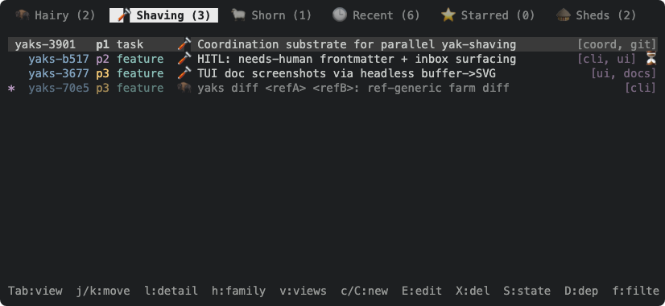
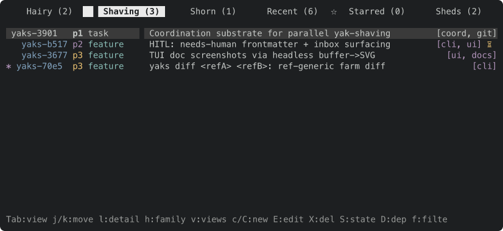
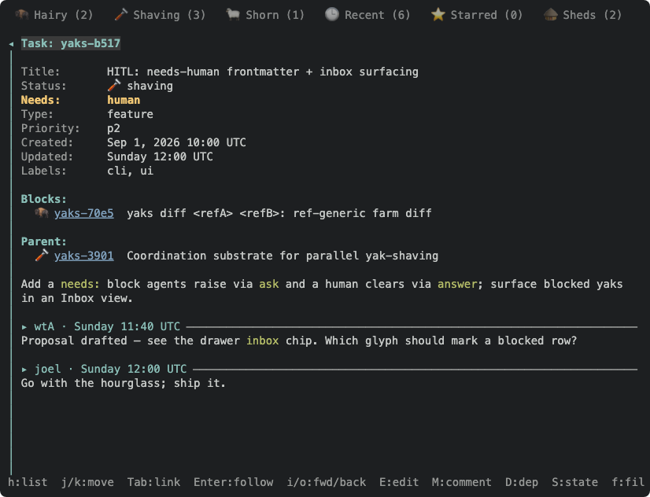
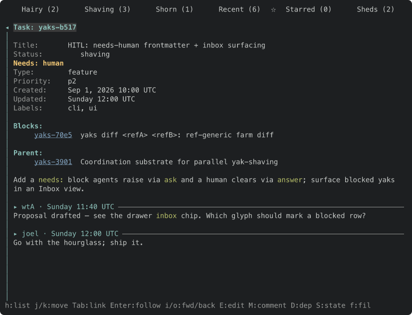
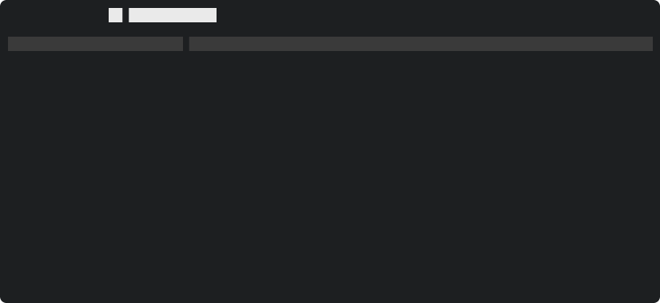

Follow-up to yaks-4305. The image viewer decodes with the `image` crate (png, jpeg, gif, webp), which cannot read svg, so an `.svg` attachment still goes to the OS opener. That is the format most yak evidence uses: toque frames and `docshots` write SVG.

Options to weigh:

- Rasterize with `resvg`/`usvg` (pure Rust) into a `DynamicImage`, then reuse `ImageView` as is. Caveat from `docs/tui.md`: a pure-Rust rasterizer renders our color emoji as tofu, so toque frames would look worse than in a browser. Fonts also need loading (system fonts via `fontdb`) or the text vanishes.
- Keep svg external and make the evidence habit attach a PNG next to the SVG (what the recipe in `docs/tui.md` already does).
- Teach toque to emit a PNG itself, so `yaks attach` gets something the viewer can show. That belongs in toque, not here.

Lean: the third or second, not `resvg` in yaks: this binary stays self-contained and out of rasterization on purpose (see `docs/tui.md`, "Rasterizing an SVG to view it"). Decide before building.

Acceptance: Enter on an `.svg` attachment either opens in the pane or has a documented reason it does not.

---
▸ 2026-10-22T20:47:07Z [delta:Add basic image attachment rendering]

moved: hairy -> shaving

---
▸ 2026-10-22T20:48:08Z [delta:Add basic image attachment rendering]

Claim (yakherd, thread of yaks-4305). Owner: `svg-1`. This is a SPIKE, not a landing: the dependency decision is the human's, so the output is evidence.

Goal: find out what `resvg` (pure Rust) would cost and give us. Rasterize an svg into an `image::DynamicImage` and feed it to the existing `ImageView::open` path (`src/tui/imageview.rs`) so an `.svg` attachment shows in the pane. Build it on a branch behind the question; do not land.

Measure and report: (1) release binary size before and after (`ls -l target/release/yaks`), (2) clean-build time delta, (3) transitive crate count (`cargo tree --prefix none | sort -u | wc -l` before and after), (4) the look: attach as PNG (rasterize with headless Chrome per docs/tui.md) a toque docshot svg (`docs/assets/tui-list.svg`, `tui-detail.svg`) as our viewer renders it, next to how Chrome renders the same svg. Specifically: does text show (font loading via `fontdb` system fonts: what happens with no monospace font?), and the color emoji (tofu?). (5) decode time for a typical frame.

Scope: `Cargo.toml`, `src/tui/imageview.rs` (the decode step only), a test. Out of scope: everything else, docs, skills.

Gate: `cargo test --workspace`. Final message: the numbers, two PNGs, your recommendation (adopt / do not adopt / adopt behind a cargo feature), and the commit SHA.

---
▸ 2026-10-22T20:48:42Z [svg-1]

Start (svg-1) 2026-10-22T20:48:42Z. Farm file: /Users/joel/.local/share/yaks/farms/yaks-539d3edb/.yaks/yaks/yaks/yaks-4e9c.md. Branch svg-1-resvg-spike. Baseline: 225 unique transitive crates.

---
▸ 2026-10-22T20:55:51Z [svg-1]

Decision: rasterize svg with `resvg` (text + system-fonts + memmap-fonts only; default-features off). Rejected: default features (adds raster-images/svgz: +282 KB, +3 crates, and `image` already decodes embedded-raster formats we would never need); `usvg`+`tiny-skia` directly (same dep tree, more glue).
Decision: load system fonts via `fontdb::Database::load_system_fonts` once per process in a `OnceLock` (14 ms, 838 faces here) rather than per open; rejected a lazy per-svg load (the scan, not the parse, dominates a small svg).
Decision: a malformed or empty-pixmap svg returns None from `ImageView::open`, so it falls back to the OS opener like a corrupt png.
Decision: `an_undecodable_image_attachment_falls_back_to_the_os_opener` now uses a corrupt `logo.png` (svg is decodable now, so it no longer meant "undecodable"); added `enter_on_an_svg_attachment_rasterizes_it_into_the_pane` and `a_malformed_svg_attachment_falls_back_to_the_os_opener`.

---
▸ 2026-10-22T20:55:51Z [svg-1]

Spike summary (svg-1; branch svg-1-resvg-spike, one commit, not landed, yak NOT shorn). resvg 0.48.1, default-features=false + text/system-fonts/memmap-fonts. Release build, macOS arm64, separate CARGO_TARGET_DIR per build.
1. Binary: 6,238,736 B before; 9,060,352 B after (+2.82 MB, +45%). With resvg default features: 9,342,480 B.
2. Unique transitive crates (`cargo tree --prefix none | sort -u | wc -l`): 225 before; 263 after (+38); 266 with default features.
   Clean full release build, fresh target dir: 18.6 s wall (2m19 cpu) before; 21.8 s wall (3m12 cpu) after (+3 s wall, +53 s cpu).
3. Look (attached, 826x380 and 826x632, same size as the SVGs): tui-list-chrome / tui-list-resvg-trimmed, tui-detail-chrome / tui-detail-resvg-trimmed, plus tui-list-resvg-nofonts.
   - Text shows with system fonts loaded. The svg's font-family list (`ui-monospace,'SF Mono','DejaVu Sans Mono',Menlo,Consolas,monospace`) resolved to Menlo here (ui-monospace/SF Mono are not matched by fontdb; Menlo is the 4th candidate). Chrome resolves to SF Mono-ish; glyph widths line up, so the frames look the same layout-wise.
   - With NO font database (or only a proportional font such as Helvetica) text is silently dropped: you get background rects and no letters (tui-list-resvg-nofonts.png). No error, no tofu, no fallback. On Linux without DejaVu Mono/fontconfig monospace this would be the result; mitigation would be bundling a font (adds ~0.3-1 MB) or detecting `fonts.len()==0` / no monospace face and falling back to the OS opener.
   - Color emoji: NOT rendered as colour. resvg draws the emoji tabs (🦬 🪒 🐑 🕒 ⭐ 🛖) as small monochrome/silhouette outlines or blank (Starred star is a thin outline; Shaving razor shows as a broken tiny glyph) where Chrome shows full-colour Apple Color Emoji. Not blank squares of tofu here because macOS has the emoji font and fontdb finds it as an outline fallback, but they are visibly worse than Chrome and the pill highlight behind "Shaving" clips the glyph. docs/tui.md's "tofu" claim holds in spirit (degraded), not literally as boxes on this machine; on a box without an emoji font it would be missing glyphs.
   - Other differences: Chrome draws list bg highlight bars slightly wider and bolds "Needs: human"; resvg lost the bold weight on "human" (Menlo bold selected only for some runs) and draws the row highlight identically. Small, but the Chrome render is the truthful one.
   - Default-features vs trimmed renders differ in 791 / 740 pixels out of ~314k / ~523k (antialiasing noise), so trimming costs no fidelity.
4. Decode time, release, median of 10 after font load: tui-list.svg 175 ms, tui-detail.svg 153 ms (no font db: 0.26-0.44 ms, i.e. nearly all of it is text shaping/glyph outlining with fonts). One-time system font scan: 14 ms (838 faces). So Enter on an svg blocks the UI thread ~170-190 ms the first time; fine for evidence frames, would matter for a large svg (the 32 MiB cap is far too high for svg).
Gate: `cargo test --workspace` green (710 lib + all integration tests, 0 failed), run on the final tree. `cargo fmt -- <files>` only; src/actor.rs restored.
Recommendation: do not adopt as default; if the human wants svg in the viewer anyway, adopt behind a cargo feature (default off) with a fallback to the OS opener when no monospace face is found. Reasons: +2.8 MB (+45%) and +38 crates for a viewer whose main svg input (toque frames) renders worse than a browser (emoji, weight), silently loses all text without a font, and the existing lean (toque emits PNG / attach PNG next to SVG) gives a perfect image at zero binary cost.

---
▸ 2026-10-22T20:56:02Z [svg-1]

Correction to the summary note after re-reading the PNG pairs side by side (the numbers stand; two "look" lines were loose):
- Not verified: which font Chrome picked (I did not query it), and my "bold lost on human" guess was wrong. The real differences: (a) resvg ignores `opacity` on `<tspan>` (class `.s0{opacity:.6}`), so dimmed tabs/rows (Hairy, Shorn, the 4th list row) are full brightness; (b) in tui-detail, `Needs: human` has "human" jammed right after "Needs:" instead of at the x=136 value column, i.e. a per-tspan x position was not honoured for that bold run; (c) emoji are small monochrome/outline glyphs, not colour, and the Shaving pill clips its razor. Text itself, layout and colours otherwise match Chrome.
- Font: resvg resolved the family list to Menlo (queried via fontdb: `ui-monospace`/`SF Mono` not matched by name, Menlo matched).

---
▸ 2026-10-22T20:56:27Z [delta:Add basic image attachment rendering]

Spike result (yakherd, from svg-1's report; not landed). Commit a703b64 on branch `svg-1-resvg-spike` in svg-1's clone (thread ksQQQTmKmfXeRfyO736_R3BpP5LOACmuQpIBxBCA0aLJyrhJPreUvVwLftHG); `cargo test --workspace` passes there. I have not re-run it on main because I am not merging it.

- Cost of `resvg` 0.48.1, default features off, `text`+`system-fonts`+`memmap-fonts`: release binary 6.24 MB to 9.06 MB (+2.82 MB, +45%); 225 to 263 unique crates (+38); clean release build 18.6 s to 21.8 s wall (2m19 to 3m12 cpu).
- Look: text shows only if a system monospace font is found (Menlo here); with none, all text is silently dropped and you get blank rectangles. Emoji are monochrome/outline, not color. `opacity` on `<tspan>` is ignored, so dimmed text is full brightness. One layout oddity in `tui-detail` (`Needs: human`), cause not investigated.
- Speed: 150-180 ms per toque frame, almost all of it text shaping, so Enter on an svg blocks the UI about 170-190 ms.

Recommendation: do not adopt by default. The svgs we attach most (toque frames) look worse than in Chrome and render blank on a box with no monospace font. Cheaper: have toque or the attach step emit a PNG beside the svg (a perfect image, zero binary cost).

---
▸ 2026-10-22T20:56:27Z [delta:Add basic image attachment rendering]

asked: needs human

Decision for you: how should svg attachments display?

- (a) Don't add `resvg`. Keep svg opening externally, and make evidence a PNG next to the svg (a toque `render_to_png`, or `yaks attach` accepting a pair). My lean, and svg-1's. It costs nothing in the binary and the picture is the real one.
- (b) Adopt `resvg` behind a cargo feature that is off by default, with a fallback to the OS opener when no monospace font is found. Same cost (+2.8 MB, +38 crates) only for builds that opt in; the toque frames still look worse than Chrome.
- (c) Adopt it by default. Not recommended.

If (a): I will close this yak with a note and file the toque/attach PNG yak (toque is a separate repo, so that is yours to point me at). If (b): the spike commit is a working base; it needs the feature gate and the font fallback. Branch `svg-1-resvg-spike` stays in svg-1's clone until you decide.

---
▸ 2026-10-22T21:01:42Z [Joel Webber]

On `resvg`, can we not just render them to PNGs and cache the results? I'm not sure I've ever seen a system without a monospaced font, but if we absolutely must, can't we just embed a standard one? That would actually be really helpful for `toque`, where we always know we need it.
