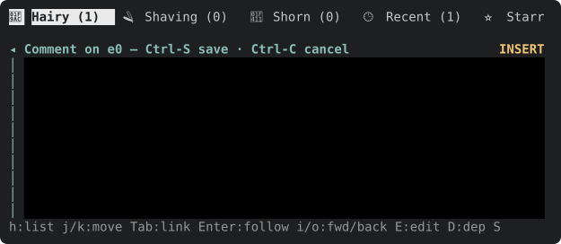
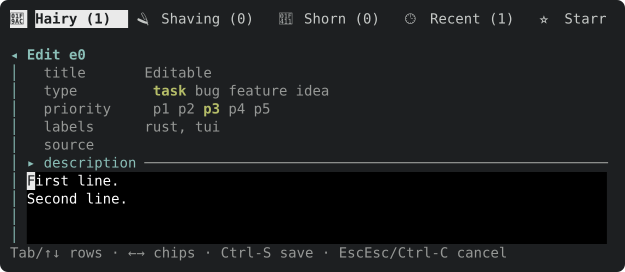
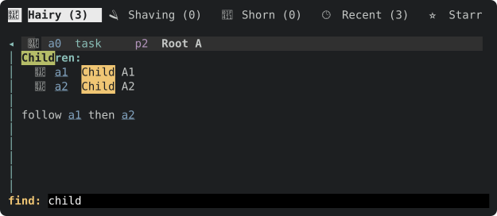
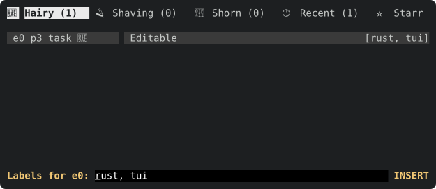
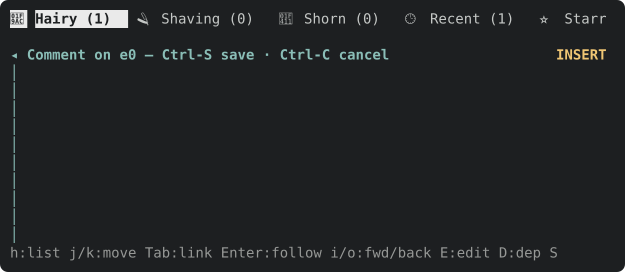
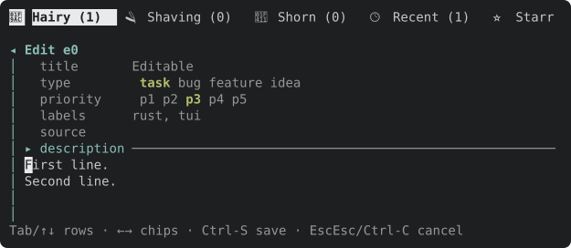
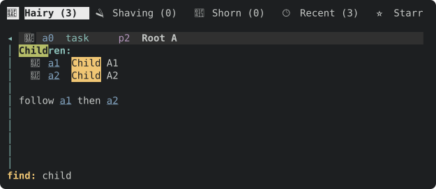
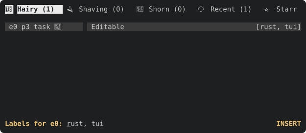

`editor_theme` (src/tui/editor.rs) never sets edtui's `base`, so edtui's default `bg(BLACK).fg(WHITE)` paints every embedded editor pitch black. Set `base` to `Style::default()` (terminal default), or at most a very subtle shade from the shared palette, and check every editor surface (comment overlay, edit form blocks, single-line fields). Before/after frames attached.

---
▸ 2026-10-17T04:31:30Z [delta-lead]

moved: hairy -> shaving

---
▸ 2026-10-17T04:31:30Z [delta-lead]

Claim (yakherd delta-lead, 2026-10-17): owner **bg-1**.

Scope: `editor_theme` in src/tui/editor.rs (set edtui's `base` so editors paint the terminal default background, or at most a very subtle shade; keep the cursor styles), plus any snapshot this moves. Check every editor surface: comment overlay (`M`), edit form content blocks (`E`), single-line fields (title/labels, the find prompt). Out of scope: markdown highlight colours (yaks-bc53 / yaks-9425).

Evidence: before/after headless frames of the comment overlay and the edit form attached (`yaks tui --headless` text frames do not show background colour, so also attach SVGs rendered with toque from a test or a scratch harness, or describe the cell bg from `toque`'s buffer). Judge: coordinator at landing.

Do NOT regenerate docs/assets docshots (several workers would collide on the SVGs; the coordinator regenerates them after landing). Re-accept any insta snapshot your change moves (`INSTA_UPDATE=always cargo test`, or `cargo insta accept` if installed) and read every changed .snap diff before committing. `cargo fmt` reformats files nobody touched (src/actor.rs, src/tui/docshots.rs, src/tui/tests.rs): run `cargo fmt -- <your files>` and `git checkout` those three if they changed. Docs/help parity per AGENTS.md (docs/tui.md, help_content in src/tui/render.rs) where behaviour a user sees changes.

---
▸ 2026-10-17T04:32:17Z [bg-1]

Start 2026-10-17 04:32:13Z UTC; path /home/joel/src/yaks/.delta/worktrees/9vc96g6e408g/yaks/.yaks/yaks-5408.md

---
▸ 2026-10-17T04:40:29Z [bg-1]

verify: `cargo test --workspace` -> PASS (exit 0)

---
▸ 2026-10-17T04:40:58Z [bg-1]

Decision: set edtui `base` to `Style::default()` (terminal default bg/fg) in `editor_theme`, the single constructor used by the comment overlay (M), edit-form content blocks (E), single-line fields (title/labels/find query line) — rejected a subtle palette shade (palette.rs is another worker's, not landed, and the pane background is the terminal default anyway). Cursor styles unchanged.

Decision: tests live in a new `theme_tests` mod in src/tui/editor.rs (unit test on `editor_theme(..).base` for all three modes + a comment-overlay frame test asserting no cell has bg `Rgb(0,0,0)`), rather than a new insta snapshot: text snapshots don't show bg colour, and no existing snapshot moved. Note edtui's BLACK is `Color::Rgb(0,0,0)`, not `Color::Black`; first draft of the frame test checked the wrong value and passed vacuously — caught by removing the fix (both tests then FAIL; with fix both pass).

Evidence: before/after toque SVGs of the comment overlay, edit form content zone, label field and detail find line attached (before-*.svg / after-*.svg). Before: each carried black `<rect class="b1" fill:#000000>` bands (comment overlay: 10 rows x 580px; 1 black fill class in each of the 4 files); after: zero `#000000` fills in all 4. Only difference between before/after comment.svg is those rects. No browser available here to rasterise, so verified from SVG source.

Summary: `editor_theme` now sets `.base(Style::default())` (+ doc comment). No docs/help change: no key or behaviour a user reads about changed; grep for black/background in docs/tui.md found nothing. Gates: `cargo test --workspace` PASS (verify note above), `cargo test --release` exit 0, 17 result lines all ok. docshots SVGs not regenerated (per claim note).

---
▸ 2026-10-17T04:40:58Z [bg-1]

moved: shaving -> shorn
