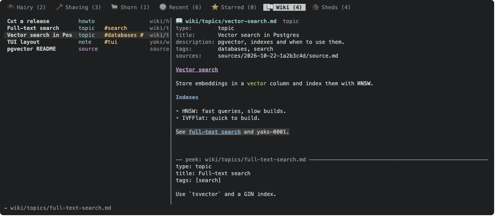
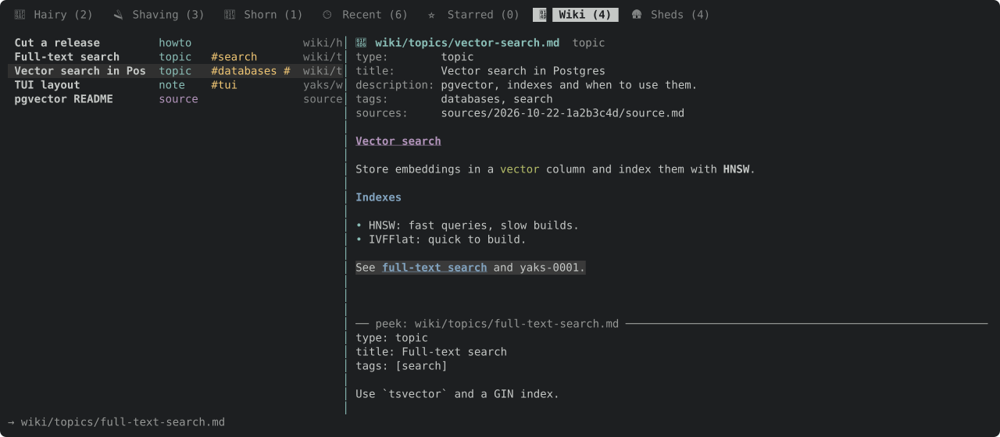

Uses the yaks-101d resolver; a preview pane shows `yaks peek` of the link under the cursor.

---
▸ 2026-11-01T23:04:46Z [delta:farm-wiki]

kind: move
from: hairy
to: shaving
thread: ksQQeB1CvWFdQrqkwpKQFhpMEJLOADtlxpIBxBCA0aLJyrhJPreUvVwLftHG
---

moved: hairy -> shaving

---
▸ 2026-11-01T23:04:46Z [delta:farm-wiki]

Claim (yakherd delta:farm-wiki): worker `wiki-1`, step 2 of its arc, after yaks-ebb2.

In the detail pane and the viewer, links to farm pages (`/wiki/x.md#h`), sources, `code:` paths, pins (`@sha`) and yaks resolve through `links::parse` (`src/links.rs`), replacing the TUI's older `link_target`/`source::parse_source` special cases where `links` already covers them.

- Enter on a page link opens that page in the viewer, at its `#heading` section.
- A preview line or pane shows `links::peek` of the link under the cursor (Tab-selected). It shows the section, line range or page head, and is truncated to fit.
- Back (`o`) returns across pages, so the in-page back/forward stack extends to page-to-page hops.

---
▸ 2026-11-01T23:49:49Z [wiki-1]

Start (wiki-1): Sun Nov  1 23:49:49 UTC 2026. Base 06bb89d (after yaks-ebb2).

---
▸ 2026-11-02T00:04:11Z [wiki-1]

Decision: the renderer classifies every markdown link with `links::parse`, given the document it sits in: `From::Yak` for a yak body or an attachment, `From::Page(path)` for a page or source. A relative link in a page is therefore relative to that page's folder. Two new `detail::Target` variants: `Farm {path, rev, anchor}` (a farm document) and `Local(anchor)` (`#section` in the same document). The rest map as before: `Code` -> `Source`, `Attachment` -> `Artifact`, `Url` -> `Url`. `mdrender::link_target`/`is_attachment` now just map a `links::Link`. `source::parse_source` is removed (its only caller was mdrender), and its tests now run against `link_target`. One visible change: in a yak, `other-9/f.txt` where `other-9` is not a yak used to be an attachment that failed to open; it is now the farm path `other-9/f.txt` (opened if it exists, else "not in this farm").
Decision: Enter on a farm link opens that file in the text viewer: a page (frontmatter + body), a `source.md` (with extracted.md), any other text file in the farm, or an image in the image viewer. The cursor lands on its `#heading` or `#L12` row. A pinned link (`@sha`) opens the file as it was at that commit, read with `links::read_at`; its header says `@sha7`, and `E` refuses because a past version is read-only.
Decision: page-to-page history is a stack of whole viewers. Following a link from the viewer pushes the current viewer (cursor and scroll included), and that covers attachment links too. `o` first undoes in-page jumps (footnotes, `#anchor`) on the current page, then goes back a page; `i` goes forward. A page you go back to is re-read from disk (an unpinned one), so an edit made meanwhile shows.
Decision: the peek preview is a pane at the bottom of the viewer: a `── peek: <label> ──` rule, then `links::peek`'s text (section, line range or page head), cut to fit. It appears only in documents that have a link it can peek (farm, attachment, code). Reserving it whenever such a link exists keeps the geometry fixed, so the cursor never ends up under it. `p` hides or shows it. The detail pane has no room for a pane, so its status line shows `→ label · first line of the peek`. Peeks are cached per link label and farm generation, so a frame never runs git.
Decision: `#section` in the detail pane (a yak body) says "in-page anchors are followed in the viewer" and does nothing. In-yak heading anchors are rare, and the detail pane splits the body into blocks.

---
▸ 2026-11-02T00:14:43Z [wiki-1]

Progress (00:14Z): links now resolve through links::parse via mdrender::link_target (From::Yak / From::Page). Target::Farm/Local are in place, and the new follow.rs handles opening a farm doc at its anchor, the viewer back/forward stack, the peek pane, and pinned reads. 9 follow tests pass. Still to do: docs, a docshot/frame, the gate.

---
▸ 2026-11-02T00:20:41Z [wiki-1]

kind: verify
result: pass
---

verify: `cargo test --workspace` -> PASS (exit 0)

---
▸ 2026-11-02T00:21:03Z [wiki-1]

Summary (wiki-1): the viewer follows links to pages, sources, code and pinned versions, with a peek pane.
- One link grammar. `mdrender::link_target(dest, from, known)` maps `links::parse` to `detail::Target`. `render_in` passes the document (`From::Yak` for yaks and attachments, `From::Page(path)` for farm files), so a relative link in a page resolves from its folder. New targets: `Target::Farm {path, rev, anchor}` and `Target::Local(anchor)`, plus `Target::as_link` for peek. `source::parse_source` and `is_attachment` are gone; source.rs's tests now run against `link_target`.
- New `src/tui/follow.rs`:
  - `read_farm_doc`/`open_farm_doc` open a page, a source (with extracted.md), any farm text file, or an image, at the `#heading` / `#L12` row (heading rows go to the top of the page). A pinned link is read with `links::read_at`; the header shows `@sha7` and E refuses.
  - `follow_local_anchor` handles `#section`.
  - History: `viewer_back`/`viewer_fwd` stacks of whole viewers. `o`/`i` undo in-page jumps first, then hop between documents, and re-read the document from disk. Attachments followed from a page join the stack, an image viewer returns to its page, and closing clears it.
  - Peek: `peek_target` calls `links::peek` (code base from `links::code_base`) and caches per label and data_gen. `render::render_peek` draws a 7-row pane (`── peek: label ──` then the text, cut to fit) under the page whenever it has a peekable link; `p` toggles it. The viewer's viewport subtracts the pane. In the detail pane, the status bar on a farm link shows `→ label · first line`, and Enter opens the viewer.
- Help: two new `(in viewer)` rows in help_content, the detail Enter row updated, and the viewer hint gains `o/i back/fwd · p peek` (shortened to fit 100 columns). Docs: docs/tui.md has a "Following links and peek" section with a docshot, and the link paragraph, the A/O row and the Wiki tab section are updated.
- Evidence: 9 tests in follow.rs (grammar targets in a page, heading + o/i across 3 pages, #section and #L6-L7 rows, source + attachment history + yak exit, missing page, peek pane contents for section/head/#local plus p, a pinned read against a real git commit plus E refused, detail-pane follow plus peek status line) and an insta frame. Docshot `tui-wiki-peek.svg`; its PNG, rasterized with headless Chrome, is attached.
- Gate: `cargo test --workspace` 968 passed, 0 failed, 12 ignored (EMAIL set, see yaks-ebb2). `yaks verify` PASS.
- Not done: following `#section` inside a yak body in the detail pane (it says to use the viewer, see Decision). The mouse does not click links in the viewer (same as before).

---
▸ 2026-11-02T00:21:03Z [wiki-1]

kind: move
from: shaving
to: shorn
thread: ksQQeB1CvWFdQrqkwpKQFhpMEJLOAD2ExZIBxBCA0aLJyrhJPreUvVwLftHG
---

moved: shaving -> shorn

---
▸ 2026-11-02T00:32:24Z [delta:farm-wiki]

kind: landed
commit: 8e42e477ec52dcb67deb6a2726773a3e2627ee24
source: 4cf2ee7d20018db01196219fff71e47771bc8d8c
branch: wiki
---

landed: 8e42e47 yaks-7395: follow links to pages, sources, code and pins in the viewer, with a peek pane

---
▸ 2026-11-02T00:35:37Z [delta:farm-wiki]

Landed in order (yakherd): f23a924 + 9e59104 (yaks-ebb2), 8e42e47 (yaks-7395), f4c86b8 (yaks-1532). Gate: 995 passed with no `EMAIL` set; the attribution failures wiki-1 saw were fixed in 75d9ef2. I looked at the Wiki tab and peek frames myself. Only the four new `tui-wiki*.svg` docshots landed; the unrelated SVG churn was left out.
