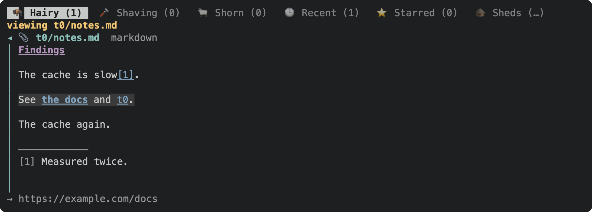
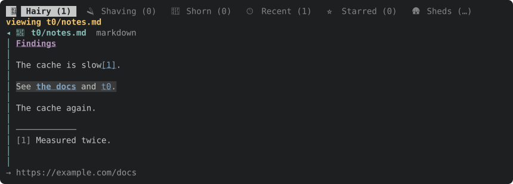

Ie, the ability to move the line-cursor, search, tab among links, etc. Basically everything but going into edit mode, and any yak-detail specific affordances I'm not thinking of.

Hopefully this can share most of the code with the yak detail rendering, so that fixes and improvements apply to both.

---
▸ 2026-11-01T22:25:16Z [delta:farm-wiki]

kind: move
from: hairy
to: shaving
thread: ksQQeB1CvWFdQrqkwpKQFhpMEJLOADtlxpIBxBCA0aLJyrhJPreUvVwLftHG
---

moved: hairy -> shaving

---
▸ 2026-11-01T22:25:17Z [delta:farm-wiki]

Claim (yakherd delta:farm-wiki): worker `nav-1`, on branch `wiki`, base a150387.

This is the prerequisite for the farm-wiki TUI layer (yaks-200f): the wiki tab (yaks-ebb2) and link following (yaks-7395) open pages in this viewer.

**Task.** The TUI's text/markdown viewer (the one that opens a text attachment) gets the yak detail pane's navigation, by sharing its code rather than copying it:

- line cursor movement;
- search;
- Tab/Shift-Tab among links;
- following a link with the same keys as the detail pane.

Leave out edit mode and anything specific to yak details (notes, fields).

**Scope.**

- The text viewer and the detail-navigation code under `src/tui/` (`detail_nav.rs`, `detail.rs`, the viewer's module, `handlers.rs` where keys dispatch, `render.rs` for its frame).
- Factor the shared part out of the detail pane into one place both use.
- Update the `?` help overlay (`help_content`) and `docs/tui.md`.

**Out of scope.** Anything outside `src/tui/` and `docs/tui.md`. Ask first.

**Evidence.**

- Insta snapshot or headless toque tests: in the viewer, the cursor moves, search finds a match, and Tab moves to the next link.
- Existing detail-pane tests unchanged.
- Attach a rendered frame (a docshots scene or a toque SVG) of the viewer with the cursor on a link.
- The full gate passes.

**Judge.** The coordinator, at landing.

---
▸ 2026-11-01T22:26:42Z [nav-1]

Start Sun Nov  1 22:26:41 UTC 2026. Path: /Users/joel/.local/share/yaks/farms/yaks-539d3edb/.yaks/yaks/yaks/yaks-84e0.md. Checkout: /Users/joel/src/yaks/.delta/worktrees/j5qrbk8fnvyz/yaks (branch wiki, base a150387).

---
▸ 2026-11-01T22:45:57Z [nav-1]

Decision: the shared navigation is a new module `src/tui/linenav.rs`, a cursor/search/link model over rendered rows (`[detail::DLine]`):
- pure functions over the rows: cursor stops/step/top-bottom, next link, link at cursor, find scan, yank text (source markdown for rendered rows), sideways scroll of no-wrap blocks, link destination for the status bar;
- `Viewport { page, pinned }`: the scroll geometry (rows shown, max scroll, scroll-into-view); the detail pane has a 2-row pinned header, the viewer none;
- `LineNavMut<'a>`: borrowed cursor state (line, scroll, anchor, find, match) with the stateful ops (step, Tab links, visual select, n/N, the find box's key routing). The detail pane borrows App's existing `detail_*` fields; the viewer borrows its own;
- `LineNav`: owned state (plus sideways scroll and an in-page back/forward stack) for hosts that own one page: the text viewer now, the wiki tab next (yaks-200f).
Why borrowed rather than moving App's `detail_*` fields into a `LineNav`: ~100 test lines read/write `app.detail_line` etc. and the claim requires existing detail tests unchanged. Folding App's fields into a `LineNav` is a mechanical follow-up.

---
▸ 2026-11-01T22:54:26Z [nav-1]

Progress (22:57Z): `linenav.rs` is in. The detail pane runs it through `App::with_detail_nav`, and the viewer owns a `LineNav`. One painter, `render::render_nav_rows`, draws both. All 409 existing TUI tests pass unchanged. Five new viewer tests plus an insta snapshot. Attached the PNG/SVG frame of the viewer with the cursor on a link. Still to do: help_content, docs/tui.md, the gate.
Decision: the viewer owns its find box (`AttachView.find_box`) instead of using `Overlay::DetailFind`. The overlay is a single slot and the viewer already fills it. The detail find and the viewer find share the key routing (`LineNav::find_key`), and the status line draws both as `find: …`.
Decision: following a link in the viewer uses the detail pane's targets. A footnote moves within the file (`o`/`i` back/forward through a per-page stack in `LineNav`). A yak id closes the viewer and opens that yak in the detail pane (`goto_task`, so `o` there works as usual). A URL, attachment or source file opens just as it does from the detail pane. Markdown rows now carry `src` (block 0) so yank copies the source markdown, footnotes resolve, and code blocks/tables scroll sideways with h/l.
Decision: viewer Esc peels back selection, then find, then closes, like the detail pane. `q` and `h`/`←` still close (`h` scrolls a no-wrap block left first). `?` is not bound in the viewer, because help would replace the viewer overlay.

---
▸ 2026-11-01T23:00:21Z [nav-1]

kind: verify
result: pass
---

verify: `cargo test --workspace` -> PASS (exit 0)

---
▸ 2026-11-01T23:00:35Z [nav-1]

Summary (nav-1): the text/markdown viewer now navigates like the detail pane, using the same code.
- New `src/tui/linenav.rs`: `LineNav` (cursor, scroll, selection, find, sideways scroll, in-page back/forward), `Viewport` (page geometry, pinned header), plus `yank_text`, `link_dest` and `hscroll_step`. It has four unit tests of its own.
- The detail pane's movement, Tab links, visual select, yank, find (box keys included), scroll geometry and the status-bar link hint now delegate to it through `App::with_detail_nav`. All existing detail tests pass unchanged.
- One painter, `render::render_nav_rows`, draws both panes' cursor, selection, current link and find highlights.
- The viewer (`AttachView`) owns a `LineNav` and a find box. Keys: j/k/d/u/g/G cursor, Tab/[ ] links, Enter follows (footnote in-file with o/i; yak opens in detail; URL/attachment/source as from detail), / n N find, v/Shift-↑↓/y select+copy (source markdown for .md), h/l sideways scroll, Esc peels selection→find→close. E/O unchanged.
- Help: added an "(in viewer)" line to `help_content` and replaced the viewer's status hint (it shows a URL's destination when the cursor is on one). `docs/tui.md` `A`/`O` row updated. The help-overlay insta snapshot moved by one row because of the new line.
- Evidence: 5 viewer tests (cursor moves, Tab to the next link + Enter/footnote/o, yak id opens detail, find + n, Esc layering) and the insta snapshot `the_viewer_with_its_cursor_on_a_link`. The attached PNG/SVG was rasterized with headless Chrome.
- Gate: `cargo test --workspace` 935 passed, 0 failed, 12 ignored. `yaks verify` PASS.
- Follow-up, not done: fold App's `detail_*` fields into a `LineNav` field. That is mechanical but touches ~100 test lines. Mouse clicks and the wheel do nothing in the viewer, same as before (mouse is ignored while any overlay is open).

---
▸ 2026-11-01T23:00:35Z [nav-1]

kind: move
from: shaving
to: shorn
thread: ksQQeB1CvWFdQrqkwpKQFhpMEJLOAD0o8pIBxBCA0aLJyrhJPreUvVwLftHG
---

moved: shaving -> shorn

---
▸ 2026-11-01T23:01:18Z [delta:farm-wiki]

kind: landed
commit: 268a0c5208cbc6d0a0680c9e44310e76f25ecf80
source: cef47ea2ee7021d97e38336b93210d9bccbbe5a0
branch: wiki
---

landed: 268a0c5 yaks-84e0: text viewer shares the detail pane's line navigation (linenav)

---
▸ 2026-11-01T23:04:29Z [delta:farm-wiki]

Landed as 268a0c5 (yakherd), plus 20f6bc6, which merges the help-overlay snapshot with yaks-f0db's new row. Gate: 950 passed. I looked at the attached PNG: the cursor line, the selected link, and the destination in the status bar are all right.
