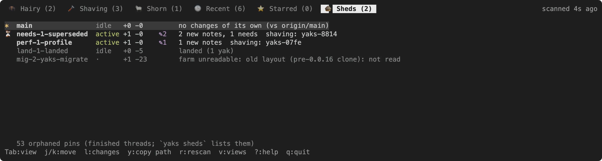
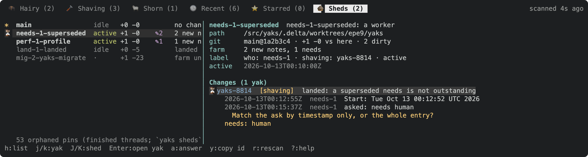

Approach A of the 2026-10-12 brainstorm, agreed to come first (Joel, on yaks-8b7a: "then a thin Sheds tab first, then the overlay"). Joel's pain: he opens terminals in Delta worktrees by hand to check a thread's state. The tab puts `yaks sheds` and `yaks changes <shed>` on screen, live, from inside `yaks tui`; the yak tree stays home.

Scope: a shed list, a shed's detail (its `changes`), a few keys, a background refresh that never blocks the UI. Data comes from `src/sheds.rs` (`sheds::discover`, `sheds::changes`) exactly as the CLI does, and every text the tab shows that the CLI also shows is produced by the same function, so the two cannot drift.

Out of scope: badges on yak rows, a Sheds section in the yak detail, the merged Inbox, the arrival flash (yaks-7204); the activity log (yaks-19c3); making the scan cheap (yaks-07fe); re-rooting the TUI on a shed.

---
▸ 2026-10-12T23:59:17Z [delta-lead]

Design proposal (delta-lead, 2026-10-12), grounded in the code; to confirm with Joel before any code.

## Where it lives
- A built-in view `🛖 Sheds` (key `sheds`), pinned by default, last on the tab strip. `views_store::reconcile` already appends a new built-in to existing users' saved views, and the view picker can unpin it. Rows dispatch on the view key, as `working-set` does today (`viewmodel::rows`).
- While the Sheds tab is active, only list/detail movement, Tab/[ ]/v/?/q and the keys below act. The yak-editing keys (S, E, X, D, …) are inert there, so nothing on that tab can change a yak by accident.

## One row per shed
```
 🛖 Sheds (3)                                            scanned 4s ago
 ⏳ fix-it-q7zz              active  +2 -0  ✎3  1 needs, 2 moved, 5 notes  shaving: yaks-8814
 *  main                     idle    +0 -0      no changes of its own (vs origin/main)
    land-1-landed-farm       idle    +1 -4      landed (1 yak)
    mig-2-yaks-migrate       ·       +0 -23     old layout (pre-0.0.16 clone)
    53 orphaned pins (finished threads)
```
- Columns: a marker (`*` the checkout the TUI runs in, as in the CLI; `⏳` an open ask there), name (the CLI's `name:`), liveness (active / stale accented, idle dim), `+ahead -behind`, dirty count, the `farm:` summary (the same text as the CLI line: one shared function in sheds.rs), then `shaving:` ids.
- Order: main first, then sheds with an open ask, then active, then outstanding, then stale, then quiet ones (no changes, landed) dimmed, then unreadable ones. The CLI keeps path order.
- The tab count is the number of sheds with something outstanding (not landed, not empty, readable), not the total.

## A shed's detail (l / Enter)
- Header: name · title, path, branch@head, +a -b, dirty, baseline (`vs fork 1a2b3c4`), who, liveness, farm activity.
- Then its `changes`, one block per yak: id, title, status, `from -> to`, `needs:`, edited/landed marks, and each new note's first line with timestamp and actor. Text from the same code as `yaks changes`.

## Keys
- j/k g/G d/u to move, l/Enter for the detail, h/Esc back to the list.
- Enter on a yak in the detail opens THIS checkout's copy in the yak detail (`open_task_in_detail`). A yak that exists only in the shed gets a notification: "<id> exists only in shed <name>".
- `y`: copy the shed's path (on a yak line in the detail: its id, as `y` does elsewhere).
- `r`: rescan now.
- `a` on a `needs: human` yak in the detail: answer it in that shed (`Farm::answer_in_shed`, the `answer <id>@<shed>` path), with a notification that the answer is uncommitted in the shed's tree. See question 4.

## Background refresh
- A scan (`sheds::discover` + `sheds::changes` for every shed with a farm of its own + `orphaned_pins`) runs on a worker thread and comes back as one snapshot over an mpsc channel. The event loop `try_recv`s it on its existing 250 ms tick, next to the `.yaks/` watcher, so the farm reload and key handling never wait on git.
- A scan starts when the tab is opened, every 10 s while the tab is the active one, and on `r`. One scan at a time; a request during a scan just queues the next one. Nothing scans while the tab is not shown (one scan at startup feeds the tab count). The right side of the tab row reads `scanning…` / `scanned 4s ago`.
- Selection survives a rescan by shed path (and by yak id in the detail).
- Tests and toque set the snapshot directly (no thread), so frames are deterministic.

Measured today in this checkout (release build, 10 sheds, 53 orphaned pins): `yaks sheds` takes 2.0-2.5 s wall clock, 0.5 s user + 0.6-1.0 s sys; 43 git subprocesses add up to about 0.95 s of it. So the scan must stay off the UI thread whatever yaks-07fe finds; once it is cheap, the cadence (and B's always-on badges) can follow.

## Evidence, docs
- Unit tests: row order and text; key routing (S on the Sheds tab opens nothing); a snapshot applied while the cursor is on a shed keeps it there.
- An insta whole-frame snapshot from a fixture snapshot; toque frames of the list and a detail, LOOKED at and attached; a docshots scene embedded in docs/tui.md.
- `help_content` (a Sheds section), `help_hint` for the Sheds tab, docs/tui.md, README, and the yaks skill's TUI paragraph.

## Questions for Joel (my recommendation first)
1. Tab count: outstanding sheds (recommended) or all sheds?
2. Order: attention first, as above (recommended), or the CLI's path order?
3. Unreadable (old-layout) sheds and orphaned pins: dim rows plus a one-line footer (recommended), or hidden?
4. `a` (answer in a shed) in the thin tab now, despite yaks-e475 (an uncommitted answer can be lost when the worker syncs with git)? Recommended: yes, with that warning in the notification; it is the same write as the CLI's.
5. Refresh only while the tab is shown, every 10 s (recommended), or always in the background?
6. Pinned by default (recommended)?

---
▸ 2026-10-12T23:59:17Z [delta-lead]

asked: needs human

Confirm the Sheds tab design in the note above, or adjust: the six numbered questions at its end (each has a recommended answer). Also: OK to run yaks-07fe (profile the scan) and yaks-8814 (superseded needs) as two Sonnet workers in parallel while I build the tab here?

---
▸ 2026-10-13T00:08:38Z [Joel Webber]

Answers:
1. Tab count - outstanding sheds
2. Order - attention first
3. Garbage sheds - dim them, but we may want to remove them later (or allow them to be filtered out).
4. Answer in-shed - Yes, let's try to get that right. If we run into lost answers, we can try to fix that later.
5. Refresh - yes, only when the tab's open. We may want to change that when we add more inline affordances.
6. Pinned by default - yes

---
▸ 2026-10-13T00:08:41Z [Joel Webber]

Answered above.

---
▸ 2026-10-13T00:11:39Z [delta-lead]

picked up

Picked up by delta-lead (yakherd, this thread): building the tab here to the design note with Joel's six answers (all as recommended; garbage sheds dimmed, filtering/removal later).

---
▸ 2026-10-13T00:11:39Z [delta-lead]

moved: hairy -> shaving



---
▸ 2026-10-13T00:28:18Z [delta-lead]

Rendered frame (docshots fixture, rasterized with headless Chrome): the shed list.



---
▸ 2026-10-13T00:28:18Z [delta-lead]

Rendered frame: a shed's changes in the detail, with the ask's question under its note.

[real-machine-headless](yaks-98f1/real-machine-headless.txt)

---
▸ 2026-10-13T00:28:19Z [delta-lead]

Real machine: yaks tui --headless on this repo (Recent, the Sheds tab, the needs-1 shed's detail).

---
▸ 2026-10-13T00:28:42Z [delta-lead]

Decision: the tab is a built-in VIEW (key `sheds`, pinned, last), not a new top-level mode. `rows()` is empty there, so every yak key finds no selection, and `handle_key` routes the tab's keys to `handle_sheds_key` before the yak match, so S/E/X/… cannot reach a yak from the tab (tested). Rejected: a separate `Focus::Sheds` mode (a third pane state every handler would have to know about) and branching each yak handler on the tab.

---
▸ 2026-10-13T00:28:42Z [delta-lead]

Decision: one scan = `sheds::discover` + `sheds::changes` for every shed with its own farm + `orphaned_pins`, run on a short-lived thread per scan, delivered as one `Snapshot` over mpsc. The live loop calls `settle_sheds(false)` each tick (non-blocking); toque's `settle` calls `settle_sheds(true)` so a headless frame is the settled one. `changes` for every shed (not on demand for the selected one) so moving between sheds is instant; it costs a little more per scan, which yaks-07fe can trim. The scan age is a field refreshed by `settle`, so `render` stays pure and tests freeze it. Rejected: a long-lived worker thread (no state to keep), computing `changes` lazily per selection (staleness and a second request type).

---
▸ 2026-10-13T00:28:42Z [delta-lead]

Decision: an ask's note shows its question (up to 6 lines) under the note's first line in the shed detail, because the `a` key answers it there; `yaks changes` shows only the first line (`asked: needs human`). Not changed in the CLI (out of scope; `inbox --sheds` already shows the question there).

---
▸ 2026-10-13T00:28:42Z [delta-lead]

Done (delta-lead). The Sheds tab, to the design note with Joel's six answers.

What shipped:
- src/tui/sheds_tab.rs (new): `Snapshot` (scan, attention order, outstanding count), `ShedsTab` state, the scan plumbing (`request_sheds_scan`, `settle_sheds`, `apply_sheds_snapshot` keeping the shed by path and the yak by id), the keys, answer-in-shed via `Farm::answer_in_shed`, the list and detail renderers, a test fixture and 9 tests.
- Wiring: `view::sheds_view` / `SHEDS_KEY`; `App.sheds`; rows/count branches in viewmodel; render dispatch, tab count and `scanned Ns ago` slot; `EditAction::AnswerInShed`; the event loop and toque `settle`; the state header.
- Prep commit 1d8151a: `sheds::farm_line`, `sheds::is_outstanding`, pub `label_line`, so the tab and `yaks sheds` share their text (`yaks sheds` byte-identical before/after on this machine).
- Docs: docs/tui.md (Layout, a Sheds-tab key table, a Sheds tab section with two shots), README, the yaks skill's TUI paragraph, yaks-coordinating's watch list, `help_content` (a Sheds section) and `help_hint` (per focus on the tab).

Evidence:
- `cargo test --release`: 550 passed in the bin crate plus every integration suite green (run before the last test was added; `sheds_tab` 9/9 after).
- Real machine, `yaks tui --headless` on this repo: the tab lists the 4 live sheds with the same counts as `yaks sheds`; needs-1's detail showed its notes live while it worked (attached transcript).
- Real machine, the one write: a throwaway `git worktree` shed with `yaks ask yaks-98f1`; from the tab, j l j j j a, typed an answer, Enter: the shed's yaks-98f1.md got `needs: agent` and the attributed note, uncommitted there (`git status`: ` M .yaks/yaks-98f1.md`); the notification dropped below the tabs (too long to sit beside them); the rescan kept the cursor on the yak. Worktree removed after.
- Frames LOOKED at (rasterized with headless Chrome, attached): attention order, dimmed quiet/unreadable rows, the ask's question in yellow.
- Snapshot churn: four existing insta snapshots and every docs/assets SVG now show the 🛖 Sheds tab; at 96 columns the `family:` indicator no longer fits beside the strip and yields, as designed.

Found on the way: yaks-93fe (a plain git worktree of a Delta clone is taken for the primary by discovery; CLI and tab alike).
Follow-ups not done: mouse on the tab (clicks and wheel do nothing there; tab clicks work); filtering out or hiding garbage sheds (Joel: maybe later).

---
▸ 2026-10-13T00:28:42Z [delta-lead]

moved: shaving -> shorn

---
▸ 2026-10-27T01:10:50Z [Joel Webber]

requested: needs agent

Tidy request: change only the line structure of this yak's description and every note, so each renders as intended under CommonMark.

Put a blank line between blocks, make run-on facts a list, and fence pasted output. Never change a word, a note header (`▸ <ts> [actor]`) or the frontmatter. Edit the file at `yaks path yaks-98f1` directly: `update --description` replaces the whole body, notes included. Then `yaks pickup yaks-98f1 --drop-request`, which removes this request note, so no new note is left behind.
