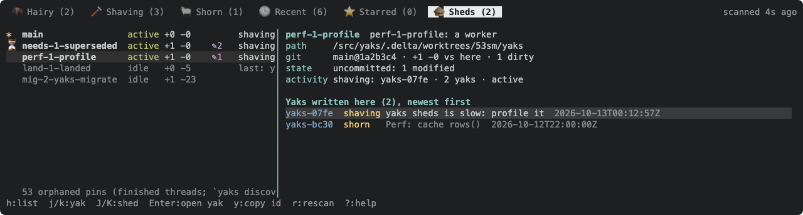

With one live farm (yaks-6a34) "what is shed X doing" cannot come from diffing farm copies. Every write (note, move, ask, answer, attach) records the shed it ran in beside the actor, named by the rule `yaks sheds` already uses (`main`, the Delta thread-title slug, ...), e.g. a `shed:` on the entry header or an `actor@shed` form; decide the on-disk shape carefully (schema bump) and keep it readable.

Then the Sheds tab and `yaks sheds` compute per shed, from the farm alone: yaks it claimed (`shaving` with its stamp), yaks it wrote to, newest stamp (liveness), open asks it raised; plus the git facts discovery already gives (branch, ahead/behind, dirty, merged). Ordering per yaks-0309/yaks-9a06 falls out as a plain sort.

Delete once the trial holds: fork points / base farms / `compare_farms` / `yak_changes` / `landed` / `needs_superseded` / `outstanding_ids` in sheds.rs, `inbox --sheds`, `show --sheds`, `answer <id>@<shed>`, `changes <shed>`, the TUI ghost rows, badges and `copies:` chip. Keep: discovery (host, pins, worktrees), names, git state. Blocked on the trial's verdict.

---
▸ 2026-10-19T04:29:29Z [delta:herd-pass]

Herd pass 2026-10-19: unblocked, the trial's verdict is in (yaks-6a34). The per-shed farm-diff commands it deletes (`changes <shed>`, `inbox --sheds`, `show --sheds`, `answer <id>@<shed>`, ghost rows) are also what the skills rewrite (yaks-b048) stops teaching, so land the two together or skills first. yaks-0309 and yaks-9a06 (ordering) now sit under this yak.

---
▸ 2026-10-21T03:30:36Z [delta:herd-pass]

Joel (2026-10-19): agreed that the skills stop teaching the per-shed farm-diff commands now (yaks-b048), ahead of their deletion here.

---
▸ 2026-10-21T21:30:17Z [delta:sheds-review]

Review 2026-10-21 (delta:sheds-review), on main @ 3bc2282 (sync/private/merge-driver landed, tui-sync-1 shorn and awaiting its landing). What the shared-farm model has already made vacuous, so this yak's delete list is concrete:

**What `yaks sheds` shows today** (surveyor, 8 rows): every other row reads `farm: shares this farm`; the current row reads `no differences (vs this checkout)` (the farm diffed against itself); every row is `idle` (`in_progress`/`who` come from `label(base, theirs)`, which needs a farm of its own); the detail says `No yak changes of its own.` for every shed; and the farm worktree itself (branch `yaks`, `✎405`, `+1 -18`) is listed as a shed, which it is not.

**Still true and worth keeping:** discovery (`gather`/`host`/`pinned`/`resolve_pin`, the host's `git worktree list`), names (`yaks.shed.title`, `slug`, `disambiguate`, `resolve`), per-shed git facts (branch, HEAD, ahead/behind this checkout, dirty/untracked, `merged` into the primary), `yaks discover`, `-C`.

**Dead code (sheds.rs, ~6.4k lines incl. ~3.7k of tests):** `FarmDelta`, `Moved`, `BaseKind`, `FarmBase`, `ShedFarm`, `BaseCache`, `fork_point`/`fork_candidates`, `upstream_base`, `base_farm`/`base_files`/`base_farm_tasks`/`TempDir`, `load_farm`, `compare_farms`, `yak_changes`, `Changes`/`changes`/`shed_yak_changes`, `label`, `reference_tasks`, `status_rank`, `outstanding_ids`, `needs_superseded`, `landed_ids`, `split_landed`/`Focus`/`fold_landed`, `render_changes*`/`changes_json*`, `farm_line`, `newest_mtime` (liveness via farm mtime).

**Dead commands/flags (main.rs + farm.rs):** `yaks changes`, `inbox --sheds` (`Farm::inbox_sheds`, `ShedAsk`), `show --sheds` (`Farm::show_sheds`, `ShedCopies`), `answer <id>@<shed>` (`Farm::answer_in_shed`), `attachment`'s cross-shed search (`Farm::attachment_farms`), `--shed <name>` (it existed to read another shed's farm). Tests: `tests/{answer_shed,attachment_sheds,changes,inbox_sheds,show_sheds,sheds_layouts,shed_flag}.rs`.

**Dead TUI (sheds_tab.rs ~1.9k lines, plus the overlay):** `Snapshot::{changes,only_tasks,copies,shed_only,open_asks}`, the shed detail's per-yak change list, the `🛖N`/`🛖N⚠`/`🛖<shed>` badges, ghost rows (`tree.rs shed_only`, `viewmodel::selected_shed_only`, `guard_shed_only`), the `copies: any|home` drawer chip (`memo`, `views_store`), the Inbox's other-shed asks and `a`-answers-in-shed (`open_answer_in_shed_prompt`, `commit_answer_in_shed`), the docshots scene `with_shed_only`.

**One more row to drop:** a `git worktree` whose branch is the farm branch (`store::farm_branch`) is the farm, not a shed; its state belongs to `yaks status` / the TUI sync chip.

Design question for the replacement (the per-write stamp): the shed is per-MACHINE metadata (a Delta dir id or worktree path means nothing on another machine once the farm is pushed), while the actor is already the durable, committed 'who' (`delta:<thread title>` when unnamed). So consider recording the shed OUTSIDE the yak files: an uncommitted per-shed activity log under the farm (e.g. `.yaks/.activity/<shed-id>`, gitignored like `.lock`; one `ts  id  op` line per write), joined to discovery by shed id (`main`, the Delta dir id, else the worktree dir). No schema bump, nothing to merge, the sheds view = git facts + that log (claims, touched yaks newest first, liveness from the newest line). Alternative: a stamp in the note header (schema 7, committed, meaningless off-machine). Joel to pick.

---
▸ 2026-10-22T02:45:25Z [delta:sheds-review]

moved: hairy -> shaving

---
▸ 2026-10-22T02:45:25Z [delta:sheds-review]

Decision (Joel 2026-10-21): record the shed OUTSIDE the yak files, in an uncommitted per-machine activity log under the farm (gitignored like `.lock`), joined to discovery by checkout. No schema bump. Rejected: a shed stamp in the note header (schema 7, committed, meaningless on another machine). The actor stays the durable 'who'.

---
▸ 2026-10-22T03:24:41Z [delta:sheds-review]

Implementation in progress (delta:sheds-review): activity log + slim sheds view built; gate green; docs updated. Evidence next.

[surveyor-sheds](yaks-9eaa/surveyor-sheds.txt)

---
▸ 2026-10-22T03:25:39Z [delta:sheds-review]

Done (delta:sheds-review). Summary:

- **New: the activity log** (`src/activity.rs`). `store::write::save` appends `<ts>\t<id>` to `<farm>/.activity/<hash of checkout path>.log` for the checkout the process runs in (git top-level of the cwd). The dir holds a `.gitignore` of `*`, so git, `yaks status` and `yaks commit` never see it; discovery's `only_leftovers` tolerates it. `YAKS_NO_ACTIVITY=1` turns it off.
- **`sheds.rs` rewritten** (6.4k -> 2.4k lines): kept discovery, names, git state; deleted fork points, base farms, `compare_farms`/`yak_changes`/`landed`/`label`/`resolve`. A row = git facts + `touched` (yaks it wrote, newest first, status now), `in_progress`, `last_write`, `liveness` (active = wrote within 2h; stale = holds a shaving yak, quiet longer). The farm branch's own worktree is no longer listed. Orphaned pins are one count line.
- **Deleted commands/flags:** `yaks changes`, `--shed`, `show --sheds`, `inbox --sheds`, `answer <id>@<shed>`; `yaks attachment` reads this farm only.
- **TUI:** Sheds tab rebuilt on the new data (detail = yaks written, Enter opens); scans only while the tab is shown. Removed the overlay: `🛖` badges, shed-only rows, the detail `Sheds:` section, the `copies` drawer chip (`FilterSpec::home_only`), Inbox shed asks, answer-in-shed, `Loc::Shed`.
- **Docs/help:** README, docs/cli.md, docs/tui.md, clap help, `?` overlay, help bar, coordinating skill line; 4 obsolete docshot SVGs removed, tui-sheds/tui-sheds-detail/tui-drawer regenerated.

Evidence:
- `cargo test --release`: all suites green (703 unit + every integration suite), incl. new `tests/shed_activity.rs` (end-to-end through the binary on a farm-branch repo) and unit tests for the join, liveness and farm-worktree exclusion.
- Real farm: `yaks sheds` in this repo shows this thread's row `shaving: yaks-9eaa · 1 yak · active` with the yak listed; `git status` in the farm worktree shows nothing under `.activity`.
- Surveyor output attached (no activity yet there: the log starts with this build). Frame of the new Sheds detail attached.

Children: yaks-0309 (ordering: attention, then most recent writer) and yaks-9a06 (detail newest first) are delivered here.

---
▸ 2026-10-22T03:26:19Z [delta:sheds-review]

verify: `cargo test --release` -> PASS (exit 0)

---
▸ 2026-10-22T03:26:28Z [delta:sheds-review]

moved: shaving -> shorn
