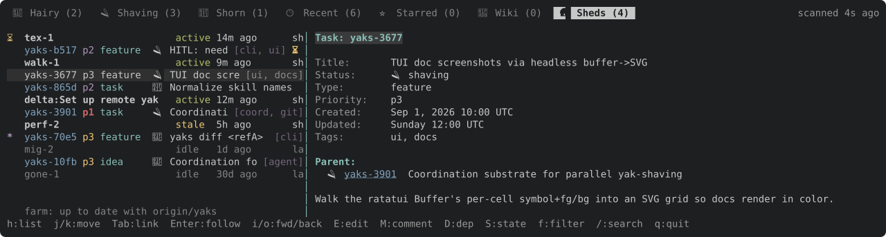

Phase 3, second half, of [the design](/wiki/design/tui-model.md#1-rows-and-views); implements yaks-f1e6: the Sheds tab becomes an ordinary tree view. Each actor is a collapsible root row; its children are the yaks it touched (working, asking, then recent, as `Shed::rows` orders them). The tab's own cursors, key handlers and list renderer go.

---
▸ 2026-11-03T04:24:11Z [herd-tui]

Claim (yakherd herd-tui): worker `sheds-2` (Sonnet 5.5), from main at `50af0a9a` (phase 3a landed: `tree::Item`, `RowKind`, kind-aware `lookup`).

**Task.** Sheds becomes a tree view of the list, like Wiki became a flat one in 3a.

**Rows.** `tree::Item` gains `Shed(&Shed)` (and `RowKind::Shed`); `memo::Loc` gains `Shed(usize)` (index into the snapshot's sheds). `build_rows` on the Sheds view:

- one root row per shed, in today's order (attention first);
- under it, its touched yaks as `Item::Yak` children (depth 1, in `Shed::rows()` order: working, asking, recent);
- a yak no longer in the farm is skipped.

Roots are collapsible with the existing `collapsed` set and `Space`, keyed by a key that cannot collide with a yak id (e.g. `shed:<name>`). Default: expanded. `/` (the live `filter.search`) keeps a shed whose name or any child matches, and only the matching children.

**Rendering.** `render_list` draws a shed root with today's shed-row text (actor, liveness, last write, what it is shaving); reuse `render_sheds_list`'s line builder. Children draw as normal yak rows, with today's Kind label (`shaving`/`asking`/`recent`) dim at the right if it fits. The footer (farm freshness) and the tab-row `scanned 4s ago` label stay.

**Pane.**

- With focus on the pane, a **shed** row shows today's shed detail (checkpoint branch, its yaks); drop the yak-line cursor inside it.
- A **yak** row shows the normal yak detail pane, so `J`/`K` step through the tree and the shed context stays on the left.
- `Ctx::Sheds` and `Ctx::ShedDetail` go: the Sheds view is `Ctx::List`/`Ctx::Detail`, with shed-row bindings by kind:
  - `l`/`Enter` open the pane;
  - `y` copies the shed name;
  - `r` rescans.
- Yak rows get every yak key, `U`/`W` included (yaks-f1e6's complaint).

**Delete.** `ShedsTab.cursor`, `.line`, `.list_offset`, `.offset`; `move_shed`, `move_shed_yak`, `selected_shed_yak`, `open_shed_yak`, `render_sheds_list`; the shed-detail yak cursor. Keep the snapshot, the scan plumbing, `busy()` and the count.

**Out of scope.** The viewer overlay (phase 4), search semantics beyond the rule above (phase 6a), any key change other than the ones listed. Anything else: `yaks ask yaks-c354`.

**Evidence.**

- The gate: `env -u YAKS_DIR -u YAKS_ACTOR cargo test --workspace`, fresh `TMPDIR`.
- Sheds snapshots (`sheds_tab` insta, and the `tui-sheds*` docshots in `docs/assets`) WILL change, since the layout is new. Regenerate the docshots (`cargo test -p yaks docshots -- --ignored`) and record each changed snapshot in one `Decision:` note. No non-Sheds snapshot may change.
- New tests:
  - `j` from a shed root lands on its first yak;
  - `Space` collapses a shed;
  - `Enter` on a yak child shows the yak detail, and `J` moves to the next row;
  - `U` on the Sheds view requests a sync;
  - `/` keeps only matching children.
- Docs and help parity: `docs/tui.md`'s Sheds tab section and key table are rewritten for the tree; `?` and the hint are generated.
- Attach a headless frame of the Sheds tree with a yak child selected and its detail open (the fixture's `snapshot()` in `sheds_tab.rs` tests has sheds; a scratch farm has none).

**Judge.** herd-tui at landing.

---
▸ 2026-11-03T04:27:48Z [sheds-2]

Start: Tue Nov  3 04:27:48 UTC 2026; yaks path: /home/user/.local/share/yaks/farms/yaks-b0f8dcf9/.yaks/yaks/yaks/yaks-c354.md; top-level /home/user/yaks-5; 50af0a9 yaks-be65: row kinds (yak, document); the Wiki becomes a flat view of document rows

[sheds-tree-headless](yaks-c354/sheds-tree-headless.txt)

[sheds-tree-yak-detail-fixture](yaks-c354/sheds-tree-yak-detail-fixture.txt)

