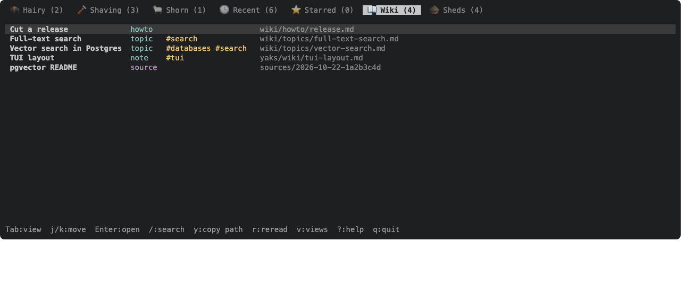
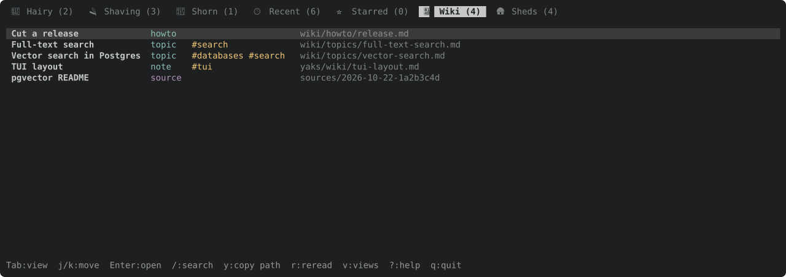
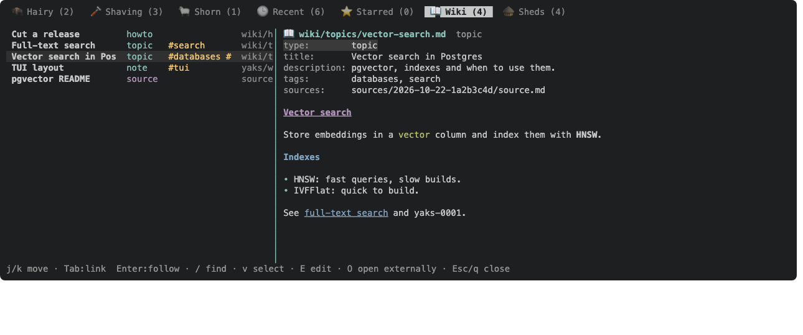
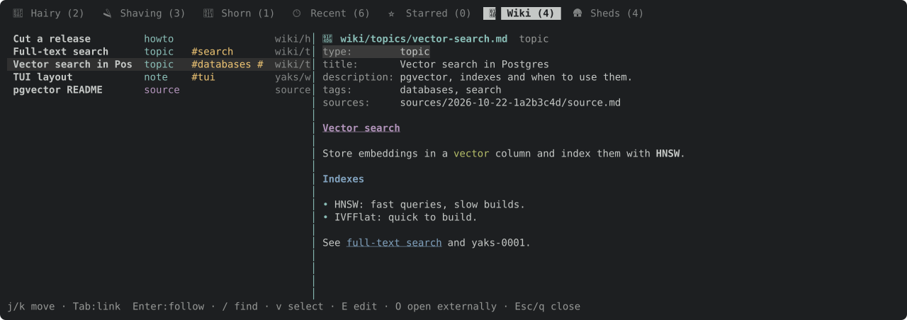

A view of `wiki/`, herd wikis and `sources/`, opening a page in the rendered markdown view with the detail pane's navigation (yaks-84e0).

---
▸ 2026-11-01T23:04:46Z [delta:farm-wiki]
kind: move
from: hairy
to: shaving
thread: ksQQeB1CvWFdQrqkwpKQFhpMEJLOADtlxpIBxBCA0aLJyrhJPreUvVwLftHG
---

moved: hairy -> shaving

---
▸ 2026-11-01T23:04:46Z [delta:farm-wiki]

Claim (yakherd delta:farm-wiki): worker `wiki-1`, on branch `wiki` at 20f6bc6. It runs the TUI arc serially in one worktree: yaks-ebb2, then yaks-7395, then yaks-1532, with one commit each.

**yaks-ebb2, the Wiki tab.** A new top-level tab, after Starred and before Sheds, listing the farm's pages:

- Sources: `pages::load_all` covers `wiki/` and herd wikis; `sources::list` covers sources.
- Grouping: a tree by folder, or a flat list with paths. Record the choice as a `Decision:`.
- Columns: title, kind, tags.
- Enter opens a page in the rendered markdown viewer that yaks-84e0 just built on the shared `linenav` component (`src/tui/linenav.rs`; the `AttachView` viewer in `handlers.rs`/`render.rs`).
- The page's frontmatter shows as a header block above the body.
- Sources open their `source.md` plus `extracted.md`.
- `/` filtering works like the other tabs.
- The tab count is the page count.

---
▸ 2026-11-01T23:05:38Z [wiki-1]

Start (wiki-1): Sun Nov  1 23:05:30 UTC 2026. Path: /Users/joel/.local/share/yaks/farms/yaks-539d3edb/.yaks/yaks/yaks/yaks-ebb2.md. Checkout: /Users/joel/src/yaks/.delta/worktrees/x3afjaetd9ve/yaks (branch wiki, base 20f6bc6).

---
▸ 2026-11-01T23:31:10Z [wiki-1]

Decision: the list is flat, one row per page, sorted by path. Pages come first, then sources (kind `source`). Each row shows title, kind, tags and a dim path, and the path column carries the folder. Why: a folder tree needs collapse state and cursor-over-folders rules, while a flat list with paths keeps `/` filtering, counts and selection to one index. The wiki is small and paths group by folder anyway once sorted.
Decision: the page view is the existing text viewer (`AttachView`, `Overlay::Attachment`) with a document kind (attachment / page / source), not a second viewer. A page shows its frontmatter as field rows (`key` + value) above the rendered body. A source shows `source.md`, then a `── extracted.md ──` section with the extracted text. They all get the yaks-84e0 navigation unchanged, and E/O/links stay in one place for yaks-7395/yaks-1532 to extend. The list stays visible on the left, as with an attachment.
Decision: `/` on the Wiki tab is the same inline search as the yak tabs (it edits the live filter's `search`). The Wiki rows filter on it (title, path, kind, tags), so the `*` tab marker, the `filter: "q"` chip and Esc-reverts behave as on the other tabs.

---
▸ 2026-11-01T23:49:11Z [wiki-1]
kind: verify
result: pass
---

verify: `cargo test --workspace` -> PASS (exit 0)

---
▸ 2026-11-01T23:49:31Z [wiki-1]

Summary (wiki-1): the TUI has a Wiki tab (📖), after Starred and before Sheds.
- New `src/tui/wiki_tab.rs`. `read_entries` builds the list from `pages::load_all` plus `sources::list`. `WikiTab` holds the entries and the cursor. `handle_wiki_key` owns the keys (j/k/g/G/d/u, Enter/l open, / search, y copy path, r reread, Esc reverts the search, Tab/[ ] views), and `render_wiki_list` draws the rows (title, kind, #tags, dim path). The list is reread on every farm reload.
- The viewer (`AttachView`) gained `DocKind {Attachment, Page, Source{extracted}}` and `open_doc`. A page renders its frontmatter as field rows (a list of scalars joined; a list of maps shown as written) above the markdown body. A source renders `source.md`, then a `── extracted.md ──` row and the extracted text. Yank uses `blocks()` for each part's source markdown. The navigation is the yaks-84e0 `LineNav`, unchanged.
- `view::wiki_view` / `WIKI_KEY`. The tab count is the page count; the yak rows are empty there, so yak keys are inert.
- `views_store::reconcile` now puts a built-in that is missing from a saved views file just before its next default neighbour, not at the end. An existing user's tab bar gets Wiki before Sheds. Tested.
- Help: a "Wiki tab" section in `help_content` and its own `help_hint`. Docs: `docs/tui.md` (layout, keys table, a Wiki tab section with two docshots) and the README TUI paragraph.
- Evidence: 9 tests in `wiki_tab.rs` (order, list + count, inert keys, / filter + Esc, page with frontmatter + Tab, source with extracted text, reload sees a new file, two insta frames), plus the reconcile test. Docshots `tui-wiki.svg` and `tui-wiki-page.svg`; their PNGs, rasterized with headless Chrome, are attached. 17 existing snapshots changed only in the tab strip and help overlay, because of the new tab.
- Gate: `cargo test --workspace` 959 passed, 0 failed, 12 ignored. `tests/attribution.rs` needs `EMAIL` set in this environment: its isolated GIT_CONFIG_GLOBAL has no identity, and git can't auto-detect one on this host. That was already true before this change; `yaks verify` ran with EMAIL set.
- Not done: a folder tree (see Decision) and mouse in the Wiki list (the mouse handler ignores it).

---
▸ 2026-11-01T23:49:31Z [wiki-1]
kind: move
from: shaving
to: shorn
thread: ksQQeB1CvWFdQrqkwpKQFhpMEJLOAD2ExZIBxBCA0aLJyrhJPreUvVwLftHG
---

moved: shaving -> shorn

---
▸ 2026-11-01T23:49:49Z [wiki-1]

Landed in two commits: 95b39e1 (all of it but src/tui.rs) and 06bb89d (src/tui.rs: the module and App.wiki field). My `git add src/tui` left out the sibling file. I did not squash, because history rewrites are not allowed; the coordinator can squash when landing.
