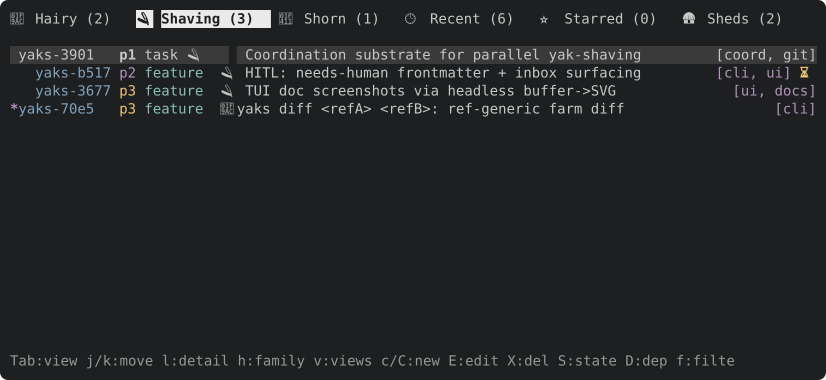
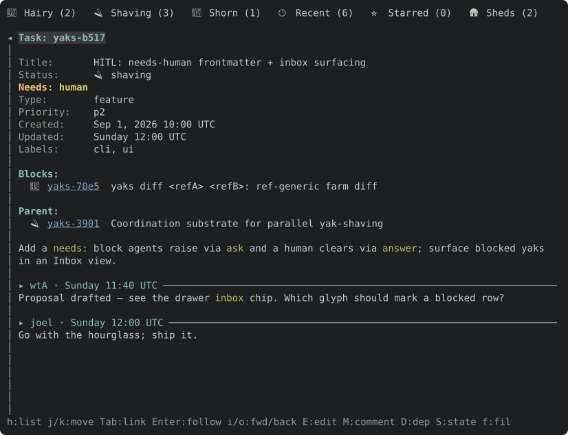

# yaks

A task tracker made of markdown files. Each task (a **yak**) is one file with
YAML frontmatter. The files live on their own git branch, so every checkout of
your repo shares one live task list and your code branches carry no task churn.
No database, no daemon, no server: one self-contained binary.

```text
yaks branch  ->  ~/.local/share/yaks/farms/<repo>-<hash>/.yaks/
  config.yaml
  yaks/yaks/yaks-1a2b.md     one file per yak; `status: hairy|shaving|shorn|dead`
  yaks/yaks/yaks-1a2b/       its attachments
```

## Install

**npm** (prebuilt binary for your platform; the command is `yaks`):

```sh
npm i -g @j15r/yaks     # then: yaks --help
# or zero-install:
npx @j15r/yaks list
```

**From source** (needs a Rust toolchain):

```sh
git clone https://github.com/joelgwebber/yaks
cd yaks
cargo install --path .   # installs to ~/.cargo/bin
yaks --help
```

Re-run `cargo install --path .` to pick up local changes. If you also have the
npm package installed, put `~/.cargo/bin` ahead of npm's bin directory on your
`PATH` so your local build wins. `cargo build` / `cargo test` are the usual
inner loop (`./target/debug/yaks`).

## Quick start

```sh
cd my-repo
yaks init                  # farm on the `yaks` branch + the agent skills
yaks create "Wire up the login form" --type feature --priority 2
yaks list
yaks shave <id>            # start work  (hairy -> shaving)
yaks shorn <id>            # finish      (shaving -> shorn)
yaks commit                # commit the farm on its branch
yaks sync                  # pull + push it (or `yaks private` to keep it local)
```

**Shave** a yak before you work on it, **shear** it (`shorn`) when it's done.
A farm groups yaks into **herds** by id prefix (`yaks create --herd web`); a
parent with its descendants is a **family**.

## Concepts

**States are adjectives, verbs are transitions.** A yak is *hairy* (todo),
*shaving* (in progress), or *shorn* (done); *slaughtered* yaks are `dead`,
hidden from normal queries. You **shave** (hairy→shaving), **shear** / mark **shorn**
(shaving→shorn), **regrow** (shorn→hairy), **slaughter**, and **revive**.

**Task file.** Frontmatter for metadata, the markdown body for the description:

```markdown
---
id: yak-a1b2
title: Wire up the login form
status: shaving        # hairy | shaving | shorn | dead
type: feature          # bug | feature | task | idea
priority: 2            # 1 urgent … 5 lowest (default 3)
created: "2026-02-16T10:00:00Z"
updated: "2026-02-16T10:30:00Z"
parent: yak-c3d4       # optional; only on child tasks
depends_on: [yak-e5f6] # optional
labels: [auth]         # optional
source: https://…      # optional external issue URL
---

Longer description goes here.
```

IDs are flat and stable (`{prefix}-{4hex}`). Hierarchy lives in the `parent:`
field, not in the ID. Dependencies are ids in `depends_on:`; a yak is *ready*
when all of them are shorn (or dead), and *tangled* otherwise.

## Commands

`yaks -C <path> <command>` (global, like `git -C`) runs any command as if started
in `<path>`.

| Command | What it does |
|---------|--------------|
| `yaks create` | Create a task; the title is positional (`yaks create "Fix login"`). Flags: `--type`, `--priority`, `--parent`, `--labels` (comma- or space-separated), `--depends-on`, `--source`, `--description` (`-` reads stdin; `--description-file PATH`), `--json` (emit the new id + file path) |
| `yaks list` | List tasks; filter by `--status/--type/--priority/--label/--search`, `--ready`, `--tangled`, `--parent-of`, `--all` |
| `yaks show <id>` | Full detail for one task, with parent + children |
| `yaks refs <id>` | List what a task points at (parent, deps, id mentions in its text), flagging any that dangle; `--incoming` lists what points AT it instead (children, dependents, mentions in titles/descriptions/notes, each saying how; `--json`) |
| `yaks commits <id>` | the git commits naming a yak or touching its file |
| `yaks update <id>` | Change fields/labels, set `--description`, or append a `--note` (`-` reads stdin; `--note-file PATH`: multi-line markdown without shell quoting) |
| `yaks ask <id>` / `answer <id>` | Block a yak on a human (sets `needs: human`, drops it from `next`) / answer it (sets `needs: agent`, so the answer cannot get lost; `--done` clears instead), each recording a `--note` |
| `yaks request <id>` | Hand a yak to an agent with no prior question (sets `needs: agent`, recording the `--note`, or a canned `--kind tidy\|summarize` instruction); refuses a yak awaiting a human |
| `yaks pickup <id>` | An agent takes on a yak awaiting it (answered or requested): clears `needs: agent` with an attributed note (`--drop-request`: removes a done request's note instead). The only thing that clears it |
| `yaks inbox` | The `needs` queue, two sections: awaiting a human (`replied` marks a plain-note reply that skipped `answer`) and awaiting an agent (marked `answered` or `requested`); `--for human\|agent`, `--json` |
| `yaks wait` | Block until the inbox has something (`--for human\|agent`, filters), then print it like `inbox`; `--timeout 10m` exits 2 when nothing came, `--new` ignores what was already there |
| `yaks shave <id>` | hairy → shaving (alias: `work`) |
| `yaks shorn <id>` | shaving → shorn (alias: `close`) |
| `yaks regrow <id>` | shorn → hairy (alias: `reopen`) |
| `yaks slaughter <id>` / `revive <id>` | set the status to / from the hidden `dead` (`slaughter --family` also takes live descendants) |
| `yaks next` / `tangled` | ready tasks / dependency-blocked tasks |
| `yaks path [<id>…]` / `path <filters>` | each yak's current absolute file path (for a precise `git add`); no arguments: the farm root in use |
| `yaks search <q>` | substring search over id/title/description |
| `yaks sheds` | every checkout of this repo (git worktrees, Delta clones), the one you are in marked (`*`, `(here)`, JSON `current`): its branch, HEAD, ahead/behind this checkout, dirty files, and what it has been doing: every checkout shares the one farm, and each write records the checkout it ran in in the farm's local activity log (`<farm>/.activity/`, per machine, never committed), so a row lists the yaks that checkout wrote (newest first, status now), which are `shaving`, open asks, and `active` (wrote within 2 hours) / `stale` (holds a shaving yak, quiet longer). A `state:` line says what keeps it (`merged, clean`, or `uncommitted: N modified, M untracked`). Names: `main`, else the Delta thread-title slug (recorded in the clone's git config), else the dir id or branch. The farm branch's own worktree is not a shed. Read-only; `--json` (`touched`, `in_progress`, `last_write`, `liveness`) |
| `yaks discover [PATH]` | diagnostic: how `yaks sheds` finds the other checkouts, step by step, from inside any checkout: `git worktree list`, the host repo this checkout's alternates name, every Delta clone pinned there (`refs/delta/<dir>/<name>/*`, live or gone), and the host checkout's git worktrees. Git data only; read-only, no farm needed. `--json` |
| `yaks log` | timestamped notes and status moves across a filtered set, oldest first (an activity log); `--since`/`--by` narrow it |
| `yaks dep` / `reparent` | edit dependencies / move under a new parent |
| `yaks bulk` | Apply one field edit (and/or reparent, and/or `--request <kind>`) to every yak matching a filter. **Dry-run by default** — pass `--commit` to apply. Requires a filter *and* a mutation flag |
| `yaks rollup` | group yaks by the external issue they roll up to (`--keys` for a PR body) |
| `yaks stats` | task statistics |
| `yaks doctor` | read-only farm-integrity check (an invalid `status:` value, one id in two yak files, dangling parent/dep refs); exits non-zero on problems, so it's CI-usable. `--json` for machine output |
| `yaks doctor --strict` | also flags shorn yaks with no recorded note — a shear without evidence (the evidence-before-shear rule) |
| `yaks preflight [<id>...]` | read-only landing check: each shorn yak's `verify:` last PASSed, no invalid `status:` or duplicate id, no merge conflict in the farm; `--push-main` also checks `local` is the human's checkout |
| `yaks brief <id> --as <name>` | print the worker brief for a yak: the actor prefix, the gate (`verify:`), how to finish, how to ask |
| `yaks status [--check] [--json]` | the farm's uncommitted changes, one line per yak, and whether its branch is published / ahead / behind |
| `yaks sync` | commit, pull (a merge driver turns two machines' edits to one yak into a valid yak) and push the farm branch; never pushes a private farm |
| `yaks private [--off]` | keep the farm on this machine: `sync` never pushes it, a `pre-push` hook refuses a manual push |
| `yaks init [--farm <checkout>]` | start the farm branch (or share another repo's) and install the skills |
| `yaks commit [-m <msg>]` | commit the farm on its branch with a generated message (`yaks: shorn yaks-abc1; updated yaks-def2`); never pushes |
| `yaks scan-ids [file]` | flag real yak-ids in text (file and/or stdin) — a leak check for a pre-commit / PR gate; exits non-zero if any are found |
| `yaks tui` | open the interactive terminal UI |

Add `--json` to any query command for machine-readable output. The
state-transition verbs (`shave`, `shorn`, `regrow`, `slaughter`, `revive`) plus
`update` and `reparent` accept **multiple ids** and apply the same change to
each. Note-writing commands (`update`, `ask`, `answer`) and the state-transition
verbs take `--as <actor>` to attribute the note or move (falling back to
`$YAKS_ACTOR`, then the harness identity, then the git user). Every move appends
a `moved: <from> -> <to>` entry to the yak, stamped like a note.

`yaks bulk` is a filter-driven mass edit: the standard query filters
(`--status`, `--type`, `--priority`, `--label`, `--search`, `--ready`,
`--tangled`, `--needs`, `--run-on`, `--parent-of`) *select* the set, and a mutation flag
(`--add-label`, `--remove-label`, `--set-priority`, `--set-type`, `--reparent`,
`--unparent`, `--request tidy|summarize`) *applies* the change to each. It is
**dry-run by default**: without `--commit` it just prints the matched set and
the intended mutation, changing nothing. It refuses to run without at least one
filter flag (so it never touches the whole farm) and without at least one
mutation flag. It only edits fields, reparents and queues requests (skipping a
yak awaiting a human) — no state transitions (use `shave`/`shorn`/etc. for
those). Example: `yaks bulk --label auth --set-priority 1 --commit`.

## Interactive TUI

`yaks tui` opens a full-screen browser over the farm — views by state, a detail
pane, inline create/edit, dependency and reparent pickers, search, and an
embedded modal editor (vim or emacs keybindings, per the farm's `config.yaml`). It
auto-refreshes when the files change underneath it, so it stays in sync if you
(or an agent) edit yaks from elsewhere. It takes the mouse too (wheel scroll,
click to select / open / switch view). Mark rows with `m` for a bulk state
change over the selection; `a` answers a yak awaiting a human, or else requests agent work on it (both hand it to an agent: `needs: agent`), and `Q` asks a question;
and an **Inbox** view lists every yak with a `needs` value, each flagged inline
with a ⏳ badge and a warning accent (awaiting a human) or a ✅ badge (answered or
requested, awaiting an agent). A **Sheds** tab shows every checkout of the repo and the
yaks each one has been writing (`yaks sheds`, refreshed in the background).



Open a yak (`l`) for its metadata, relations, description and attributed notes:



These screenshots are rendered headlessly, and the same machinery lets an agent
drive the TUI: `yaks tui --headless` reads one action per line on stdin and prints a
text snapshot after each, via [toque](https://github.com/joelgwebber/toque) (its
README walks through a short session). See [docs/tui.md](docs/tui.md) for the keys.

## Use with an AI coding agent

yaks includes an **agent skill** so assistants drive it correctly (shave before
coding, shear when done, keep task state honest). It's a plain skill — it just
shells out to the `yaks` CLI (or `npx`), so there's nothing to run as a plugin.

Install the skill straight from the binary — no clone required:

```sh
yaks skills install                          # -> ./.agents/skills in the git repo you're in (yaks + yaks-tracker)
yaks skills install --with coordination      # + the multi-agent skills (yaks-coordinating, yaks-working)
yaks skills install --user                   # -> ~/.agents/skills (also the default outside a git repo)
yaks skills install --dir ~/.claude/skills   # any agent's skills dir; --force to overwrite
yaks skills status                           # current / stale / edited, same directory rules
```

Inside a git repo the default is project-local (`.agents/skills` in the repo's
top-level), so agents working in the project find the skills and you can commit
them; it prints where it wrote. Project-local installs are never updated behind
your back, but an ordinary `yaks` command tells you (one stderr line, once per
yaks release per checkout) when they are `stale`; `yaks skills status` and
`yaks doctor` say it any time, and you re-run `yaks skills install`.
`YAKS_SKILLS_AUTOSYNC=0` silences the notice.
`--user` / outside a repo, `~/.agents/skills` is the **cross-client convention**:
the [Agent Skills](https://agentskills.io) client-implementation guide tells
agents to scan it in addition to their own native directory, so one install
reaches every compliant client. (The spec defines the `SKILL.md` format, not
where skills live — there is no official installer.) **Claude Code is the
exception**: it reads `~/.claude/skills` and does *not* scan `.agents`, so
install there explicitly with `--dir`.

It shells out to the `yaks` binary (or `npx @j15r/yaks`), so make sure one of
those is on the agent's `PATH`.

Prefer a universal, multi-agent skills manager? The skills are plain
spec-compliant `SKILL.md` files, so [openskills](https://github.com/numman-ali/openskills)
installs them too (note it uses `.agent/` — singular — for its `--universal`
mode, which is its own convention rather than the `.agents/` one above):

```sh
npx openskills install joelgwebber/yaks
```

## Where the farm lives

The farm is an orphan branch (`yaks`) holding only `.yaks/`, checked out once
per machine under `~/.local/share/yaks/farms/`. Every checkout of the repo
(the main one, git worktrees, agent clones) finds it, so edits are live
everywhere and no code commit ever contains a yak.

```sh
yaks init                          # new repo: create the `yaks` branch + worktree
git clone <repo> && yaks list      # a clone of a repo with `origin/yaks`: no setup
yaks path                          # which farm am I on?
yaks commit && yaks sync           # commit the farm, then pull + push it
yaks private                       # never push it (a pre-push hook guards it)
yaks init --branch yaks/team-a     # name the farm branch (saved as git config yaks.branch)
```

**Several repos, one farm.** Point a repo at another repo's farm with git
config; it travels with every clone and worktree of that repo, Delta clones
included:

```sh
cd ~/src/web
yaks init --farm ~/src/api --herd web    # sets yaks.farm + yaks.herd
yaks create "Fix the header"             # -> web-xxxx, in ~/src/api's farm
```

`git config yaks.farm <checkout>` / `yaks.herd <prefix>` by hand does the same.
`YAKS_DIR=<dir>` overrides everything for one command (a `.yaks/` directory, or
a directory containing one). `yaks merge <farm>` folds another farm in.

## Configuration

The farm's settings live in its `config.yaml`:

```yaml
herd: yak              # default herd / id prefix (`yaks init` writes it; `create` errors without one)
default_type: task     # default --type
default_priority: 3    # default --priority
vim_mode: true         # TUI editor keybindings: vim (true) or emacs (false)
inline_images: true    # TUI: draw an image alone in a body paragraph in place (false: a link row)
```

Repo settings are git config: `yaks.branch` (the farm branch, default
`yaks`), `yaks.farm` and `yaks.herd` (share another repo's farm),
`yaks.private` (set by `yaks private`).

## License

Apache-2.0.
