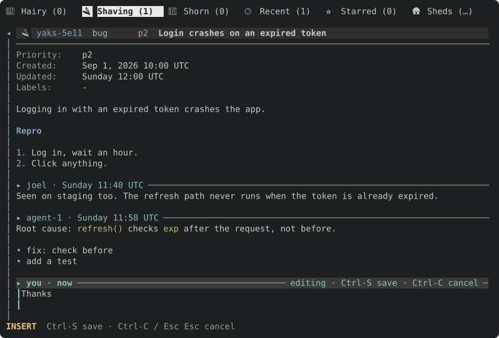
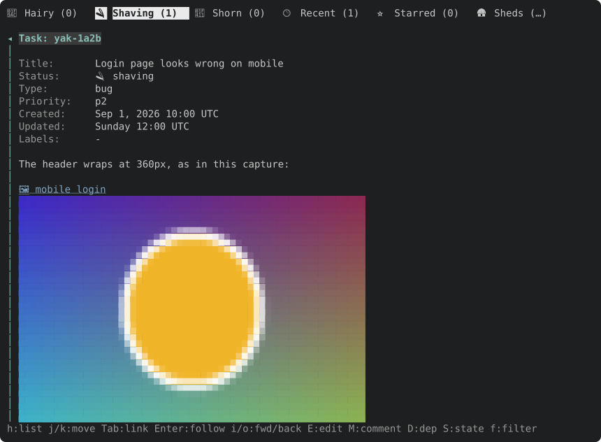
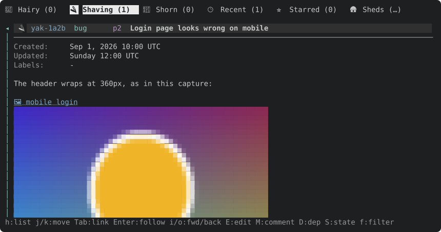
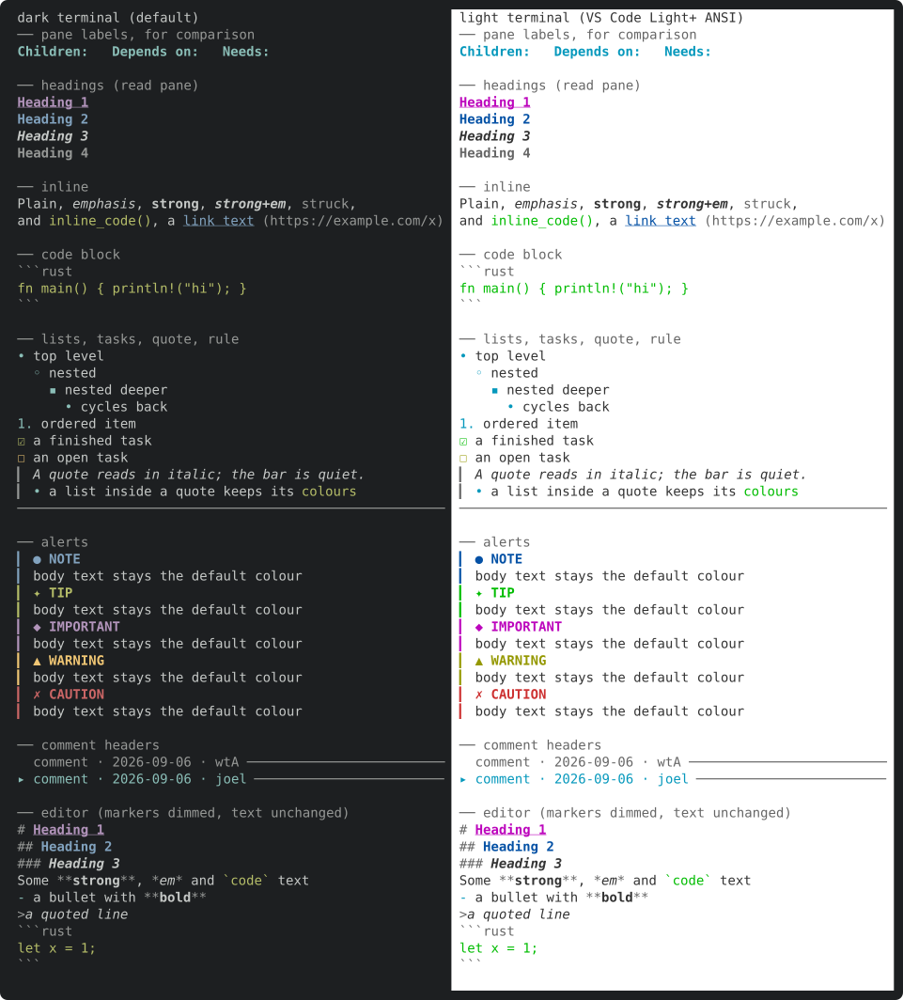
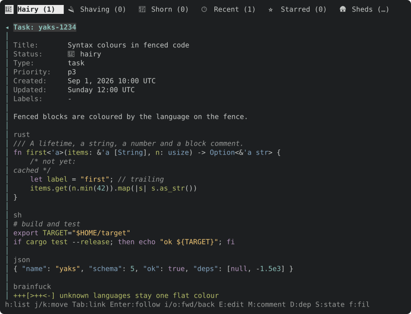
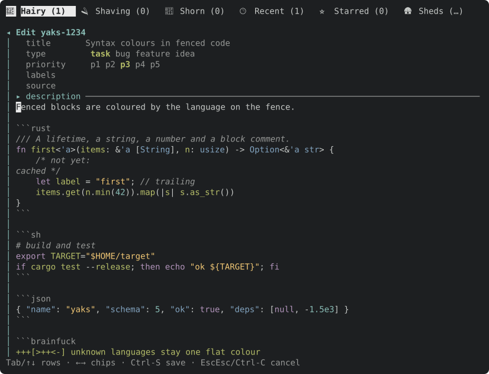
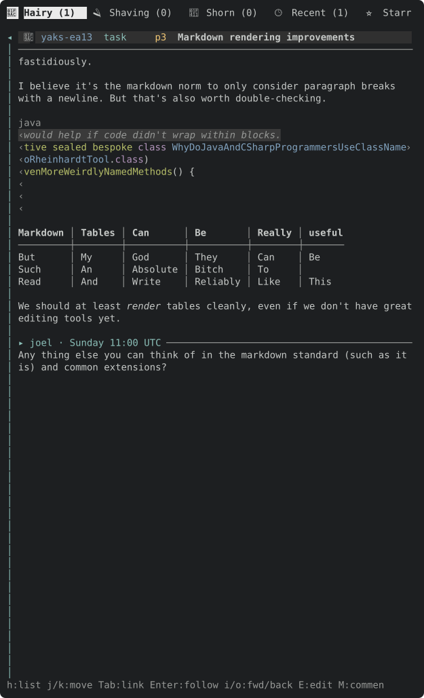
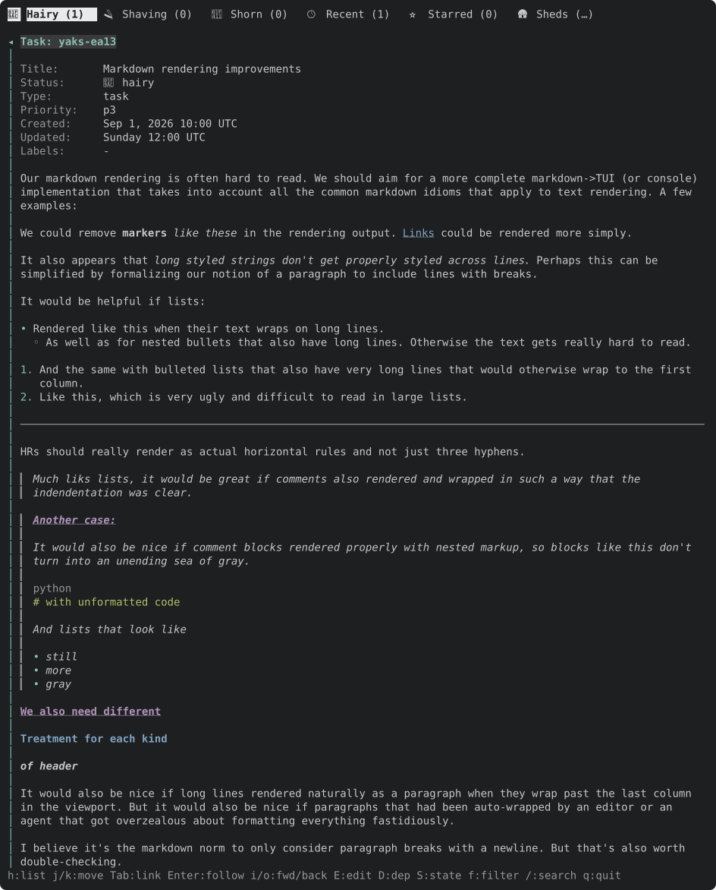
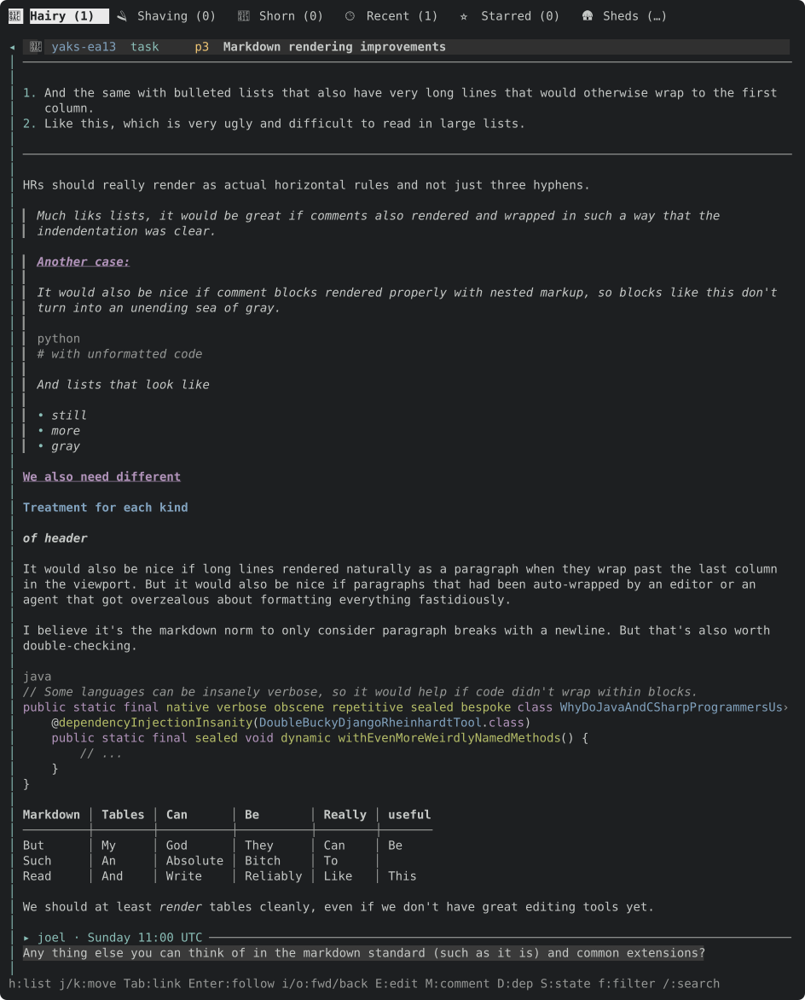

# TUI guide

`yaks tui` opens an interactive terminal UI over the same farm the CLI operates
on. Every mutation writes the same `.yaks/` files, so the TUI and CLI are
interchangeable.

## Layout

- **List pane** — the yaks in the active *view*, as a tree or flat list.
  Views are tabs across the top (`Tab`/`[`/`]` to switch). Built-in views
  include the default tree, **Recent**, **Inbox** (yaks with a `needs` value: awaiting a human, or answered and
  awaiting an agent), and
  **Starred**; you can save the current filter as a named view. The
  **Sheds** tab lists the repository's checkouts instead of yaks (see
  [Sheds tab](#sheds-tab)).
- **Detail pane** — the selected yak: fields, parent/deps/children, source, a
  `Needs:` line when blocked, and the body + timestamped notes. Task-id
  references and URLs in the body are followable links. It (and every
  right-side overlay) takes ~⅔ of the width, clamped to 48–120 columns; the
  list gets the rest. When that would leave the list under 48 columns (a
  terminal narrower than ~140), the
  pane covers the whole main area and its divider is tipped with `◂` — the
  list is behind it; `h`/`Esc` returns to it.
- **Filter drawer** (`f`) — toggle status / type / priority chips, a label and
  search box, a parent scope, and `ready` / `tangled` / `inbox` predicates. On a
  multi-herd farm it also grows a `herd` chip row to scope the list to one or
  more herds. The drawer composes into any view.
- **Farm chip** — on the tab row's right edge, what the farm has that git does
  not, and where the farm branch stands against its upstream (the one
  `yaks status` prints, read from local git: it never fetches, and nothing is
  ever committed or synced unless you press `W` / `U`). Dim text, in this order:
  `● 3 uncommitted` (yaks and other farm files git lacks), `not published`
  (the farm branch has no upstream), `↑2` (commits to push), and `↓1` (commits
  to pull: the one warning colour). Nothing is shown when the farm is clean and
  up to date or for a private farm. When the full text does not fit beside the
  tabs it shortens to `●3` and `unpub`, and is hidden if even that does not
  fit. An
  in-tree farm (`.yaks/` committed beside the code) has no branch of its own, so
  only the uncommitted count. It is re-read whenever the farm is (re)loaded: at
  startup, after every TUI change, and when files under `.yaks/` change; it
  does not notice a commit or push made elsewhere until then. The family label
  and notifications sit just left of it.
- **Status bar** — the active farm, view, and cursor context.

## Signals

- A **`⏳` badge** on a row marks a yak awaiting a human (`needs: human`); the
  detail `Needs:` line renders in a warning accent. A **`✅` badge** marks an
  answered yak awaiting an agent (`needs: agent`): it blocks nothing, so the
  detail `Needs:` line is plain and the row is never shown as awaiting a human.
- The dependency-blocked marker (`*`) and the multi-select marker (`●`) are
  distinct axes and can co-occur.
- The tab row's right edge shows the active **family scope** for tree views
  (`family: remaining`; a leading `~` means it inherits the global default).
  Cycle it with `h`.
- In a **multi-herd farm** (one `.yaks/` holding several id prefixes / herds),
  each row's id prefix is tinted by herd so herds are easy to scan, the create
  form's header shows which herd a new yak will join, and the detail pane gains a
  `Herd` field (between `Type` and `Priority`) that `H` moves the yak between.
  On a single-herd farm none of this chrome appears.

## Keys

**Movement** — `j`/`k` or `↓`/`↑` move; `d`/`u` half-page; `PgDn`/`PgUp`
full-page; `g`/`G` top/bottom.

**List pane**

| Key | Action |
|---|---|
| `Tab` / `S-Tab`, `[` / `]` | Next / previous view |
| `l` / `→` / `Enter` | Show detail pane |
| `h` | Cycle **family scope** — how much of each tree shows: auto → lone → remaining → all |
| `Space` | Collapse / expand subtree |
| `m` | Mark / unmark row (multi-select) |
| `S` (with marks) | Bulk state transition over the marked set (shearing asks for one optional comment for the set) |
| `v` / `V` | View picker / save filter as a view |
| `*` | Star / unstar (Starred view) |
| `W` | Commit the farm (`yaks commit`; also in the detail pane, not on the Sheds tab). The result is the notification: `committed <sha> <message>`, `nothing to commit`, or the error |
| `U` | Sync the farm (`yaks sync`: commit, pull, push; also in the detail pane). Shows `syncing…` while it runs (it touches the network, so the TUI waits), then the sync report's last line, or the error |

**Detail pane** — `h`/`←`/`Esc` back (on a code block or table row `h`/`←`
scroll it left first, and go back only at offset 0); `l`/`→` scroll the code
block or table under the cursor right (nowhere else); `j`/`k` scroll; `Tab`/`[`/`]` cycle links,
`Enter` follow; `B` find references (also in the list pane): a picker over
the yaks that point *at* this one — its children, the yaks that depend on it, and
those whose title, description or a note mentions its id — each row tagged with
how (`[child]`, `[depends]`, `[title]`, `[body:L3]`, `[note:<ts> [actor]]`);
type to filter, `Enter` goes to one like `#` (it is `yaks refs <id>
--incoming`); `i`/`o` nav forward/back (each yak reopens at the cursor and
scroll you left it at); `J`/`K` next/prev task; `Ctrl-N`/`Ctrl-P`
next/prev content block; `v` + `Shift-↑↓` visual-select lines, `y` copy;
`/`, `n`/`N` find (`Enter` keeps the cursor on the current match, `Esc` restores
the pre-find scroll and cursor).

**Edit**

| Key | Action |
|---|---|
| `c` / `C` | New root / child yak |
| `E` | Edit what the cursor is on: a body row (the description or a comment) turns that block into an editor **in place**; a header row (`Title:`, `Type:`, `Priority:`, `Labels:`, `Source:`, `Herd:`) opens the form on that field (`Status:` opens the state picker) |
| `P` / `T` / `L` / `S` | Priority / type / labels / state |
| `S` → `n` | Shear: a one-line prompt asks for an optional comment, recorded as a note on the yak before it moves to shorn (so `yaks doctor --strict` sees evidence). `Enter` on an empty line shears with no note; `Ctrl-C` (or `Esc` in emacs mode, a double-`Esc` in vim) cancels and leaves the yak as it was. With marks, the one comment goes on every yak that moves. |
| `D` / `R` | Add dependency / reparent |
| `H` | Move to another herd (multi-herd farms) |
| `M` | Add a comment (note): an empty editor under a `▸ you · now` header after the last comment, in place |
| `a` | Ask / answer (on a yak awaiting a human: answer, which sets `needs: agent`; otherwise ask, which sets `needs: human`) |
| `A` / `O` | Attach artifact / open it. An empty path pastes the clipboard PNG, then prompts for its name (empty keeps `paste-<timestamp>.png`). Opening (`O`, or `Enter` on the link) finds the file in this farm. A text attachment (UTF-8, up to 1 MiB, not an image) opens **in the pane**: a `.md`/`.markdown` file rendered as a yak body is, anything else verbatim and wrapped; `j`/`k`, `d`/`u`, `g`/`G` scroll, `E` edits it in place (the multi-line editor: `Ctrl-S` writes the file back under the farm lock and returns to the viewer, re-rendered; cancel returns unchanged, asking first if you typed anything; a file changed on disk meanwhile is not overwritten until a second `Ctrl-S`), `O` hands it to the OS opener, `Esc`/`q`/`h` close. An image (png, jpg, gif, webp up to 32 MiB; svg up to 4 MiB) opens **in the pane** too: drawn with the terminal's own graphics protocol (kitty, sixel, iTerm2) when it speaks one, else as half-block cells; shrunk to fit, never enlarged; `O` opens it externally, `Esc`/`q`/`h` close. An svg is rasterized first (see *Svg attachments* below); a corrupt or undecodable image and binary files open with the OS opener |
| `r` | (detail) Rename the attachment whose link (📎 or 🖼) the cursor is on (`Tab` to it); the file moves and every link is rewritten. The extension is kept if you omit it |
| `X` | Slaughter (delete, with confirm); on a yak with live descendants the confirm offers the whole family, naming how many go |
| `:w` / `:q` / `:wq` | Save / cancel / save+close (editor Normal mode) |
| `Enter` | (editor Insert mode, multi-line editors) Continue a markdown list or quote: `- `, `* `, `+ `, `1. ` / `1) ` (renumbered), `- [ ] ` (a `- [x] ` item continues as `- [ ] `) and `> ` start the next line with the same indent and marker; in the middle of a line the second half gets the marker; on an item with an empty body it removes the marker instead, ending the list. It is edtui's line break, so undo is unchanged. Single-line fields are unaffected |

**Editing in place** — `E` on a body row, or `M`, edits one content block
without leaving the detail pane. The block's rendered rows are replaced by an
editor showing its raw markdown, under its own header (accented, with an
`editing · Ctrl-S save · Ctrl-C cancel` hint) and beside a bar down the left;
everything above and below stays rendered and scrolls as usual. The editor's
cursor starts on the source line behind the row the line cursor was on. It is as
tall as the block's source lines plus one spare row, grows as you type, and is
capped so about four rows of context stay on screen (the editor scrolls inside
beyond that); the pane scrolls only as far as needed to show all of it. Every
key goes to the editor (vim or emacs, per `vim_mode`; `Tab` completes a yak
reference, `:w` / `:q` work in vim Normal mode). `Ctrl-S` saves just that block
(the other blocks are rewritten in their canonical form, so they keep their
text), `Ctrl-C` or a rapid `Esc Esc` cancels (asking first when you changed
something), and an empty new comment is not saved. After a save the block
re-renders in place and the line cursor stays on the same source line (on the
new comment's header after `M`). A save never drops what another process wrote
while the editor was open: notes or moves appended meanwhile are kept below
your edit, and if the yak changed any other way nothing is saved, the pane
reloads, and the editor reopens with your text (`changed on disk; not saved:
review and Ctrl-S again`).




**Image attachments** — `Enter` (or `O`) on an image link opens it in the pane
instead of the OS viewer. At startup the TUI asks the terminal which graphics
protocol it speaks (kitty, sixel or iTerm2, via `ratatui-image`) and its cell
size; a terminal that does not answer gets half-block cells, which is also what
headless frames and the SVG docshots show.


**Image size** — an author sizes a markdown image with a trailing token in its
alt text: ``, ``, ``
(`` for no alt). It is the one form that stays valid CommonMark
and reads as plain alt text on GitHub. The token is the alt's *last* word: `=`
then `W`, `xH` or `WxH`; `W` is digits with an optional `%` (of the pane's
content width) or `px`, `H` is digits with an optional `px` (no `%`); bare
digits are pixels; zero or anything else is not a size and stays in the alt.
The token never displays: `🖼 shot` shows without it. Pixels become cells with
the terminal's cell size, so the same image can take different cell counts per
terminal. Sizing rule (`imagesize::cells`): with **no size** an image is shown
at its natural size, shrunk to the pane width and a row cap, never enlarged (as
GitHub does); with a **width** (or a **height**) it takes that size, clamped to
the pane width, the other side following the aspect ratio, and no row cap; with
**both** it fits inside the `WxH` box, aspect kept. The viewer above still
fits the whole pane; the size applies to the inline image below.

**Inline images** — an image that is the whole of a top-level body paragraph
(`` on a line of its own, in a description or a comment) is
drawn in the detail pane, under its `🖼 shot` link row, which stays followable
(`Enter` opens the viewer). It is not drawn in place inside a sentence, a list, a
quote or a table: those stay the link row. The layout reserves the image's rows
from its file header alone, so a yak never waits on its pictures; the image is
decoded when it first scrolls into view and kept (a handful at a time). With no
size an image shows at its natural size, shrunk to the pane width and two thirds
of the pane's height; an explicit size (see above) may be taller. An image
partly scrolled out of view is **clipped** at the pane edge on every protocol
(kitty and half-block skip rows, sixel drops bands, iTerm2 draws row slices); one
fully out of view is not decoded. A remote (`http://`) image, a missing or
undecodable file stays the link row; an svg is drawn like any other image. Set `inline_images: false` in
`.yaks/config.yaml` to keep every image a link row (for a terminal whose image
protocol misbehaves).





**Svg attachments** — an `.svg` attachment (up to 4 MiB) is rasterized by
[toque](https://github.com/joelgwebber/toque)'s `png` feature (`resvg`) with
fonts embedded in the binary, never the system's, so a toque frame looks the
same on every machine and shows its text and color emoji even where no
monospace font is installed. The PNG is cached by the svg's content under
`$XDG_CACHE_HOME/yaks/svg/` (default `~/.cache/yaks/svg/`); it is rebuildable, a
read-only cache only costs a re-render (a few ms), and it is never in the farm.
The embedded fonts are DejaVu Sans Mono and a color emoji subset covering the
glyphs in our own frames: a character outside that subset renders blank, most
visibly the box-drawing corners of a bordered widget (the wider subset is a
known follow-up). A malformed svg opens with the OS opener.

**Pasting** — the TUI enables bracketed paste, so a terminal paste (`Cmd-V` /
`Ctrl-Shift-V`) lands in the focused text field as one literal insert: fast,
never interpreted as vim Normal-mode commands, newlines flattened to spaces in
single-line fields. A paste with no text field focused is ignored.

**Search & filter** — `/` inline search; `#` go to any yak (list or detail pane:
a picker over every yak — type an id fragment like `a1b2`, the full id, or
title words, then `Enter` opens its detail, switching to its view and recording
the jump so `o` comes back); `f` filter drawer; `Esc` revert filter to the
active view.

**Sheds tab** — its own keys (the yak keys do nothing there):

| Key | Action |
|---|---|
| `j` / `k`, `g` / `G`, `d` / `u` | Move between sheds |
| `l` / `→` / `Enter` | Show the shed: its git state and the yaks it wrote |
| `h` / `←` / `Esc` | (detail) Back to the shed list |
| `j` / `k` | (detail) Move between its yaks (newest write first) |
| `J` / `K` | (detail) Next / previous shed |
| `Enter` | (detail) Open the yak |
| `y` | Copy the shed's path (detail: the yak id) |
| `r` | Rescan now |

**General** — `y` copy yak id; `?` toggle help; `q` / `Ctrl-C` quit.

**Mouse** — the wheel scrolls the pane under the pointer (over the list it moves
the selection; over the detail it scrolls, or with the detail open, the list
wheel steps tasks like `J`/`K`). Left-click a row to select it (click it again to
open the detail; with the detail open, a click shows that row's yak and keeps it open), click a detail line to put the cursor there (click it again to
follow its link), and click a tab to switch view. The mouse is ignored while an
overlay (editor, picker, drawer, help) is open. Mouse back/forward buttons aren't
supported — the terminal library (crossterm) drops those buttons — so use `o`/`i`.
Capturing the mouse turns off the terminal's own click-drag text selection; hold
**Shift** while dragging (**Option/⌥** in some macOS terminals, e.g. iTerm2) to
select text natively.

**List pane** — the tree of a view (here the *Shaving* tab): ids, priorities,
types, status glyphs, titles, and dim labels. The `*` gutter marks a
dependency-blocked yak; the `⏳` marks one awaiting a human.


**Detail pane** — the selected yak. `Needs:` renders in a warning accent above
the fields; `Blocks:`/`Parent:` list linked yaks; the body carries the
description and timestamped, attributed notes (here a `[wtA]` → `[joel]`
human-in-the-loop exchange). `Created:`/`Updated:` read relative to now for
recent times (`just now`, `5m ago`, `3h ago`, `yesterday 14:05 -04:00`,
`Tuesday 09:30 -04:00`) and as an absolute date past a week
(`Aug 27, 2026 12:15 -04:00`), in your local timezone, which is always labelled.


Once you scroll past the frontmatter (`j`/`k`/`d`/`u`/`G`), a sticky one-line
header pins the yak's status, id, type, priority, and title to the top of the
pane, with a dim rule under it, so a long body never leaves you wondering which
yak you're reading. The unscrolled `Status:` field carries the same status icon.


**Markdown styles** — one palette (`src/tui/palette.rs`) styles markdown in the
detail pane and the editor, using only the 16 ANSI colours so it follows your
terminal theme on dark and light backgrounds. Body headings are magenta
underlined (H1), blue bold (H2) and bold italic (H3), deliberately unlike the
pane's own cyan-bold labels (`Children:`, `Depends on:`). In the editor
the markers (`#`, `>`, `**`, `*`, `~~`, backticks, link `[` `]` and the `(url)`)
are dimmed on the cursor's line and hidden on every other line, so the rest of
the text reads like the rendered pane; link text is blue underlined. Hidden
markers still occupy their cells (the terminal's "conceal" attribute draws them
blank), so nothing shifts when the cursor moves between lines. Fence lines stay
dim rather than hidden.
The swatch below shows every style on a dark and a light terminal.



**Code syntax colours** — a fenced block whose info string names a known
language (`rust`/`rs`, `sh`/`bash`/`shell`/`console`, `json`, `toml`,
`yaml`/`yml`, `python`/`py`, `js`/`ts`/`jsx`/`tsx`, `java`) is coloured token by
token, in the detail pane and in the editor alike: keywords magenta, strings
yellow, numbers cyan, comments dark grey italic, types and the keys of
json/toml/yaml blue, and anything else in the code block's green. Block comments
and multi-line strings carry across lines. It is a small lexer, not a parser,
so an odd construct costs a colour, never the layout. Any other language (or
none) stays one flat green. Colours are the 16 ANSI ones (`syntax_*` in
`src/tui/palette.rs`, lexers in `src/tui/syntax.rs`).





**Rendered markdown** — the detail pane renders a body as CommonMark
(GitHub-flavoured): markers are hidden, a single newline joins lines into one
paragraph that re-wraps to the pane width (a blank line starts a new one),
wrapped list items hang under their bullet, quotes keep their `▎` bar around
nested headings, lists and code, code blocks and tables are never wrapped (a fenced block's
language shows as a dim label row above it; see below for scrolling), and
`[text](url)` shows just its text (still followable with `Tab`/`Enter`; while
the line cursor is on such a link the status bar shows its destination, dim and
truncated, in place of the key hints). A link to a yak attachment
(`<id>/<file>`) is marked `📎` and an image `🖼`; `Enter` opens a text
attachment in the pane's viewer (below) and an image externally. A link to a **repo source file** is written as a path from the repo root
behind one `../` (`[code](../src/foo.rs)`, the shape from when a yak file sat
directly in `.yaks/`; yaks resolves it against the code checkout, so it keeps
working, but under herd directories it no longer resolves as a plain relative
link on GitHub); `#L12` or `#L12-L40` adds lines (GitHub's own fragment), and
`[code](../blob/<sha>/src/foo.rs#L12)` pins it to a commit (`<sha>` is 7 to 40 hex
digits). It shows as plain link text; the status bar shows `src/foo.rs:L12-L40`
(`@<sha7>` when pinned). `Enter`/`O` opens it in `$VISUAL`/`$EDITOR` at the line
(the TUI suspends while it runs, so a full-screen editor works),
else the OS opener. A pinned link whose file has changed since that commit opens
a read-only copy of `git show <sha>:<path>` under the temp directory
(`yaks-src/<sha>/…`); if the file is unchanged it opens the working copy. A link
that climbs out of the repo (`../../x`) is not a source link. Task lists show `☐`/`☑` and GitHub alerts (`> [!NOTE]`, `TIP`,
`IMPORTANT`, `WARNING`, `CAUTION`) a coloured bar with a title row. A footnote
reference shows as a dim `[n]` (numbered in order of first use) that `Enter`
follows to its definition; definitions collect at the end of their block
(description or comment) under a short dim rule, and `o` returns to the
reference. The description and each comment render separately, each comment under a
`▸ author · when` header. Yanking rendered rows (`v` … `y`) copies their source
markdown, not the displayed text. The editor still shows the raw source.

**Wide code blocks and tables** scroll sideways, one block at a time. With the
line cursor on a row of a code block or table, `l`/`→` scroll that block right
and `h`/`←` scroll it back (8 columns a press), clamped so the widest row ends
at the pane's right edge. The rest of the pane does not move: the language
label, the quote bar or list marker around a nested block, and every other
block stay put. A dim `‹` / `›` in a row's first / last column marks text
hidden on that side. `h`/`←` at offset 0, on any other row, and `Esc` anywhere
all keep their meaning, back to the list. The offset lasts only while the cursor
is on the block: moving off it (or to another yak) drops it. Yank still copies
the full source lines.







**Inbox** — the flat, cross-status list of every yak carrying a `needs` value
(`⏳` awaiting a human, `✅` answered and awaiting an agent). It is unpinned (no tab); reach it from the view picker (`v`) or the drawer
`inbox` chip.


**Filter drawer** (`f`) — status / type / priority chips plus label, search,
parent, and `ready`/`tangled`/`inbox` predicates, and — on a multi-herd farm —
a `herd` chip row to scope to one or more herds. It composes into any view.


Label fields (the `L` editor, the create/edit form's `labels`, the drawer's
label filter) take labels separated by commas and/or spaces — `ui, docs`,
`ui docs`, and `ui,docs` all mean `[ui, docs]`; a label can contain neither.

**Edit form** (`E`) — the shared create/edit form. Editing it is header fields
only: `title`, `type`, `priority`, `labels`, and `source` (the external-issue
URL; empty = none, so clearing it removes `source:`). The body is never part of
it: the description and comments are edited in place in the detail pane (see
above), so saving the form leaves the body byte-identical. `E` from the list
opens it with focus on `title`; `E` on a header line of the detail pane jumps to
that row (`Source:` to `source`, and so on). Creating (`c`/`C`) uses the same
form plus a `description` editor below the header rows. Single-line rows scroll
horizontally to keep the cursor in view rather than wrapping — a nudge to keep
titles terse. On a multi-herd farm it grows a `herd` chip row (seeded to the
yak's current herd) after `source`, so changing it and saving moves the yak to
that herd (an id-prefix rename). `H` does the same move as a one-key picker.


## Sheds tab

The **🛦 Sheds** tab is `yaks sheds` on screen: every checkout of the
repository (the primary `main`, git worktrees, Delta clones), live, so you can
see what each worker's thread is doing without opening a terminal in its
checkout. Every checkout shares this one farm, and each write records the
checkout it came from in the farm's local activity log, so a shed's activity is
just the yaks it wrote. The text is the CLI's own (the same functions produce
it).

- **One row per shed**, attention first: `main`, then sheds with an open ask
  (`⏳`), active ones (wrote within 2 hours), stale ones (hold a shaving yak but
  went quiet), then idle ones, dimmed; within each, the most recent writer
  first. `*` marks the checkout the TUI runs in. Each row shows its liveness,
  `+ahead -behind` against this checkout, `✎` and its count of uncommitted
  files, the yaks it is shaving (else the last yak it wrote), and its `state`
  (`merged, clean`: safe to delete; or what uncommitted files keep it). A
  footer counts orphaned Delta pins (finished threads; `yaks discover` lists
  them). The farm branch's own worktree is not a row.
- **The tab count** is the number of sheds busy right now (active, stale, or
  asking).
- **The detail pane** (`l`) shows the shed's path, git state, `state`, its
  activity label, then every yak it wrote, newest first, with its status now
  (`⏳` on one awaiting a human). `Enter` opens the yak; answer an ask with `a`
  from any yak view, as for any other yak.
- **Refresh**: the scan runs in the background (git in every checkout), when
  the tab opens, every 10 seconds while it is shown, and on `r`. The tab row's
  right edge says `scanning…` or `scanned 4s ago`. The UI never waits on it.
- Nothing on the tab removes a shed; cleanup stays advisory (`y` copies the
  path).


# Screenshots

These are generated headlessly: the [`toque`](https://github.com/joelgwebber/toque) crate
drives the TUI into an in-memory ratatui buffer and renders it to a self-contained
color SVG (`toque::render_to_svg`). They are deterministic and regenerate with the
UI (no live-terminal capture), via:

```sh
cargo test -p yaks docshots -- --ignored   # writes docs/assets/*.svg
```

`docshots_session` (same command, it matches the filter) also scripts a real protocol
session (`key Tab`, `key j`, `key l`) and writes `docs/assets/session.txt` (the text
transcript) plus `session-N.svg` for each frame. [toque](https://github.com/joelgwebber/toque)'s
README embeds copies of those frames (as `docs/assets/yaks-session-N.svg`) — refresh them
there when the TUI's look changes.

## Rasterizing an SVG to view it

The TUI's image viewer rasterizes an svg attachment itself (see *Svg
attachments* above), so a frame attached with `yaks attach` can be looked at in
`yaks tui`. For a file on disk, or a pixel-faithful look at the color emoji and
the system's fonts, use a real **browser engine**: headless Chrome writes a PNG
you — or an agent whose file tools only read in-project paths — can then open;
keep it in a gitignored dir such as `target/`:

```sh
mkdir -p target/svgcmp
"/Applications/Google Chrome.app/Contents/MacOS/Google Chrome" \
  --headless=new --disable-gpu --force-device-scale-factor=2 \
  --screenshot=target/svgcmp/out.png \
  --window-size=<W>,<H> docs/assets/tui-list.svg
```

`<W>`/`<H>` are the SVG's `width`/`height` (the first line of the file). A higher
`--force-device-scale-factor` yields a crisper image / more pixels to hand an LLM.
To pixel-diff two renders: `magick compare -metric AE a.png b.png /dev/null`.
