# TUI guide

`yaks tui` opens an interactive terminal UI over the same farm the CLI operates
on. Every mutation writes the same `.yaks/` files, so the TUI and CLI are
interchangeable.

## Layout

- **List pane** — the yaks in the active *view*, as a tree or flat list.
  Views are tabs across the top (`Tab`/`[`/`]` to switch). Built-in views
  include the default tree, **Recent**, **Inbox** (yaks with a `needs` value: awaiting a human, or answered or requested and
  awaiting an agent), and
  **Starred**; you can save the current filter as a named view. The
  **Wiki** tab lists the farm's pages and sources (see [Wiki tab](#wiki-tab)),
  and the **Sheds** tab lists the farm's workers (actors) instead of yaks (see
  [Sheds tab](#sheds-tab)).
- **Detail pane** — the selected yak: fields, parent/deps/children, source and
  pull requests (`PRs:`, one row per URL; set with `yaks update --pr`), a
  `Needs:` line when blocked, and the body + timestamped notes. Task-id
  references and URLs in the body, the `Source:` URL and the `PRs:` URLs are
  followable links. It (and every
  right-side overlay) takes ~⅔ of the width, clamped to 48–120 columns; the
  list gets the rest. When that would leave the list under 48 columns (a
  terminal narrower than ~140), the
  pane covers the whole main area and its divider is tipped with `◂` — the
  list is behind it; `h`/`Esc` returns to it.
- **Filter drawer** (`f`) — toggle status / type / priority chips, a tag and
  search box, a parent scope, and `ready` / `tangled` / `inbox` predicates. On a
  multi-herd farm it also grows a `herd` chip row to scope the list to one or
  more herds. The drawer composes into any view.
- **Farm chip** — on the tab row's right edge, what the farm has that git does
  not, and where the farm branch stands against its upstream (the one
  `yaks status` prints, read from local git: it never fetches, and nothing is
  ever committed unless you press `W`; it is synced by `U` or by the interval
  sync below). Dim text, in this order:
  `● 3 uncommitted` (yaks and other farm files git lacks), `not published`
  (the farm branch has no upstream), `↑2` (commits to push), and `↓1` (commits
  to pull: the one warning colour). Nothing is shown when the farm is clean and
  up to date. When the full text does not fit beside the tabs it shortens to
  `●3` and `unpub`, and is hidden if even that does not fit. It is re-read whenever the farm is (re)loaded: at
  startup, after every TUI change, and when files under `.yaks/` change; it
  does not notice a commit or push made elsewhere until then (the interval sync
  below is what brings it up to date). The family label
  and notifications sit just left of it.
- **Recurring yaks** — on load and on each sync tick (`sync_interval`, also
  when there is no remote to sync) the TUI runs `yaks regrow-due`: a shorn yak
  with `every:` whose next occurrence has arrived is hairy again, with a
  `regrew …` notice, and the list reloads. `YAKS_NO_AUTOSYNC` stops the ticks;
  the load-time pass still runs.
- **Interval sync** — every `sync_interval` (`.yaks/config.yaml`; seconds or
  `30s` / `5m` / `2h`; default `5m`; `0` or `off` turns it off) the TUI runs the
  same sync as `U` on a background thread, so the UI never waits for the
  network, then reloads, and upstream changes appear with no key pressed. A
  tick is skipped when the farm has no remote, a sync is still running, an
  overlay or editor is open, or a `W`/`U` is queued (it is tried again one
  interval later). A private farm only pulls, never pushes. A failure shows once
  as `auto-sync failed: …` in the notification area, not on every tick; a
  success is silent. `YAKS_NO_AUTOSYNC=1` turns it off for a run (tests,
  headless). A value that does not parse keeps the default. It is farm-wide,
  not per herd, and only the TUI does it: the CLI still syncs only when asked.
- **Status bar** — the active farm, view, and cursor context.

## Signals

- A **`⏳` badge** on a row marks a yak awaiting a human (`needs: human`); the
  detail `Needs:` line renders in a warning accent. A **`✅` badge** marks a
  yak awaiting an agent (`needs: agent`), answered or requested: it blocks
  nothing, so the detail `Needs:` line is plain (`agent (answered, awaiting
  pickup)` or `agent (requested, …)`) and the row is never shown as awaiting a human.
- A hairy or shaving yak with a `due:` shows the date at the right of its row,
  dim, and **red once it is overdue**; the detail view shows `Due:` (in the
  warning accent when overdue), `Every:` and `Regrown:` rows. A shorn yak is
  never overdue. See [Due dates and recurring
  yaks](cli.md#due-dates-and-recurring-yaks).
- The dependency-blocked marker (`*`) and the multi-select marker (`●`) are
  distinct axes and can co-occur.
- The tab row's right edge shows the active **family scope** for tree views
  (`family: remaining`; a leading `~` means it inherits the global default).
  Cycle it with `h`.
- In a **multi-herd farm** (one `.yaks/` holding several id prefixes / herds),
  each row's id prefix is tinted by herd so herds are easy to scan, the create
  form's header shows which herd a new yak will join, and the detail pane gains a
  `Herd` field (between `Type` and `Priority`) that `H` moves the yak between.
  On a single-herd farm none of this chrome appears.

## Keys

**Movement** — `j`/`k` or `↓`/`↑` move; `d`/`u` half-page; `PgDn`/`PgUp`
full-page; `g`/`G` top/bottom.

**List pane**

| Key | Action |
|---|---|
| `Tab` / `S-Tab`, `[` / `]` | Next / previous view |
| `l` / `→` / `Enter` | Show detail pane |
| `h` | Cycle **family scope** — how much of each tree shows: auto → lone → remaining → all |
| `Space` | Collapse / expand subtree |
| `m` | Mark / unmark row (multi-select) |
| `S` (with marks) | Bulk state transition over the marked set (shearing asks for one optional comment for the set) |
| `v` / `V` | View picker / save filter as a view |
| `*` | Star / unstar (Starred view) |
| `W` | Commit the farm (`yaks commit`; also in the detail pane, not on the Sheds tab). The result is the notification: `committed <sha> <message>`, `nothing to commit`, or the error |
| `U` | Sync the farm (`yaks sync`: commit, pull, push; also in the detail pane). Shows `syncing…` while it runs (it touches the network, so the TUI waits; the interval sync does the same in the background), then the sync report's last line, or the error |

**Detail pane** — `h`/`←`/`Esc` back (on a code block or table row `h`/`←`
scroll it left first, and go back only at offset 0); `l`/`→` scroll the code
block or table under the cursor right (nowhere else); `j`/`k` scroll; `Tab`/`[`/`]` cycle links,
`Enter` follow; `B` find references (also in the list pane): a picker over
the yaks that point *at* this one — its children, the yaks that depend on it, and
those whose title, description or a note mentions its id — each row tagged with
how (`[child]`, `[depends]`, `[title]`, `[body:L3]`, `[note:<ts> [actor]]`);
type to filter, `Enter` goes to one like `#` (it is `yaks refs <id>
--incoming`); `i`/`o` nav forward/back (each yak reopens at the cursor and
scroll you left it at); `J`/`K` next/prev task; `Ctrl-N`/`Ctrl-P`
next/prev content block; `v` + `Shift-↑↓` visual-select lines, `y` copy;
`/`, `n`/`N` find (`Enter` keeps the cursor on the current match, `Esc` restores
the pre-find scroll and cursor).

**Edit**

| Key | Action |
|---|---|
| `c` / `C` | New root / child yak |
| `E` | Edit what the cursor is on: a body row (the description or a comment) turns that block into an editor **in place**; a header row (`Title:`, `Type:`, `Priority:`, `Tags:`, `Source:`, `Herd:`) opens the form on that field (`Status:` opens the state picker) |
| `P` / `T` / `L` / `S` | Priority / type / tags / state. State moves keep families consistent like the CLI's ([Families stay consistent](cli.md#families-stay-consistent)): shaving also shaves hairy ancestors, and a move that would leave open work under a shorn or dead yak is refused |
| `S` → `n` | Shear: a one-line prompt asks for an optional comment, recorded as a note on the yak before it moves to shorn (so `yaks doctor --strict` sees evidence). `Enter` on an empty line shears with no note; `Ctrl-C` (or `Esc` in emacs mode, a double-`Esc` in vim) cancels and leaves the yak as it was. With marks, the one comment goes on every yak that moves. |
| `D` / `R` | Add dependency / reparent |
| `H` | Move to another herd (multi-herd farms) |
| `M` | Add a comment (note): an empty editor under a `▸ you · now` header after the last comment, in place |
| `a` | Hand the yak to an agent (`needs: agent`): on a yak awaiting a human, answer; otherwise request agent work (like `yaks request`; on a yak already awaiting an agent the request is appended). Opens the same multi-line editor as `M`, headed `Answer <id>` / `Request <id>`; `Ctrl-S` answers or requests with the text as the note (an empty one does so with no note), cancel changes nothing |
| `Q` | Ask a question (`needs: human`, out of `next` until answered; on a yak awaiting an agent it flips back to a human). The same editor, headed `Ask <id>` |
| `A` / `O` | Attach artifact / open it. An empty path pastes the clipboard PNG, then prompts for its name (empty keeps `paste-<timestamp>.png`). Opening (`O`, or `Enter` on the link) finds the file in this farm. A text attachment (UTF-8, up to 1 MiB, not an image) opens **in the pane**: a `.md`/`.markdown` file rendered as a yak body is, anything else verbatim and wrapped. It navigates like the detail pane, by the same code: `j`/`k`, `d`/`u`, `g`/`G` move a line cursor, `Tab`/`[`/`]` cycle links and `Enter` follows one (the status bar shows a URL's destination; a footnote or `#section` jumps within the file and `o`/`i` go back/forward; a yak id opens that yak in the detail pane; a farm page or source opens in the viewer at its anchor, `o` coming back (see [Following links](#following-links-and-peek)); an attachment, URL or source file opens as from the detail pane; a pane under the page peeks the link under the cursor, `p` hides it), `/` finds with `n`/`N` cycling, `v`/Shift-↑↓ select and `y`/`Enter` copy (a `.md` file copies its source markdown), `h`/`l` scroll a code block or table sideways, `Esc` clears a selection, then a find, then closes. `E` edits it in place (the multi-line editor: `Ctrl-S` writes the file back under the farm lock and returns to the viewer, re-rendered; cancel returns unchanged, asking first if you typed anything; a file changed on disk meanwhile is not overwritten until a second `Ctrl-S`), `O` hands it to the OS opener, `q`/`h` close. An image (png, jpg, gif, webp up to 32 MiB; svg up to 4 MiB) opens **in the pane** too: drawn with the terminal's own graphics protocol (kitty, sixel, iTerm2) when it speaks one, else as half-block cells; shrunk to fit, never enlarged; `O` opens it externally, `Esc`/`q`/`h` close. An svg is rasterized first (see *Svg attachments* below); a corrupt or undecodable image and binary files open with the OS opener |
| `r` | (detail) Rename the attachment whose link (📎 or 🖼) the cursor is on (`Tab` to it); the file moves and every link is rewritten. The extension is kept if you omit it |
| `X` | Slaughter (delete, with confirm); on a yak with hairy or shaving descendants the confirm offers to take them too, naming how many go (shorn ones stay shorn) |
| `:w` / `:q` / `:wq` | Save / cancel / save+close (editor Normal mode) |
| `Enter` | (editor Insert mode, multi-line editors) Continue a markdown list or quote: `- `, `* `, `+ `, `1. ` / `1) ` (renumbered), `- [ ] ` (a `- [x] ` item continues as `- [ ] `) and `> ` start the next line with the same indent and marker; in the middle of a line the second half gets the marker; on an item with an empty body it removes the marker instead, ending the list. It is edtui's line break, so undo is unchanged. Single-line fields are unaffected |

**Editing in place** — `E` on a body row, or `M`, edits one content block
without leaving the detail pane. The block's rendered rows are replaced by an
editor showing its raw markdown, under its own header (accented, with an
`editing · Ctrl-S save · Ctrl-C cancel` hint) and beside a bar down the left;
everything above and below stays rendered and scrolls as usual. The editor's
cursor starts on the source line behind the row the line cursor was on. It is as
tall as the block's source lines plus one spare row, grows as you type, and is
capped so about four rows of context stay on screen (the editor scrolls inside
beyond that); the pane scrolls only as far as needed to show all of it. Every
key goes to the editor (vim or emacs, per `vim_mode`; `Tab` completes a yak
reference, `:w` / `:q` work in vim Normal mode). `Ctrl-S` saves just that block
(the other blocks are rewritten in their canonical form, so they keep their
text), `Ctrl-C` or a rapid `Esc Esc` cancels (asking first when you changed
something), and an empty new comment is not saved. After a save the block
re-renders in place and the line cursor stays on the same source line (on the
new comment's header after `M`). A save never drops what another process wrote
while the editor was open: notes or moves appended meanwhile are kept below
your edit, and if the yak changed any other way nothing is saved, the pane
reloads, and the editor reopens with your text (`changed on disk; not saved:
review and Ctrl-S again`).

A comment's [metadata](cli.md#note-metadata) shows in its header after `actor · when`, `kind` first and the other keys as `key value` (`▸ tex-1 · 2h ago · checkpoint · commit 47076b0`); its `key: value` lines are not part of the editable text, and saving the comment keeps them.

`a` opens this editor too, as a new note headed `Ask <id> · you · now` or
`Answer <id> · you · now`, with a `Ctrl-S ask (needs: human)` or `Ctrl-S answer
(needs: agent)` hint: saving sets `needs` (via the same path as `yaks ask` /
`yaks answer`) and records the text as the note, rather than appending a plain
comment.

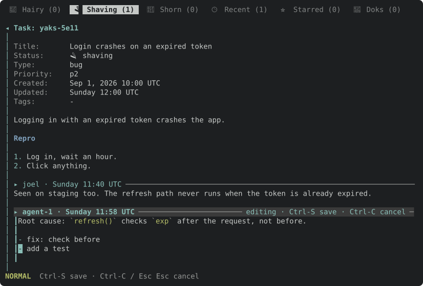

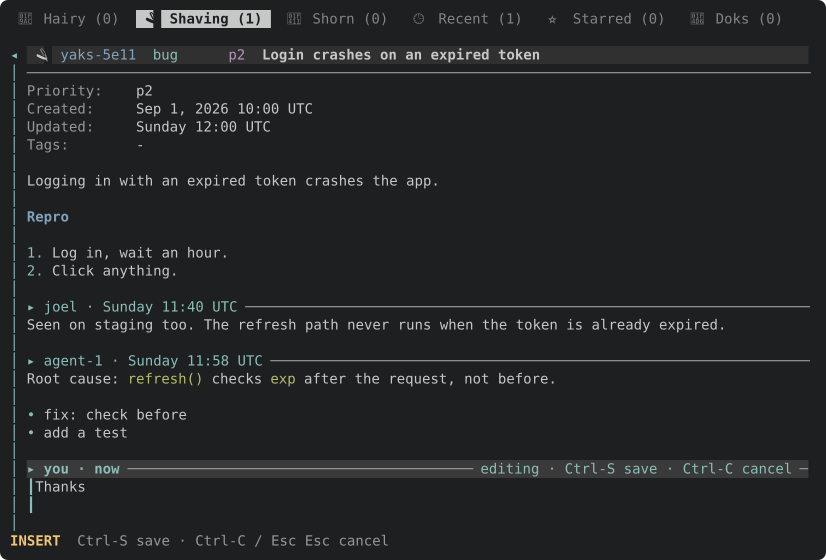

**Image attachments** — `Enter` (or `O`) on an image link opens it in the pane
instead of the OS viewer. At startup the TUI asks the terminal which graphics
protocol it speaks (kitty, sixel or iTerm2, via `ratatui-image`) and its cell
size; a terminal that does not answer gets half-block cells, which is also what
headless frames and the SVG docshots show.

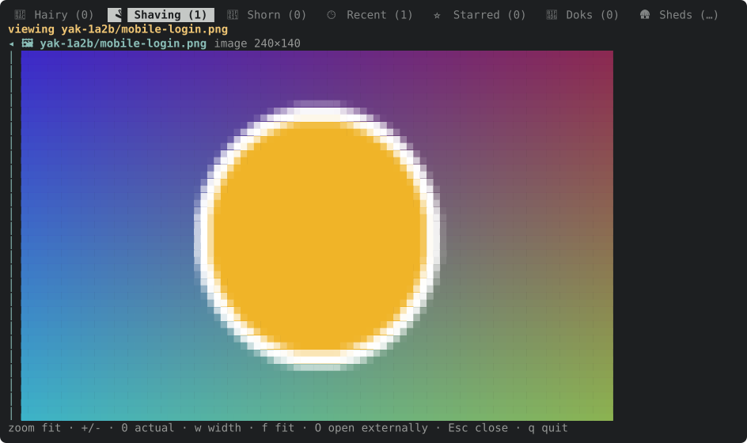

**Image size** — an author sizes a markdown image with a trailing token in its
alt text: ``, ``, ``
(`` for no alt). It is the one form that stays valid CommonMark
and reads as plain alt text on GitHub. The token is the alt's *last* word: `=`
then `W`, `xH` or `WxH`; `W` is digits with an optional `%` (of the pane's
content width) or `px`, `H` is digits with an optional `px` (no `%`); bare
digits are pixels; zero or anything else is not a size and stays in the alt.
The token never displays: `🖼 shot` shows without it. Pixels become cells with
the terminal's cell size, so the same image can take different cell counts per
terminal. Sizing rule (`imagesize::cells`): with **no size** an image is shown
at its natural size, shrunk to the pane width and a row cap, never enlarged (as
GitHub does); with a **width** (or a **height**) it takes that size, clamped to
the pane width, the other side following the aspect ratio, and no row cap; with
**both** it fits inside the `WxH` box, aspect kept. The viewer above still
fits the whole pane; the size applies to the inline image below.

**Inline images** — an image that is the whole of a top-level body paragraph
(`` on a line of its own, in a description or a comment) is
drawn in the detail pane, under its `🖼 shot` link row, which stays followable
(`Enter` opens the viewer). It is not drawn in place inside a sentence, a list, a
quote or a table: those stay the link row. The layout reserves the image's rows
from its file header alone, so a yak never waits on its pictures; the image is
decoded when it first scrolls into view and kept (a handful at a time). With no
size an image shows at its natural size, shrunk to the pane width and two thirds
of the pane's height; an explicit size (see above) may be taller. An image
partly scrolled out of view is **clipped** at the pane edge on every protocol
(kitty and half-block skip rows, sixel drops bands, iTerm2 draws row slices); one
fully out of view is not decoded. The line cursor treats an image as one row, its
link row: one `j` crosses the whole picture, as in edit mode, and a click on the
picture selects that row (a second click opens the viewer). A remote (`http://`) image, an svg (its size
is not in a file header; `Enter` still opens it in the viewer), a missing or
undecodable file stays the link row. Set `inline_images: false` in
`.yaks/config.yaml` to keep every image a link row (for a terminal whose image
protocol misbehaves).

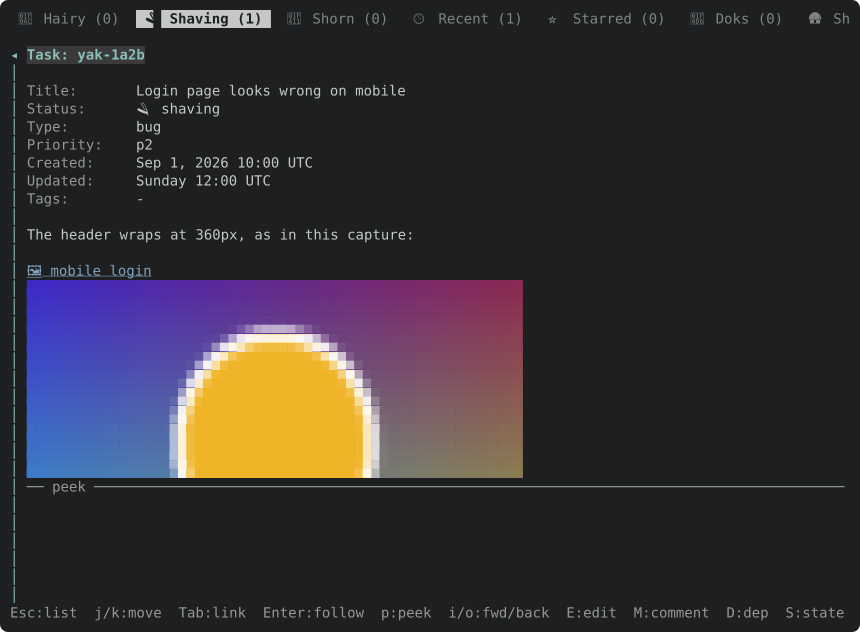

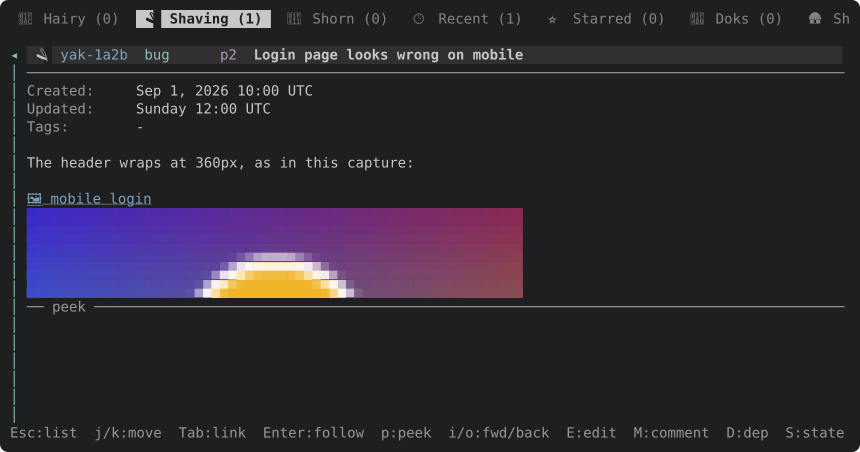

**Svg attachments** — an `.svg` attachment (up to 4 MiB) is rasterized by
[toque](https://github.com/joelgwebber/toque)'s `png` feature (`resvg`) with
fonts embedded in the binary, never the system's, so a toque frame looks the
same on every machine and shows its text and color emoji even where no
monospace font is installed. The PNG is cached by the svg's content under
`$XDG_CACHE_HOME/yaks/svg/` (default `~/.cache/yaks/svg/`); it is rebuildable, a
read-only cache only costs a re-render (a few ms), and it is never in the farm.
The embedded fonts are DejaVu Sans Mono and a color emoji subset covering the
glyphs in our own frames: a character outside that subset renders blank, most
visibly the box-drawing corners of a bordered widget (the wider subset is a
known follow-up). A malformed svg opens with the OS opener.

**Pasting** — the TUI enables bracketed paste, so a terminal paste (`Cmd-V` /
`Ctrl-Shift-V`) lands in the focused text field as one literal insert: fast,
never interpreted as vim Normal-mode commands, newlines flattened to spaces in
single-line fields. A paste with no text field focused is ignored.

**Search & filter** — `/` inline search; `#` go to any yak (list or detail pane:
a picker over every yak — type an id fragment like `a1b2`, the full id, or
title words, then `Enter` opens its detail, switching to its view and recording
the jump so `o` comes back); `f` filter drawer; `Esc` revert filter to the
active view.

**Wiki tab** — its own keys (the yak keys do nothing there):

| Key | Action |
|---|---|
| `j` / `k`, `g` / `G`, `d` / `u` | Move between pages (then sources) |
| `l` / `→` / `Enter` | Open the page or source in the viewer (it navigates like the detail pane) |
| `/` | Search titles, paths, kinds and tags; `Esc` clears it |
| `E` | Edit the page in place (also `E` in its viewer): frontmatter and body in one editor, `Ctrl-S` saves |
| `N` | New page: type its path, then write its body |
| `y` | Copy the path |
| `r` | Reread the pages now |

**Sheds tab** — its own keys (the yak keys do nothing there):

| Key | Action |
|---|---|
| `j` / `k`, `g` / `G`, `d` / `u` | Move between sheds (actors) |
| `l` / `→` / `Enter` | Show the shed: what it is shaving, asking and wrote recently |
| `h` / `←` / `Esc` | (detail) Back to the shed list |
| `j` / `k` | (detail) Move between its yaks (newest write first) |
| `J` / `K` | (detail) Next / previous shed |
| `Enter` | (detail) Open the yak |
| `y` | Copy the shed's name (detail: the yak id) |
| `r` | Rescan now |

**General** — `y` copy yak id; `?` toggle help; `q` / `Ctrl-C` quit.

**Mouse** — the wheel scrolls the pane under the pointer (over the list it moves
the selection; over the detail it scrolls, or with the detail open, the list
wheel steps tasks like `J`/`K`). Left-click a row to select it (click it again to
open the detail; with the detail open, a click shows that row's yak and keeps it open), click a detail line to put the cursor there (click it again to
follow its link), and click a tab to switch view. The mouse is ignored while an
overlay (editor, picker, drawer, help) is open. Mouse back/forward buttons aren't
supported — the terminal library (crossterm) drops those buttons — so use `o`/`i`.
Capturing the mouse turns off the terminal's own click-drag text selection; hold
**Shift** while dragging (**Option/⌥** in some macOS terminals, e.g. iTerm2) to
select text natively.

**List pane** — the tree of a view (here the *Shaving* tab): ids, priorities,
types, status glyphs, titles, and dim labels. The `*` gutter marks a
dependency-blocked yak; the `⏳` marks one awaiting a human.

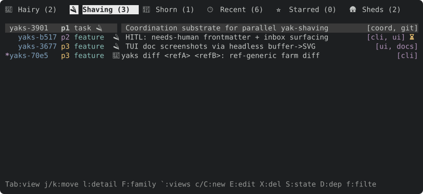

**Detail pane** — the selected yak. `Needs:` renders in a warning accent above
the fields; `Blocks:`/`Parent:` list linked yaks; the body carries the
description and timestamped, attributed notes (here a `[wtA]` → `[joel]`
human-in-the-loop exchange). `Created:`/`Updated:` read relative to now for
recent times (`just now`, `5m ago`, `3h ago`, `yesterday 14:05 -04:00`,
`Tuesday 09:30 -04:00`) and as an absolute date past a week
(`Aug 27, 2026 12:15 -04:00`), in your local timezone, which is always labelled.

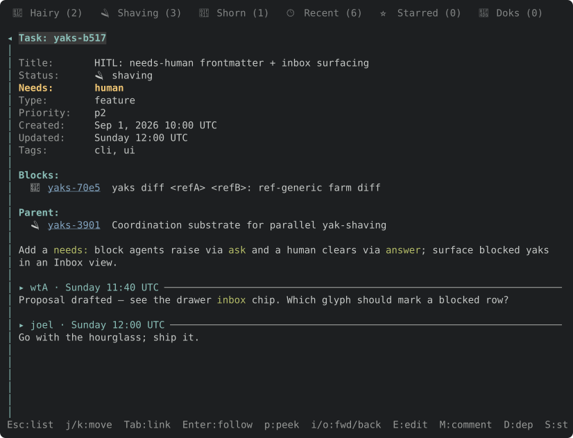

Once you scroll past the frontmatter (`j`/`k`/`d`/`u`/`G`), a sticky one-line
header pins the yak's status, id, type, priority, and title to the top of the
pane, with a dim rule under it, so a long body never leaves you wondering which
yak you're reading. The unscrolled `Status:` field carries the same status icon.

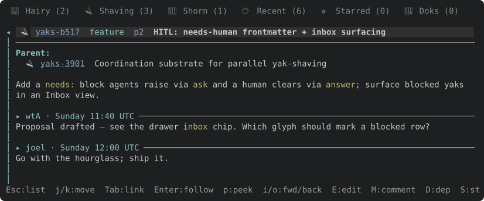

**Markdown styles** — one palette (`src/tui/palette.rs`) styles markdown in the
detail pane and the editor, using only the 16 ANSI colours so it follows your
terminal theme on dark and light backgrounds. Body headings are magenta
underlined (H1), blue bold (H2) and bold italic (H3), deliberately unlike the
pane's own cyan-bold labels (`Children:`, `Depends on:`). In the editor
the markers (`#`, `>`, `**`, `*`, `~~`, backticks, link `[` `]` and the `(url)`)
are dimmed on the cursor's line and hidden on every other line, so the rest of
the text reads like the rendered pane; link text is blue underlined. Hidden
markers still occupy their cells (the terminal's "conceal" attribute draws them
blank), so nothing shifts when the cursor moves between lines. Fence lines stay
dim rather than hidden.
The swatch below shows every style on a dark and a light terminal.

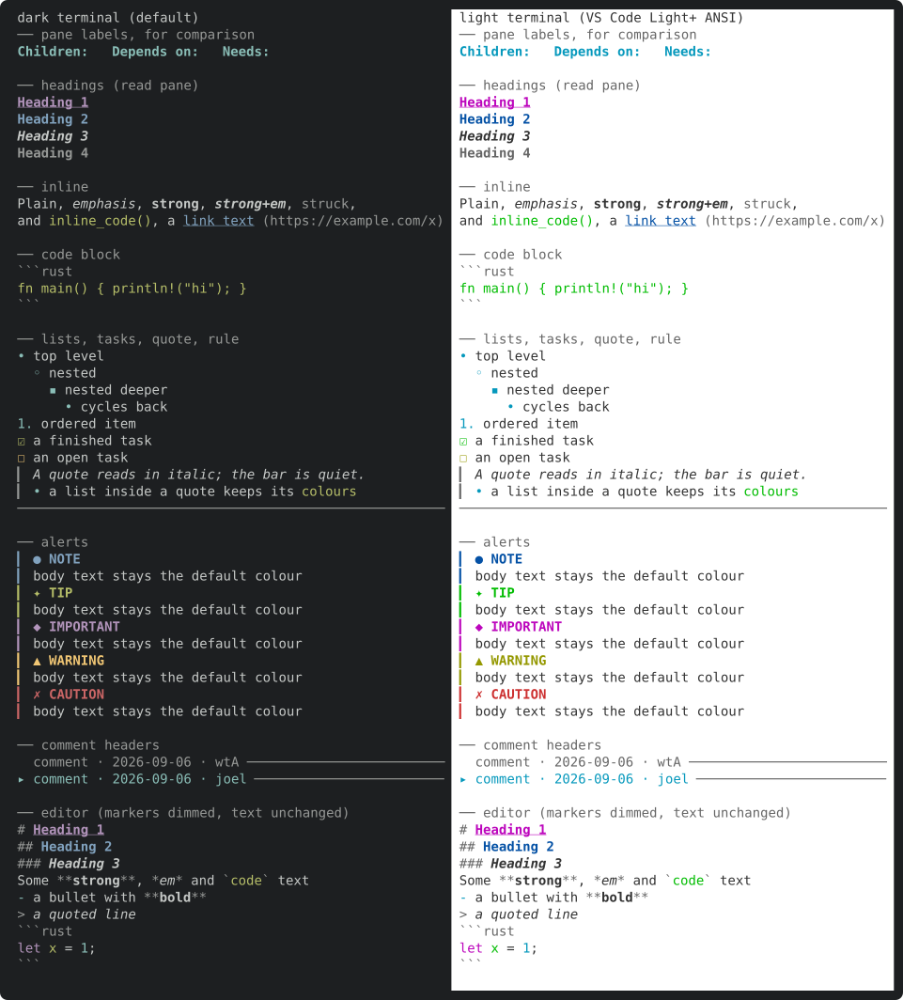

**Highlight bands** — the subtle background behind the selected row, the detail
line cursor and a visual selection is not a fixed grey: at startup the TUI asks
the terminal for its background and foreground colours (OSC 10/11) and blends
the background a little toward the foreground, so the band is subtle on any theme,
dark or light. The active tab and the editor's block cursor are plain reverse
video, which every theme resolves itself. If the terminal does not answer (some
tmux and ssh setups), `COLORFGBG` is read, else the bands are the dark greys.
Without `COLORTERM=truecolor` the blend is rounded to the nearest 256-colour
index. Set `YAKS_THEME=dark` or `YAKS_THEME=light` to override detection. The
colours are read once, so a terminal that switches theme mid-session needs a
restart of `yaks tui`.

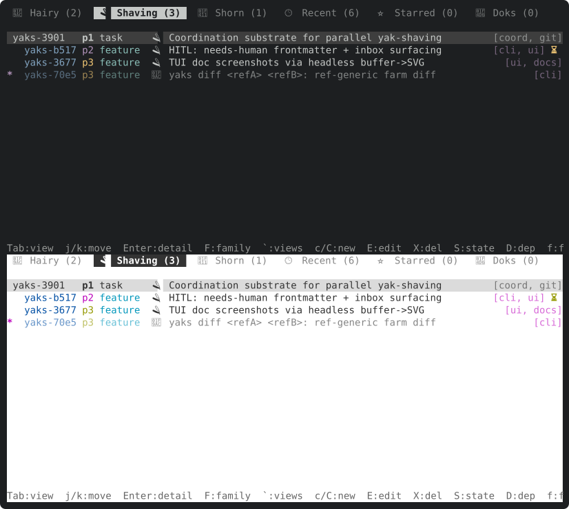

**Code syntax colours** — a fenced block whose info string names a known
language (`rust`/`rs`, `sh`/`bash`/`shell`/`console`, `json`, `toml`,
`yaml`/`yml`, `python`/`py`, `js`/`ts`/`jsx`/`tsx`, `java`) is coloured token by
token, in the detail pane and in the editor alike: keywords magenta, strings
yellow, numbers cyan, comments dark grey italic, types and the keys of
json/toml/yaml blue, and anything else in the code block's green. Block comments
and multi-line strings carry across lines. It is a small lexer, not a parser,
so an odd construct costs a colour, never the layout. Any other language (or
none) stays one flat green. Colours are the 16 ANSI ones (`syntax_*` in
`src/tui/palette.rs`, lexers in `src/tui/syntax.rs`).

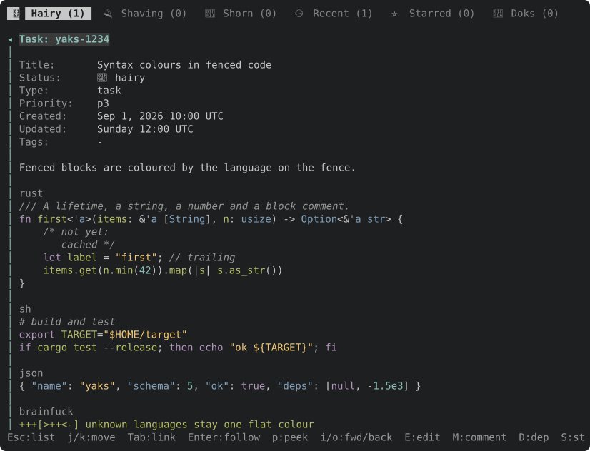

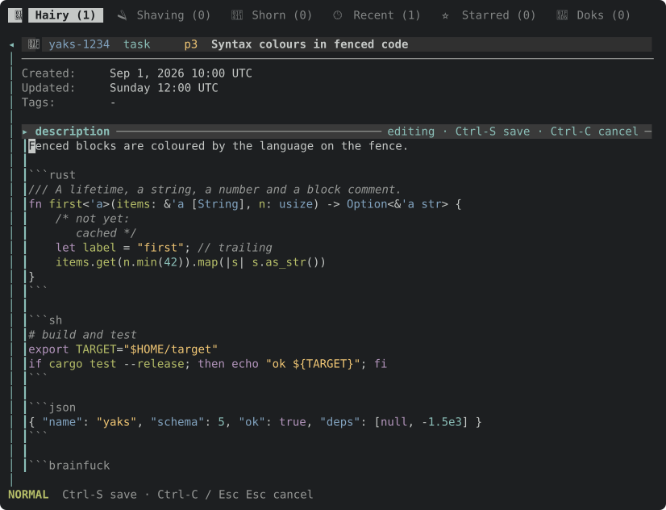

**Rendered markdown** — the detail pane renders a body as CommonMark
(GitHub-flavoured): markers are hidden, a single newline joins lines into one
paragraph that re-wraps to the pane width (a blank line starts a new one),
wrapped list items hang under their bullet, quotes keep their `▎` bar around
nested headings, lists and code, code blocks and tables are never wrapped (a fenced block's
language shows as a dim label row above it; see below for scrolling), and
`[text](url)` shows just its text (still followable with `Tab`/`Enter`; while
the line cursor is on such a link the status bar shows its destination, dim and
truncated, in place of the key hints). A link to a yak attachment
(`<id>/<file>`) is marked `📎` and an image `🖼`; `Enter` opens a text
attachment in the pane's viewer (below) and an image externally. A link to a **repo source file** is `code:` and a path from the repo root
(`[code](code:src/foo.rs)`; the older `[code](../src/foo.rs)`, from when a yak
file sat directly in `.yaks/`, still works in yaks); `#L12` or `#L12-L40` adds
lines (GitHub's own fragment), and `@<sha>` before it (`code:src/foo.rs@3f2a9c1#L12`,
or the older `../blob/<sha>/src/foo.rs#L12`) pins it to a commit (`<sha>` is 7 to 40 hex
digits). It shows as plain link text; the status bar shows `src/foo.rs:L12-L40`
(`@<sha7>` when pinned). `Enter`/`O` opens it in `$VISUAL`/`$EDITOR` at the line
(the TUI suspends while it runs, so a full-screen editor works),
else the OS opener. A pinned link whose file has changed since that commit opens
a read-only copy of `git show <sha>:<path>` under the temp directory
(`yaks-src/<sha>/…`); if the file is unchanged it opens the working copy. A link
to a **farm document** (a page from the farm root, `[x](/wiki/topics/x.md#setup)`;
in a page, a relative `notes.md` below it; a source's `/sources/<id>/source.md`;
`@<sha>` pins it) opens in the text viewer at its `#heading` or `#L12` row (see
[Following links](#following-links-and-peek)); in the detail pane the status bar
also shows the first line of its peek. Every link is read by the farm's one link
grammar (the one `yaks peek` and `yaks doctor` use), described in
[cli.md](cli.md#links). Task lists show `☐`/`☑` and GitHub alerts (`> [!NOTE]`, `TIP`,
`IMPORTANT`, `WARNING`, `CAUTION`) a coloured bar with a title row. A footnote
reference shows as a dim `[n]` (numbered in order of first use) that `Enter`
follows to its definition; definitions collect at the end of their block
(description or comment) under a short dim rule, and `o` returns to the
reference. The description and each comment render separately, each comment under a
`▸ author · when` header. Yanking rendered rows (`v` … `y`) copies their source
markdown, not the displayed text. The editor still shows the raw source.

**Wide code blocks and tables** scroll sideways, one block at a time. With the
line cursor on a row of a code block or table, `l`/`→` scroll that block right
and `h`/`←` scroll it back (8 columns a press), clamped so the widest row ends
at the pane's right edge. The rest of the pane does not move: the language
label, the quote bar or list marker around a nested block, and every other
block stay put. A dim `‹` / `›` in a row's first / last column marks text
hidden on that side. `h`/`←` at offset 0, on any other row, and `Esc` anywhere
all keep their meaning, back to the list. The offset lasts only while the cursor
is on the block: moving off it (or to another yak) drops it. Yank still copies
the full source lines.

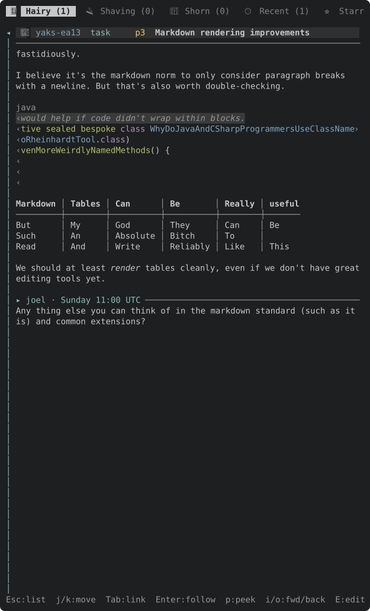

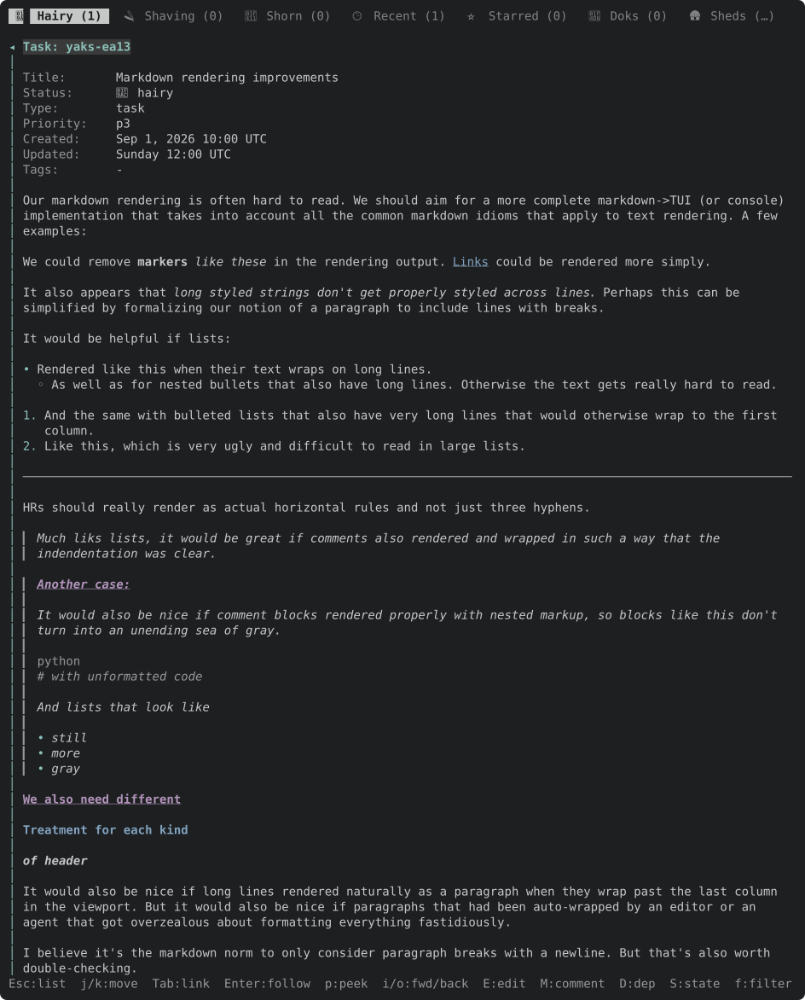

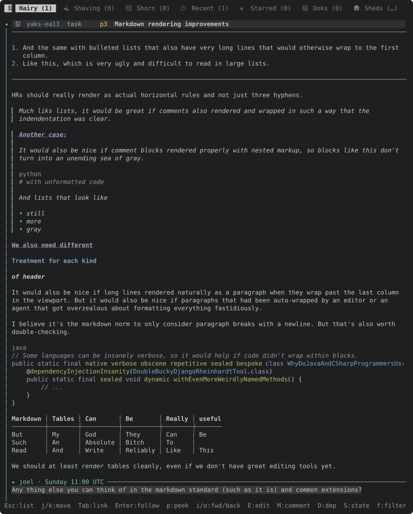

**Inbox** — the flat, cross-status list of every yak carrying a `needs` value
(`⏳` awaiting a human, `✅` answered or requested, awaiting an agent). It is unpinned (no tab); reach it from the view picker (`v`) or the drawer
`inbox` chip.

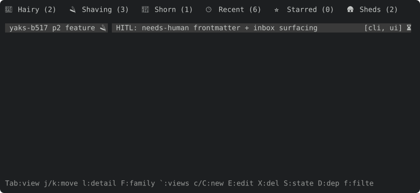

**Filter drawer** (`f`) — status / type / priority chips plus tag, search,
parent, and `ready`/`tangled`/`inbox` predicates, and — on a multi-herd farm —
a `herd` chip row to scope to one or more herds. It composes into any view.

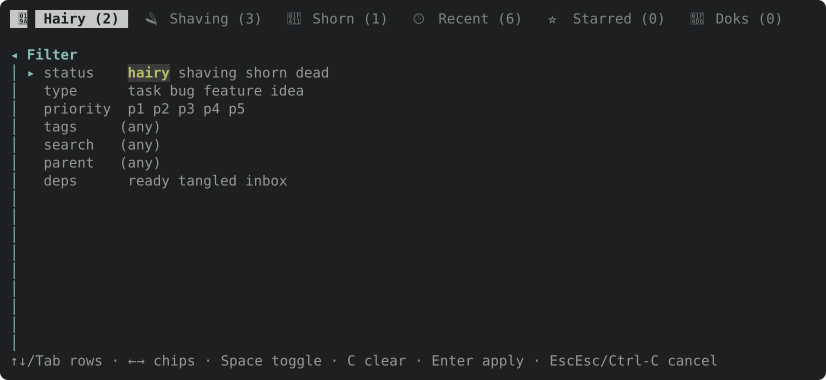

Tag fields (the `L` editor, the create/edit form's `tags`, the drawer's
tag filter) take tags separated by commas and/or spaces — `ui, docs`,
`ui docs`, and `ui,docs` all mean `[ui, docs]`; a tag can contain neither.

**Edit form** (`E`) — the shared create/edit form. Editing it is header fields
only: `title`, `type`, `priority`, `tags`, and `source` (the external-issue
URL; empty = none, so clearing it removes `source:`). The body is never part of
it: the description and comments are edited in place in the detail pane (see
above), so saving the form leaves the body byte-identical. `E` from the list
opens it with focus on `title`; `E` on a header line of the detail pane jumps to
that row (`Source:` to `source`, and so on). Creating (`c`/`C`) uses the same
form plus a `description` editor below the header rows. Single-line rows scroll
horizontally to keep the cursor in view rather than wrapping — a nudge to keep
titles terse. On a multi-herd farm it grows a `herd` chip row (seeded to the
yak's current herd) after `source`, so changing it and saving moves the yak to
that herd (an id-prefix rename). `H` does the same move as a one-key picker.

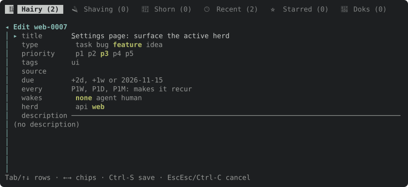

## Following links and peek

The text viewer (an attachment, or a page from the [Wiki tab](#wiki-tab))
follows links the way a browser does:

- **`Enter` on a farm document** opens it in the viewer: a page (frontmatter
  above the body), a source (with its `extracted.md`), or any other text file of
  the farm; an image opens in the image viewer. A `#heading` lands the cursor on
  that heading, at the top of the page; `#L12-L40` on line 12 of the file. A
  pinned link (`/wiki/x.md@3f2a9c1`) shows the file as it was at that farm
  commit, `@3f2a9c1` in the header; `E` refuses (a past version is read-only).
  A link to a file the farm lacks says `not in this farm` and stays put.
- **`#section`** (an anchor in the same page) moves the cursor to that heading.
- **History**: `o` undoes in-page jumps (footnotes, `#section`) first, then goes
  back to the previous document, where its cursor was; `i` goes forward. A
  document you come back to is re-read from disk, so an edit made meanwhile
  shows. An attachment followed from a page joins the same history; `Esc`
  closes the viewer and forgets it.
- **Peek**: while the cursor is on a link it can read (a farm document, an
  in-page anchor, an attachment, a `code:` file), a pane under the page shows
  `yaks peek` of it: the section a `#heading` names, the lines of a `#L12-L40`,
  or a document's fields and first paragraph, cut to fit. The pane is there
  whenever the page has such a link, so the page doesn't jump as the cursor
  moves; `p` hides it (and shows it again).

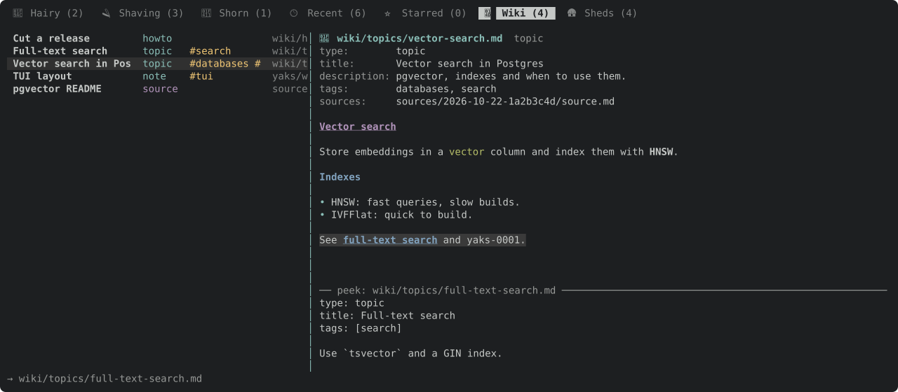

## Wiki tab

The **📖 Wiki** tab lists the farm's documents that are not yaks: every page
under `wiki/` and each herd's `<herd>/wiki/`, then every saved source under
`sources/` (the same files `yaks page list` and `yaks source list` read).

- **One row per page**, sorted by path, then the sources: the title, the kind
  (`note`, `topic`, `howto`, `summary` or a typed kind; `source` for a
  source), the tags, then the path dimmed. The list is flat; the path shows
  the folder.
- **The tab count** is the number of pages (sources are not counted).
- **`Enter` opens the page** in the text viewer, next to the list. Its
  frontmatter shows as field rows (`type:`, `title:`, `tags:`, ...) above the
  rendered markdown body. A field the viewer can't flatten to one line (a list
  of maps) shows its YAML as written. A **source** opens its `source.md`, then
  its `extracted.md` under an `── extracted.md ──` row. The viewer moves like
  the detail pane: the line cursor, `Tab` among links, `/` find, `v`/`y`
  select and copy; `Enter` follows a link (another page opens in its place,
  `o` comes back: see [Following links](#following-links-and-peek)); `Esc`
  closes it.
- **`E` edits the page in place**, from the list or its viewer: the multi-line
  editor opens on the whole file, the frontmatter as YAML between its `---`
  lines and the body below, so every field (a typed kind's, a `sources:` list)
  edits as written. `Ctrl-S` saves it and returns to the viewer, re-rendered;
  on a farm branch the save is one commit (a quick re-save joins it). The page
  must keep its `---` block; if the file changed on disk while you typed,
  nothing is written until a second `Ctrl-S`. A source is a snapshot and a
  pinned version a past one: `E` refuses both.
- **`N` creates a page**: type its path (`wiki/topics/x.md`, or a herd's
  `<herd>/wiki/...`; `.md` is added; parts are lowercase-kebab), and the page
  is written as `yaks page new` would (kind `note`, a title from the file name,
  a schema's defaults), then opened in the editor for its body. A bad or taken
  path keeps the prompt open with the reason.

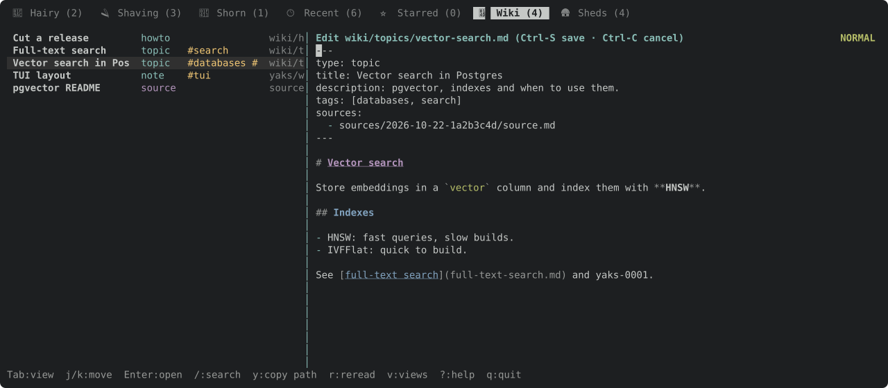

- **`/` searches** the list the way it searches yaks on the other tabs (the
  tab gets the `*` marker and the `filter:` chip; `Esc` clears it).
- **Refresh**: the list is reread whenever the farm is (at startup, after a TUI
  change, and when files under the farm change), and on `r`.

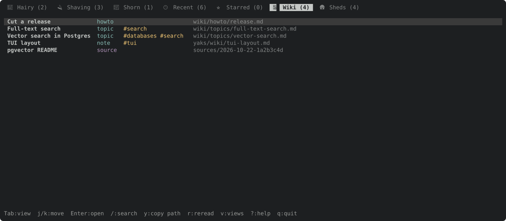

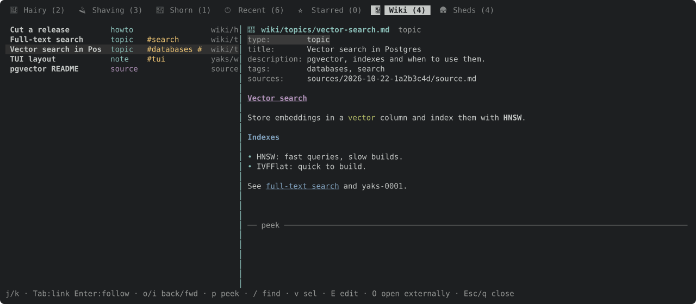

## Sheds tab

The **🛦 Sheds** tab is `yaks sheds` on screen: one row per **actor**, a worker
in the farm (the `[actor]` stamp on notes and moves), live, so you can see
what each worker is doing without opening a terminal. It is read from the farm
alone (no git checkouts, no Delta), so it shows the same on every machine once
the farm is synced. The text is the CLI's own (the same functions produce it).

- **One row per shed**, attention first: sheds with an open ask (`⏳`), active
  ones (wrote within 2 hours), stale ones (hold a shaving yak but went quiet),
  then idle ones, dimmed; within each, the most recent writer first. Each row
  shows the actor, its liveness, when it last wrote, and the yaks it is
  shaving (else the last yak it wrote). Unlike `yaks sheds`, the tab lists idle
  actors too. A footer line says how fresh the farm is
  (`farm: up to date with origin/yaks`, or how far ahead/behind as of the last
  fetch, then when the upstream last changed and when this farm last fetched:
  `· origin/yaks changed 37m ago · fetched just now`), and is left out when
  the farm has no upstream.
- **The tab count** is the number of sheds that want a look now (active, stale,
  or asking).
- **The detail pane** (`l`) starts with where the shed's code is, when its
  latest `checkpoint` note names a branch (`branch work/walk-1 @
  47076b0 (9m ago)`, read from the note, never fetched; `yaks commits <id>
  --fetch` lists the branch's commits). Then it lists the shed's yaks as `yaks sheds` does:
  `shaving` (the ones it holds the claim on), `asking` (waiting on a human) and
  `recent`, newest first, each with its status now (`⏳` on one awaiting a
  human). `Enter` opens the yak; answer an ask with `a` from any yak view, as
  for any other yak.
- **Refresh**: the scan reads the farm in the background, when the tab opens,
  every 10 seconds while it is shown, and on `r` (it never fetches). The tab
  row's right edge says `scanning…` or `scanned 4s ago`. The UI never waits on
  it.
- `y` copies the shed's name (the `YAKS_ACTOR` to pass to a worker's commands);
  in the detail, the yak id.

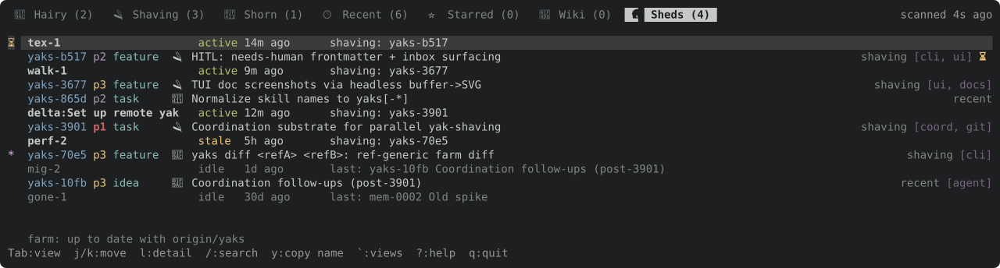

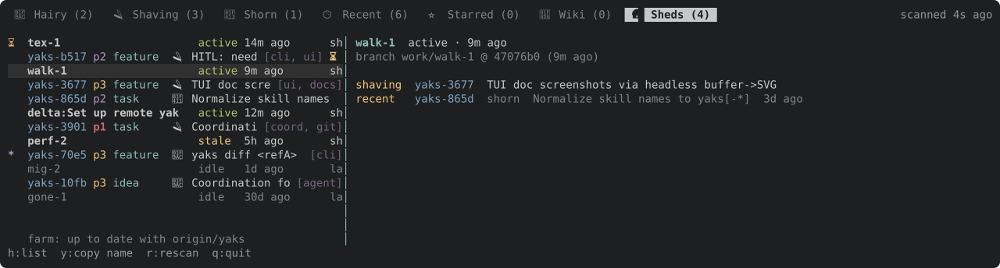

# Screenshots

These are generated headlessly: the [`toque`](https://github.com/joelgwebber/toque) crate
drives the TUI into an in-memory ratatui buffer and renders it to a self-contained
color SVG (`toque::render_to_svg`). They are deterministic and regenerate with the
UI (no live-terminal capture), via:

```sh
cargo test -p yaks docshots -- --ignored   # writes docs/assets/*.svg
```

`docshots_session` (same command, it matches the filter) also scripts a real protocol
session (`key Tab`, `key j`, `key l`) and writes `docs/assets/session.txt` (the text
transcript) plus `session-N.svg` for each frame. [toque](https://github.com/joelgwebber/toque)'s
README embeds copies of those frames (as `docs/assets/yaks-session-N.svg`) — refresh them
there when the TUI's look changes.

## Rasterizing an SVG to view it

The TUI's image viewer rasterizes an svg attachment itself (see *Svg
attachments* above), so a frame attached with `yaks attach` can be looked at in
`yaks tui`. For a file on disk, or a pixel-faithful look at the color emoji and
the system's fonts, use a real **browser engine**: headless Chrome writes a PNG
you — or an agent whose file tools only read in-project paths — can then open;
keep it in a gitignored dir such as `target/`:

```sh
mkdir -p target/svgcmp
"/Applications/Google Chrome.app/Contents/MacOS/Google Chrome" \
  --headless=new --disable-gpu --force-device-scale-factor=2 \
  --screenshot=target/svgcmp/out.png \
  --window-size=<W>,<H> docs/assets/tui-list.svg
```

`<W>`/`<H>` are the SVG's `width`/`height` (the first line of the file). A higher
`--force-device-scale-factor` yields a crisper image / more pixels to hand an LLM.
To pixel-diff two renders: `magick compare -metric AE a.png b.png /dev/null`.
