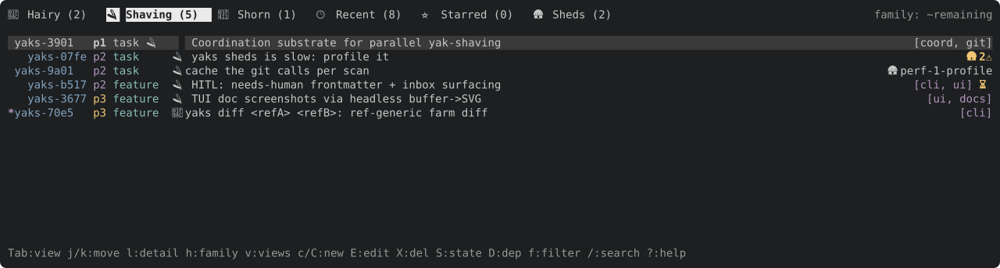
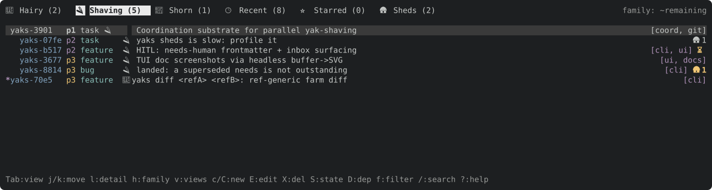
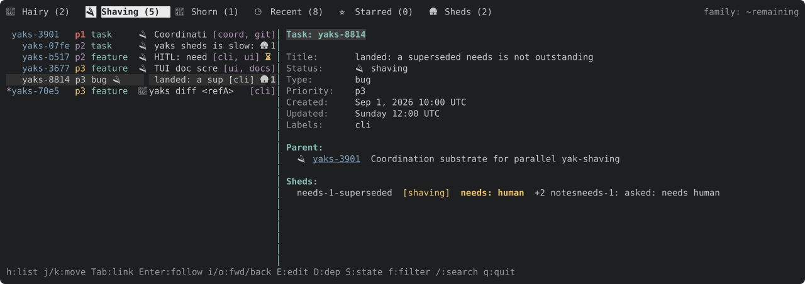
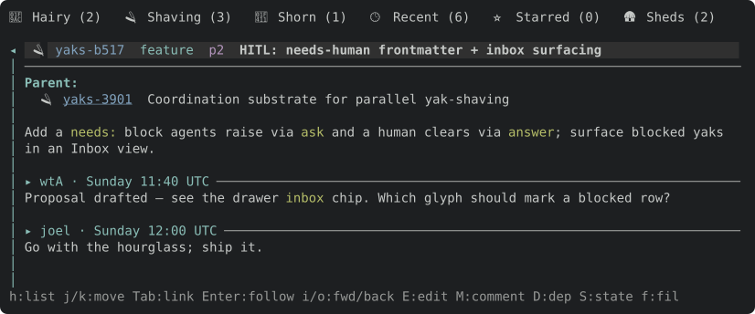
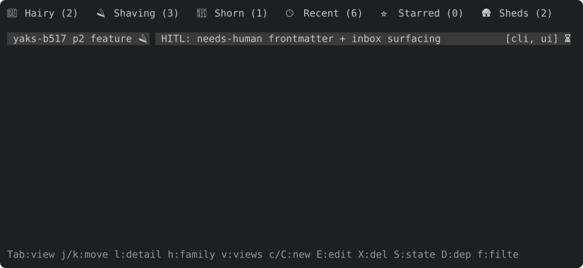
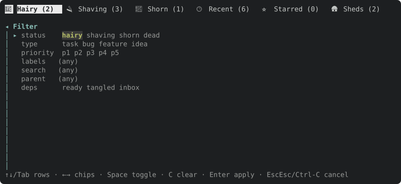
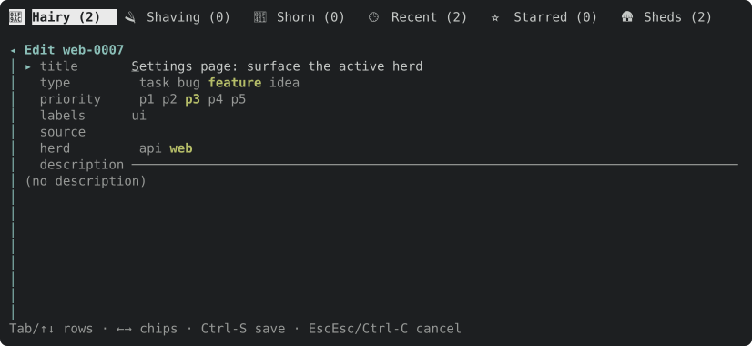
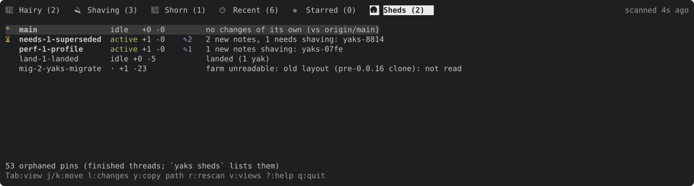
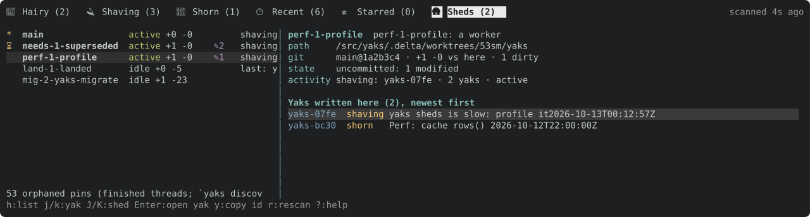
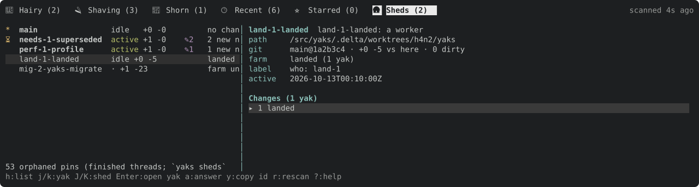

# TUI guide

`yaks tui` opens an interactive terminal UI over the same farm the CLI operates
on. Every mutation writes the same `.yaks/` files, so the TUI and CLI are
interchangeable.

## Layout

- **List pane** — the yaks in the active *view*, as a tree or flat list.
  Views are tabs across the top (`Tab`/`[`/`]` to switch). Built-in views
  include the default tree, **Recent**, **Inbox** (yaks with a `needs` value: awaiting a human, or answered and
  awaiting an agent), and
  **Starred**; you can save the current filter as a named view. The
  **Sheds** tab lists the repository's checkouts instead of yaks (see
  [Sheds tab](#sheds-tab)).
- **Detail pane** — the selected yak: fields, parent/deps/children, source, a
  `Needs:` line when blocked, a `Sheds:` section when another checkout has
  changed it (one line per shed: name, the `yaks changes` bracket words,
  `needs: <v>`, `+N notes`, and the newest note), and the body + timestamped
  notes. Task-id
  references and URLs in the body are followable links. It (and every
  right-side overlay) takes ~⅔ of the width, clamped to 48–120 columns; the
  list gets the rest. When that would leave the list under 48 columns (a
  terminal narrower than ~140), the
  pane covers the whole main area and its divider is tipped with `◂` — the
  list is behind it; `h`/`Esc` returns to it.
- **Filter drawer** (`f`) — toggle status / type / priority chips, a label and
  search box, a parent scope, `ready` / `tangled` / `inbox` predicates, and a
  `copies` chip, `any` (the default) or `home`: `home` hides the other sheds'
  overlay (shed-only rows, the `🛖` badges, the detail's `Sheds:` section, the
  Inbox's shed asks) for a plain view of this farm. Saved views keep it. On a
  multi-herd farm it also grows a `herd` chip row to scope the list to one or
  more herds. The drawer composes into any view.
- **Status bar** — the active farm, view, and cursor context.

## Signals

- A **`⏳` badge** on a row marks a yak awaiting a human (`needs: human`); the
  detail `Needs:` line renders in a warning accent. A **`✅` badge** marks an
  answered yak awaiting an agent (`needs: agent`): it blocks nothing, so the
  detail `Needs:` line is plain and the row is never shown as awaiting a human.
- A dim **`🛖N` badge** on a row says N other sheds (checkouts) carry an
  outstanding change to that yak (the detail's `Sheds:` section lists them; `yaks
  show <id> --sheds` is the CLI form). It turns yellow when one of those changes
  is an open ask (`needs: human`), so a question waiting in another checkout is
  visible from the tree. It annotates only: the row sits where this checkout's
  farm puts it, and a change that has landed, or one made in the shed the TUI
  runs in, gets no badge. Needs one Sheds-tab scan (the first lands within a
  moment of startup; refreshed every 10 s, on any view). When two or more
  sheds changed the same yak the badge reads `🛖2⚠` and the detail's `Sheds:`
  section opens with `⚠ changed in 2 sheds`: settle it before they land.
  `copies: home` in the drawer hides all of this.
- A yak that exists **only in another shed** (a worker's new yak, not landed)
  is a dim row with a `🛖<shed>` badge naming the shed, placed by the shed
  copy's status and parent: under its parent when this farm has it, else at
  the root of its status view. It is read-only here: its detail is the shed's
  copy under an `only in shed <name>` banner, and every key that writes to a
  yak (`S E P T L D R H M A X C m *`) answers `<id> is only in shed <name>:
  read-only here` and changes nothing. `a` answers its ask in that shed when it
  is awaiting a human; `y` copies the id. Added in two sheds, it is one row
  (the first shed in attention order) with the `⚠`.

  

  

  
- The dependency-blocked marker (`*`) and the multi-select marker (`●`) are
  distinct axes and can co-occur.
- The tab row's right edge shows the active **family scope** for tree views
  (`family: remaining`; a leading `~` means it inherits the global default).
  Cycle it with `h`.
- In a **multi-herd farm** (one `.yaks/` holding several id prefixes / herds),
  each row's id prefix is tinted by herd so herds are easy to scan, the create
  form's header shows which herd a new yak will join, and the detail pane gains a
  `Herd` field (between `Type` and `Priority`) that `H` moves the yak between.
  On a single-herd farm none of this chrome appears.

## Keys

**Movement** — `j`/`k` or `↓`/`↑` move; `d`/`u` half-page; `PgDn`/`PgUp`
full-page; `g`/`G` top/bottom.

**List pane**

| Key | Action |
|---|---|
| `Tab` / `S-Tab`, `[` / `]` | Next / previous view |
| `l` / `→` / `Enter` | Show detail pane |
| `h` | Cycle **family scope** — how much of each tree shows: auto → lone → remaining → all |
| `Space` | Collapse / expand subtree |
| `m` | Mark / unmark row (multi-select) |
| `S` (with marks) | Bulk state transition over the marked set |
| `v` / `V` | View picker / save filter as a view |
| `*` | Star / unstar (Starred view) |

**Detail pane** — `h`/`←`/`Esc` back; `j`/`k` scroll; `Tab`/`[`/`]` cycle links,
`Enter` follow; `i`/`o` nav forward/back (each yak reopens at the cursor and
scroll you left it at); `J`/`K` next/prev task; `Ctrl-N`/`Ctrl-P`
next/prev content block; `v` + `Shift-↑↓` visual-select lines, `y` copy;
`/`, `n`/`N` find (`Enter` keeps the cursor on the current match, `Esc` restores
the pre-find scroll and cursor).

**Edit**

| Key | Action |
|---|---|
| `c` / `C` | New root / child yak |
| `E` | Edit the field/description/comment at the cursor |
| `P` / `T` / `L` / `S` | Priority / type / labels / state |
| `D` / `R` | Add dependency / reparent |
| `H` | Move to another herd (multi-herd farms) |
| `M` | Add a comment (note) |
| `a` | Ask / answer (on a yak awaiting a human: answer, which sets `needs: agent`; otherwise ask, which sets `needs: human`; on a yak whose copy in another shed is awaiting a human, in any view (the Inbox lists them): answer it in that shed, uncommitted there) |
| `A` / `O` | Attach artifact / open it. An empty path pastes the clipboard PNG, then prompts for its name (empty keeps `paste-<timestamp>.png`) |
| `r` | (detail) Rename the attachment whose image link the cursor is on (`Tab` to it); the file moves and every link is rewritten. The extension is kept if you omit it |
| `X` | Slaughter (delete, with confirm); on a yak with live descendants the confirm offers the whole family, naming how many go |
| `:w` / `:q` / `:wq` | Save / cancel / save+close (editor Normal mode) |

**Pasting** — the TUI enables bracketed paste, so a terminal paste (`Cmd-V` /
`Ctrl-Shift-V`) lands in the focused text field as one literal insert: fast,
never interpreted as vim Normal-mode commands, newlines flattened to spaces in
single-line fields. A paste with no text field focused is ignored.

**Search & filter** — `/` inline search; `#` go to any yak (list or detail pane:
a picker over every yak — type an id fragment like `a1b2`, the full id, or
title words, then `Enter` opens its detail, switching to its view and recording
the jump so `o` comes back); `f` filter drawer; `Esc` revert filter to the
active view.

**Sheds tab** — its own keys (the yak keys do nothing there):

| Key | Action |
|---|---|
| `j` / `k`, `g` / `G`, `d` / `u` | Move between sheds |
| `l` / `→` / `Enter` | Show the shed's changes (`yaks changes <shed>`) |
| `h` / `←` / `Esc` | (detail) Back to the shed list |
| `j` / `k` | (detail) Move between its changed yaks: the outstanding ones first, then the `▸ N landed` fold line, then (open) the landed ones |
| `J` / `K` | (detail) Next / previous shed |
| `Enter` | (detail) On the `▸ N landed` line: show / hide the landed yaks. On a yak: open it: this checkout's copy, or for a yak only that shed has, its read-only shed-only row (the shed's copy) |
| `a` | (detail) Answer the yak's ask in that shed: the CLI's `yaks answer <id>@<shed>`, written into the shed's working tree and left uncommitted for its worker to commit |
| `y` | Copy the shed's path (detail: the yak id) |
| `r` | Rescan now |

**General** — `y` copy yak id; `?` toggle help; `q` / `Ctrl-C` quit.

**Mouse** — the wheel scrolls the pane under the pointer (over the list it moves
the selection; over the detail it scrolls, or with the detail open, the list
wheel steps tasks like `J`/`K`). Left-click a row to select it (click it again to
open the detail; with the detail open, a click shows that row's yak and keeps it open), click a detail line to put the cursor there (click it again to
follow its link), and click a tab to switch view. The mouse is ignored while an
overlay (editor, picker, drawer, help) is open. Mouse back/forward buttons aren't
supported — the terminal library (crossterm) drops those buttons — so use `o`/`i`.
Capturing the mouse turns off the terminal's own click-drag text selection; hold
**Shift** while dragging (**Option/⌥** in some macOS terminals, e.g. iTerm2) to
select text natively.

**List pane** — the tree of a view (here the *Shaving* tab): ids, priorities,
types, status glyphs, titles, and dim labels. The `*` gutter marks a
dependency-blocked yak; the `⏳` marks one awaiting a human.


**Detail pane** — the selected yak. `Needs:` renders in a warning accent above
the fields; `Blocks:`/`Parent:` list linked yaks; the body carries the
description and timestamped, attributed notes (here a `[wtA]` → `[joel]`
human-in-the-loop exchange).


Once you scroll past the frontmatter (`j`/`k`/`d`/`u`/`G`), a sticky one-line
header pins the yak's status, id, type, priority, and title to the top of the
pane, so a long body never leaves you wondering which yak you're reading.



**Inbox** — the flat, cross-status list of every yak carrying a `needs` value
(`⏳` awaiting a human, `✅` answered and awaiting an agent), and also a yak
of this farm whose copy in another shed is awaiting a human (the TUI form of
`yaks inbox --sheds`; the tab count agrees). `a` on such a row answers it in
that shed, as the Sheds tab's `a` does; so does a shed-only yak whose copy
asks (it is a dim row, see Signals). `copies: home` leaves only this farm's own
`needs`. When a scan finds an ask that was not in
the last one, a `⏳ new ask in <shed>: <id> <title>` notice flashes. It is unpinned (no tab); reach it from the view picker (`v`) or the drawer
`inbox` chip.



**Filter drawer** (`f`) — status / type / priority chips plus label, search,
parent, and `ready`/`tangled`/`inbox` predicates, and — on a multi-herd farm —
a `herd` chip row to scope to one or more herds. It composes into any view.



Label fields (the `L` editor, the create/edit form's `labels`, the drawer's
label filter) take labels separated by commas and/or spaces — `ui, docs`,
`ui docs`, and `ui,docs` all mean `[ui, docs]`; a label can contain neither.

**Edit form** (`E`) — the shared create/edit form: `title`, `type`, `priority`,
`labels`, and `source` (the external-issue URL; empty = none, so clearing it
removes `source:`) rows above the description and comments. `E` on the detail
pane's `Source:` line jumps straight to that row. Single-line rows scroll
horizontally to keep the cursor in view rather than wrapping — a nudge to keep
titles terse. On a multi-herd farm it grows a `herd` chip row (seeded to the
yak's current herd) between `source` and `description`, so changing it and
saving moves the yak to that herd (an id-prefix rename). `H` does the same move
as a one-key picker.



## Sheds tab

The **🛦 Sheds** tab is `yaks sheds` and `yaks changes` on screen: every checkout
of the repository (the primary `main`, git worktrees, Delta clones), live, so
you can see what each worker's thread is doing without opening a terminal in
its checkout. The text is the CLI's own (the same functions produce it).

- **One row per shed**, attention first: `main`, then sheds with an open ask
  (`⏳`), active ones, ones with work outstanding, stale ones, then quiet ones
  (nothing outstanding, or all of it landed) and unreadable ones (an old-layout
  clone), dimmed. `*` marks the checkout the TUI runs in. Each row shows its
  liveness (`active` / `stale` / `idle`), `+ahead -behind` against this
  checkout, `✎` and its count of uncommitted files, the `farm:` summary, and
  the yaks it is shaving. A footer counts orphaned Delta pins (finished
  threads; `yaks sheds` lists them).
- **The tab count** is the number of sheds with something outstanding.
- **The detail pane** (`l`) shows the shed's path, git state, baseline, who is
  working there and when its farm last changed, then its changes per yak: the
  same bracket words as `yaks changes` (`hairy -> shaving`, `new, hairy`,
  `edited`, `landed`), each new note's first line, and for an ask the
  question itself, which `a` answers in place. The outstanding yaks lead; the
  landed ones (already in this checkout's farm) fold behind one dim `▸ N landed`
  line, as `yaks sheds` does, which `j`/`k` reach and `Enter` expands to `▾ N
  landed` with the landed yaks below it (`Enter` again folds them). Folded by
  default; the open/closed state is one setting for the tab, not kept per shed
  or across runs. A shed with nothing landed shows no fold line.
- **Refresh**: the scan runs in the background (it runs git in every
  checkout and reads several farms: well under a second for a handful of
  sheds), at startup and every 10 seconds whichever view is shown (the yak
  views will annotate rows from it), and on `r`. The tab row's
  right edge says `scanning…` or `scanned 4s ago`. The UI never waits on it.
- Nothing on the tab removes a shed; cleanup stays advisory (`y` copies the
  path).







# Screenshots

These are generated headlessly: the [`toque`](https://github.com/joelgwebber/toque) crate
drives the TUI into an in-memory ratatui buffer and renders it to a self-contained
color SVG (`toque::render_to_svg`). They are deterministic and regenerate with the
UI (no live-terminal capture), via:

```sh
cargo test -p yaks docshots -- --ignored   # writes docs/assets/*.svg
```

`docshots_session` (same command, it matches the filter) also scripts a real protocol
session (`key Tab`, `key j`, `key l`) and writes `docs/assets/session.txt` (the text
transcript) plus `session-N.svg` for each frame. [toque](https://github.com/joelgwebber/toque)'s
README embeds copies of those frames (as `docs/assets/yaks-session-N.svg`) — refresh them
there when the TUI's look changes.

## Rasterizing an SVG to view it

The frames render **color emoji**, so view them with a real **browser engine** — a
pure-Rust rasterizer (`resvg`) renders our emoji glyphs as tofu. `yaks` stays out
of rasterization on purpose (it's a self-contained task-tracker binary, not an
image tool), so this is a recipe, not a subcommand. Headless Chrome writes a PNG
you — or an agent whose file tools only read in-project paths — can then open;
keep it in a gitignored dir such as `target/`:

```sh
mkdir -p target/svgcmp
"/Applications/Google Chrome.app/Contents/MacOS/Google Chrome" \
  --headless=new --disable-gpu --force-device-scale-factor=2 \
  --screenshot=target/svgcmp/out.png \
  --window-size=<W>,<H> docs/assets/tui-list.svg
```

`<W>`/`<H>` are the SVG's `width`/`height` (the first line of the file). A higher
`--force-device-scale-factor` yields a crisper image / more pixels to hand an LLM.
To pixel-diff two renders: `magick compare -metric AE a.png b.png /dev/null`.
