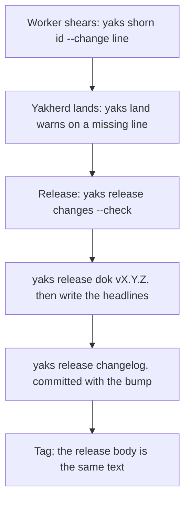

# Changelog: release notes that read breadth-first into the farm

Design for [yaks-a4d8](/yaks/yaks/yaks-a4d8.md), agreed with Joel on 2026-11-21. The survey of existing tools behind it is [the changelog research](/doks/research/changelogs.md).

## The idea

A changelog is the top layer of the farm, read breadth-first. Each layer links the one below it and adds nothing the layer below already says:

1. **Release**: the version, its date, a few headline changes (with a screenshot where there is one), then one line per change, grouped.
2. **Entry**: one sentence for the reader, describing behaviour, and a link to its yak.
3. **Yak**: what and why; its verdict and decision notes.
4. **Below the yak**: design and research doks, sources, evidence attachments, and finally its commits (`yaks commits`).

Two readers use it. A user skims what changed and goes to `docs/` for detail. An agent new to the project starts here and follows the links down. Neither needs design or implementation in the entry itself.

It borrows from existing tools instead of adopting one. From fragment tools (Changesets, towncrier), it takes writing the entry while the change is fresh and a check that it was written. From reno, it takes keeping entries and computing which release each belongs to. From Keep a Changelog, it takes the output format. Adopting a tool would mean writing every change twice (yak and fragment), in a form that cannot link into the farm.

## Decisions

### 1. The change line is a note on the yak

A yak's **change line** is a note with `kind: change`. Its text is the entry: one line of markdown, describing behaviour, which may link an image. It needs no new concept, only note metadata.

- `yaks shorn <id> --change "<line>"` writes it with the shear. `--no-change` writes a `kind: change` note with `section: none`, for internal work (a refactor, a test, farm upkeep), the counterpart of an empty changeset.
- Its **section** comes from the yak's `type`: `feature` is Added, `bug` is Fixed, anything else is Changed. `--meta section=removed|deprecated|security|changed|added|fixed` overrides it. The sections are Keep a Changelog's.
- **A correction is a newer change note** (`yaks update <id> --note "<line>" --meta kind=change`), and the latest one wins. This holds after release too: a reno-style edit with no special command.
- **Agents write it at shear time**, which the `yaks` and `yaks-working` skills and the brief say. Humans may skip it; the TUI's shear can offer the yak's title as a starting point to edit. Nothing ever uses the title, or a model's summary, without saving it as a change note first.
- **Families read breadth-first.** A child with no change line of its own is covered by the nearest ancestor that has one in the same release, and is listed under it. An umbrella yak's line is the feature; its children's lines, if any, are the detail.

Each worker's shed writes its own change lines in its clone, and they reach the farm when the farm is merged. The yakherd who lands the work and cuts the release only checks, groups and edits. That makes the process shed-aware with no extra machinery.

### 2. Release membership is computed, never stored

A yak belongs to a release when a commit in that release's range names it: by id in the message, or as a `commit:` its notes record (the same rule `yaks commits` reads, `src/yakcommits.rs`). The range is the previous release tag to this one, on the branch being released. Membership is never written to the farm, as with every index in yaks.

- **It follows branches.** A farm belongs to no branch, but membership is read from a code ref. A release branch computes its releases from its own tags, and a backport cherry-picked there keeps its message, so its yak counts in both.
- **Release tags** match `v*` unless `git config yaks.releaseTags <glob>` says otherwise.
- **What the range turns up**, in four groups:
  - shorn yaks with a change line;
  - shorn yaks with none (the gaps);
  - yaks still open or dead that commits name (partial or reverted work: listed, not entries);
  - commits that name no yak (a version bump is fine; anything else is a gap in the trail).

### 3. One command for the roll-up and the check

`yaks release changes [<range>]` lists what decision 2 computes, for an agent to boil down. The default range is the last release tag to `HEAD`. `--json` returns each yak's id, title, type, status, parent, latest change line and section, plus its commits. `--check` exits non-zero when a shorn yak in the range has no change line and no ancestor's line covers it.

The check also runs where the context is fresh. `yaks land` warns when the commit it lands names a shorn yak with no change line, while the worker's context is still around. The release check is then only the backstop.

### 4. A release is a dok, with a generated block

Each release is a dok, `doks/releases/<tag>.md` (kind `release`, fields `version`, `date`, `tag`, `range`, `yanked`), so it is browsable on GitHub, linkable and attachable like any dok.

- Its **prose** is written by the agent cutting the release: headlines, the screenshot, what an upgrade needs.
- Its **entries** sit in a block between `<!-- yaks:changes -->` and `<!-- /yaks:changes -->`. `yaks release dok <tag>` creates the dok, or rewrites only that block, from the yaks. It never touches the prose.
- The yak stays the one record: correcting a change line and rerunning updates the release. `yaks check` lists a release dok whose block no longer matches its yaks.
- A yak in the block links its file. A yak with no change line (old history, or one let through) is listed by its title and marked `(no change line)`: visible, never silently passed off as an entry.

### 5. `CHANGELOG.md` is a projection, per branch

`yaks release changelog [-o CHANGELOG.md]` writes a Keep a Changelog file for the checked-out branch. It holds the releases whose tags `HEAD` reaches, latest first, and an `Unreleased` section for the last tag to `HEAD`. It is generated, never edited, and committed with the version bump, so each branch's file describes that branch. The same text, one release at a time, is the GitHub Release body.

- **Links into the farm become web URLs** through `src/hosting.rs` when the farm is published (its branch is on the remote), and are dropped to plain text when it is not. Other farms may not publish theirs.
- **Images are pinned.** A release describes the past, so the release dok pins its images to a farm commit (`shot.png@<sha>`). The projection writes them as `github.com/<owner>/<repo>/raw/<sha>/<path>`, which serves LFS content. `raw.githubusercontent.com` serves only the pointer (see the research dok).

### 6. Images: following vs pinned

Every image link makes an explicit choice. A plain link follows the file as it is now, for an image that is updated on purpose (the current screenshot in a dok). An `@<rev>` link is a snapshot from history. This needs no new file layout.

For pinned images to work in yaks, the `@rev` reader (`links::read_at`) must turn an LFS pointer into its content (`git cat-file -p <rev>:<path> | git lfs smudge -- <path>`). Today it returns the 131-byte pointer.

### 7. History is backfilled, best effort

Generate release doks for `v0.0.1`–`v0.0.40`, with headlines written from the release yaks (yaks-bdec and the others) and the commit ranges. Releases before `v0.0.5` have no yak-naming commits and get commit subjects only. Yaks without change lines show as `(no change line)`, and the backfill adds lines only where they are worth it. Thin and odd entries stay as they are. The backfill doubles as the first test of the farm for archaeology.

## The workflow, end to end

## Archaeology, later

Decision 2 gives yaks-64c4 its chronological spine: a yak's release, and a release's yaks, are each one lookup. Two follow-ups build on it there, not here:

- **What came of a dok.** `yaks refs <dok> --incoming` already lists the yaks that link a dok. Adding each yak's status, closing note (verdict or reason for slaughter) and release answers "what, if anything, came of this idea".
- **Deferred with no yak.** List lines in design doks that defer something ("deferred", "later", "not now") and link no yak.

## Open questions

- [ ] Does a relative LFS image inside a markdown file viewed on GitHub at `blob/<sha>/…` render, or only `raw/<sha>` URLs? (decides whether the projection may keep relative image links)
- [ ] The command name: `yaks release changes|dok|changelog` is the proposal; `yaks changes` is the shorter alternative.
