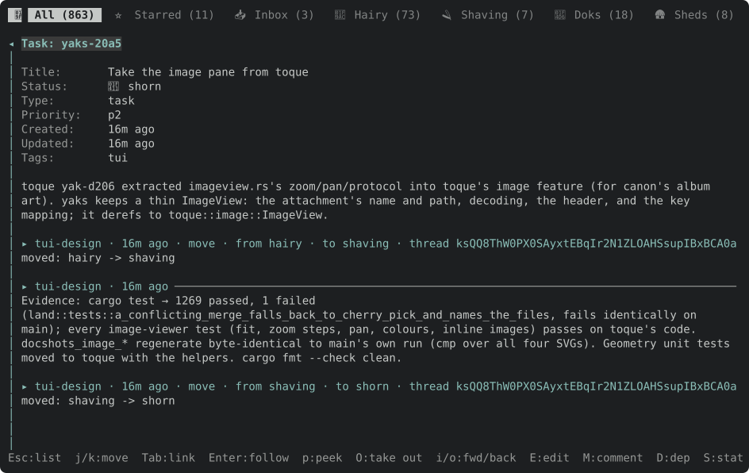

Joel: UI yaks get text logs but almost never a rendered frame. Scout research (thread): the yaks skill only asks for a screenshot 'if the TUI library can produce one', and toque couldn't from a script. toque 640993f adds headless svg/png actions; make one rendered frame required in the yaks skill, yaks-working step 6, yaks-coordinating's evidence contract and AGENTS.md, and say a dok describing a UI embeds one.

#### 2026-11-21T18:43:06Z

*tui-design · kind: move · from: hairy · to: shaving · thread: ksQQ8ThW0PX0SAyxtEBqIr2N1ZLOAHSsupIBxBCA0aLJyrhJPreUvVwLftHG*

moved: hairy -> shaving

#### 2026-11-21T18:43:54Z

*tui-design*

Evidence:

- The installed `yaks tui --headless` takes the new action: `printf 'key j\nsvg target/yt.svg\nquit\n' | yaks tui --headless` printed `=== wrote target/yt.svg ===` and wrote an `<svg …>`. One such frame is attached: .
- `cargo test skills`: ok (37, 1, 1).
- Wording, per the scout's ranking: the yaks skill's "A TUI change" now requires one rendered frame, names toque's `svg` action and adds the dok case. yaks-working step 6 says a UI change's evidence is a picture. yaks-coordinating's claim note names the state the frame must show. AGENTS.md drops "(or a headless text serialization)". docs/tui.md documents the `svg` action under Screenshots.

Decision: toque gets no skill. A dependency's repo is never an attached worktree or under ~/.agents/skills, so no consumer's agent would see it. Instead the reach is toque's own protocol (an unknown action lists `svg <path>`), toque's README "Evidence for people", the yaks skill (every farm, at shearing time) and each consumer's AGENTS.md (canon's done in canon-ed4b).

#### 2026-11-21T18:43:55Z

*tui-design · kind: move · from: shaving · to: shorn · thread: ksQQ8ThW0PX0SAyxtEBqIr2N1ZLOAHSsupIBxBCA0aLJyrhJPreUvVwLftHG*

moved: shaving -> shorn

#### 2026-11-22T17:50:52Z

*herd-files · kind: change*

`yaks tui --headless` scripts can end with `svg <path>` or `png <path>` to write a rendered frame, and the bundled skills ask for one rendered frame as evidence for every TUI change.
