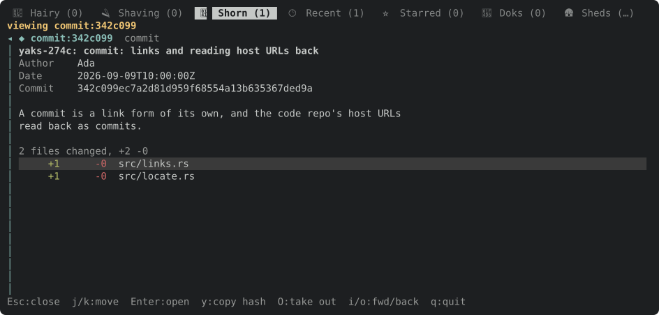
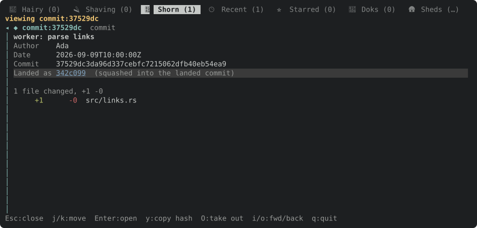
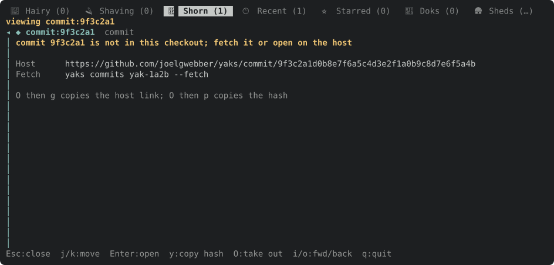
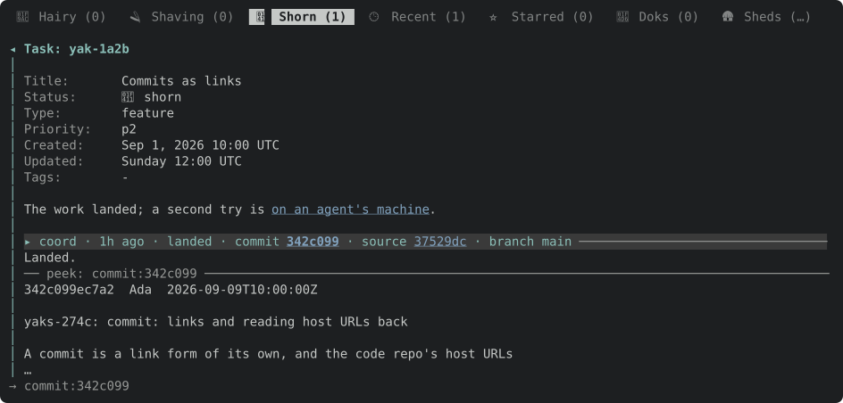

Phase 2 of yaks-3515; needs phase 1 (yaks-274c).

- **Note fields as links:** a note's `commit:` and `source:` values render as short-hash links in its header, with the full hash kept in the link.
- **Commit view:** Enter on a commit link opens a new pane view (beside the text, image and directory views) showing the subject, body, author, date and changed files with `+/-` counts. Enter on a file opens it in the code viewer at that commit. `O` takes the commit out: `g` the host URL, `p` the hash. History works.
- **Squashed worker commits:** a worker hash that is the `source:` of a landed note says "landed as <sha>" and links to it.
- **Missing commits:** a commit not in the local repo says so, and offers the host link and `yaks commits --fetch`.
- Keys go through `BINDINGS`. Update `docs/tui.md` and the `?` help, with a docshot if one fits.

#### 2026-11-18T14:40:32Z

*sources-triage · kind: move · from: hairy · to: shaving · thread: ksQQgIRwKupoSJu4WL5a-Y3Ss5LOAGwQr5IBxBCA0aLJyrhJPreUvVwLftHG*

moved: hairy -> shaving

#### 2026-11-18T14:41:25Z

*commits-tui*

Start by `commits-tui`: 2026-11-18T14:41:19Z (date -u). Farm file: /Users/joel/.local/share/yaks/farms/yaks-539d3edb/yaks/yaks/yaks-3f90.md. Checkout: /Users/joel/src/yaks/.delta/worktrees/h62preyey7a6/yaks (HEAD b0a6d579).

#### 2026-11-18T14:58:13Z

*commits-tui*

Plan (`commits-tui`):

- `Target::Commit { sha }` in `src/tui/detail.rs`, produced by `mdrender::link_target` (replacing the `Artifact` placeholder). A `Target::Url` stays a URL while rendering (no git call per frame); when it is *followed* it goes through `Space::read_url`, so a pasted host commit URL opens the commit view and a pinned blob URL opens the code viewer.
- Note headers: `commit:`/`source:` meta values (when they read as a hash through the `commit:` grammar) become 7-char `Target::Commit` links in the header row; the full sha is kept in the target.
- New `DocView::Commit(commitview::CommitView)` + `Ctx::Commit` (new `src/tui/commitview.rs`): rows built once at open (subject, body, author, date, files), wrapped at render; cursor starts on the first actionable row (landed-as, else first file). Keys reuse existing `Cmd`s through `BINDINGS`; `Enter` on a file = `open_code(path, None, Some(sha))`; `O` = take-out of the commit.
- "landed as": scan the farm's notes once at open for a `landed` note whose `source:` is this hash.
- Missing commit: a view with `missing_commit`'s reason, the host URL row, and the `yaks commits <yak> --fetch` line.
- History: `PaneAt::Doc` with path `commit:<sha>`, `read_doc` re-reads it.

[commit-view-real-farm](yaks-3f90/commit-view-real-farm.txt)

[commit-file-at-commit](yaks-3f90/commit-file-at-commit.txt)

[commit-takeout](yaks-3f90/commit-takeout.txt)

#### 2026-11-18T15:18:59Z

*commits-tui*

Decision: a new `DocView::Commit` + `Ctx::Commit` (own key section in `BINDINGS`, `commitview.rs`), not a `DocView::Text` of preformatted text. Rejected: a read-only text document (no per-row Enter target for files / `Landed as`, no cursor-on-file, and the history would have to re-read it through the farm-file path). Mirrors how `Dir` was added.

Decision: a note's `commit:`/`source:` header links are `Target::Commit { sha }` with the *full* value; `comment_label` (public, used by tests) keeps returning the same text, now with the hash cut to 7. Only a value that parses as `commit:<hash>` (7-40 hex) becomes a link, so a `source: sources/2026-...` of a dok source stays plain text. Rejected: linking every `source:` (would mislink saved sources) and detecting bare hashes in prose (Joel's decision 3).

Decision: host commit URLs stay `Target::Url` while rendering and are read back by `Space::read_url` only when *followed* (`App::follow_url`, both pane and viewer). Rejected: reading in `link_target` (a git remote lookup per link per render; `code_repo()` caches per process, but the target would then differ from what `links::parse` gives peek and take-out). A pinned blob URL opens the code viewer at that commit as a bonus of calling the same reader.

Decision: `Landed as` is computed in the TUI (`App::landed_as`) from landed notes' `source:` -> `commit:` when the view opens, scanning only yaks whose body mentions the short hash. Rejected: a derived index (AGENTS.md: any index is derived and per-user; the scan is a substring filter first), and a new `farm.rs` method (owned by the other worker).

Decision: `O` in the commit view takes out the *commit* on every row (even with the cursor on a file), and its menu lists only `p` (full hash) and `g` (host commit URL, same as `yaks url commit:<sha>`). Rejected: `e`/`o`/`r` for a commit (no file; it would repeat 'no file' errors) and file-under-cursor take-out (the file is one `Enter` away and then `O` works there with a pin).

Decision: the missing-commit view names `yaks commits <yak> --fetch` using the yak the view was opened from (selected yak), else `<yak>`. It does not run the fetch: a network call from a key press would block the UI, and the TUI has no async job path for it yet (follow-up). Rejected: running `--fetch` inline.

Decision: no edits to `links.rs`, `locate.rs` or `gitrepo.rs`. Everything needed was already public (`commit_info`, `commit_of`, `missing_commit`, `Space::web_url/read_url`).

Decision: the `comment_header_with_metadata` snapshot changed (peek pane now reserved) because a `commit 47076b0` header value is a peekable link; that is the intended consequence of 'commit fields render as links'. Accepted rather than excluding it from peek.

#### 2026-11-18T15:22:09Z

*commits-tui · kind: verify · result: pass*

verify: `cargo test --workspace` -> PASS (exit 0)

#### 2026-11-18T15:22:24Z

*commits-tui*

Summary (`commits-tui`): commit links and the commit view are in the TUI.

- Note headers: `commit:`/`source:` hash values are 7-char links keeping the full hash (`Target::Commit`); `commit:<sha>` links and followed host commit URLs open the new `DocView::Commit`.
- View: subject, author, date, full hash, message, files with +/- counts; Enter on a file opens the code viewer pinned at that commit; `Landed as <sha>` row for a landed note's `source:`; a missing commit says why, with the host URL and `yaks commits <yak> --fetch`; `O` gives `p` (hash) / `g` (host URL); `y` copies the hash; `o`/`i` history re-reads the view with its cursor.
- Keys: `Ctx::Commit` section in `BINDINGS` (`?` help, hint bar generated). Docs: `docs/tui.md` "Commits" section + take-out and peek lines; 4 docshot SVGs from `docshots_commit`.
- Gate: `cargo fmt --check` clean; `cargo test -p yaks --no-fail-fast` all green (1272 unit tests + integration); `yaks verify yaks-3f90` PASS.
- Looked at: real-farm headless frames (commit b0a6d57 from a landed note header, file at commit, take-out menu) and the rendered SVG PNGs; attached.
- Not done / follow-ups: `--fetch` is named, not run from the TUI (no async job path); the Code: row is phase 3 (yaks-ccb9); the diff is phase 5. Not installed (coordinator's job).
